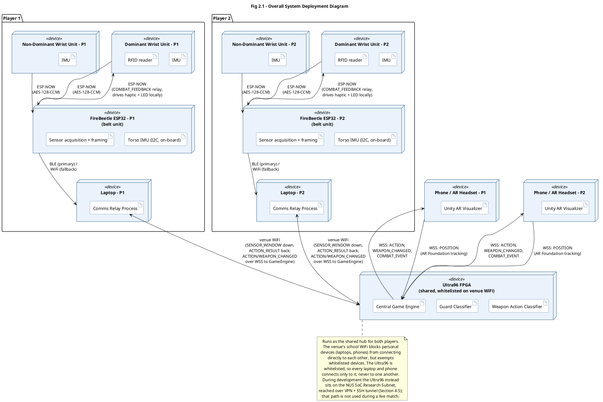
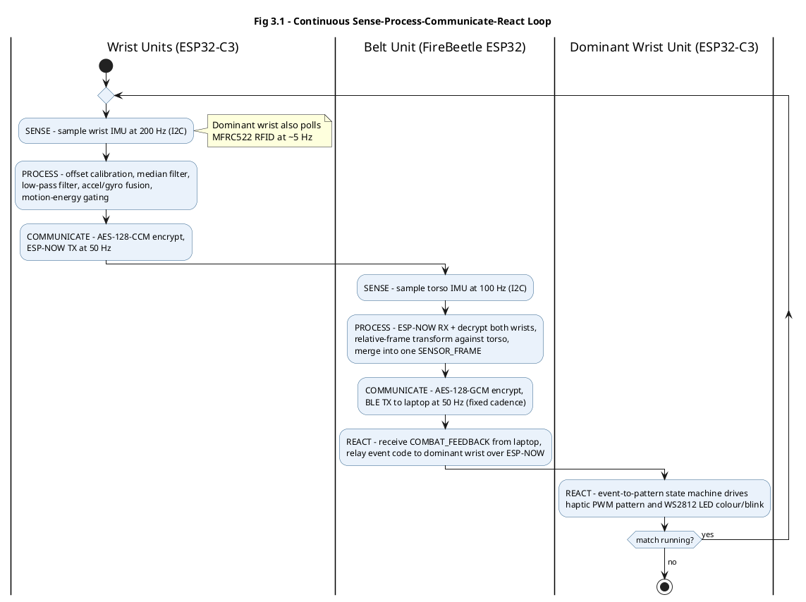
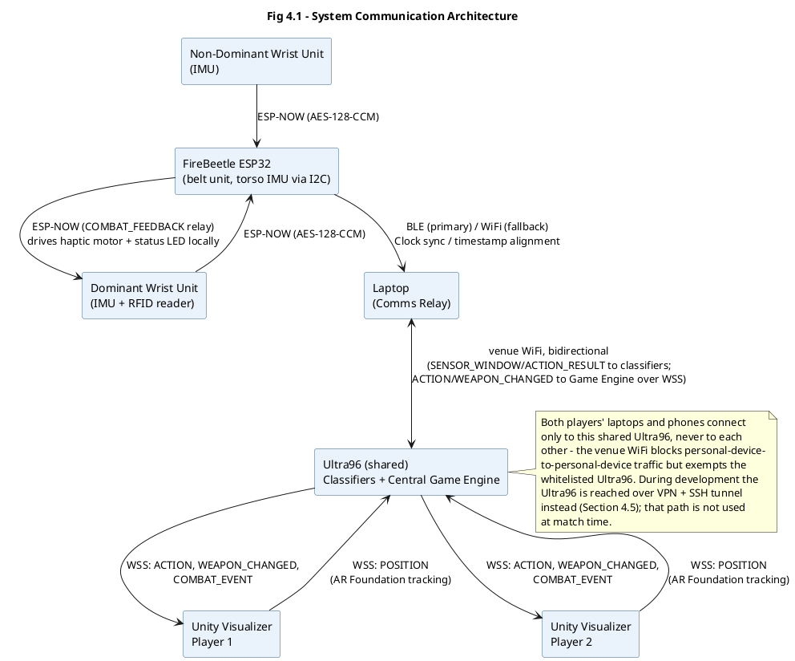
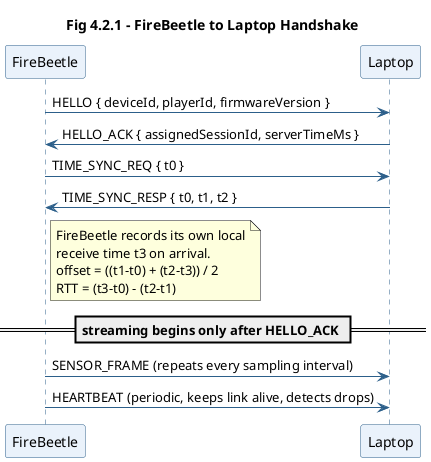
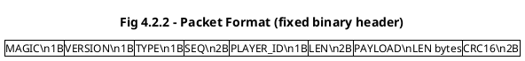
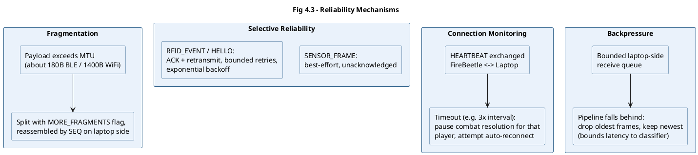
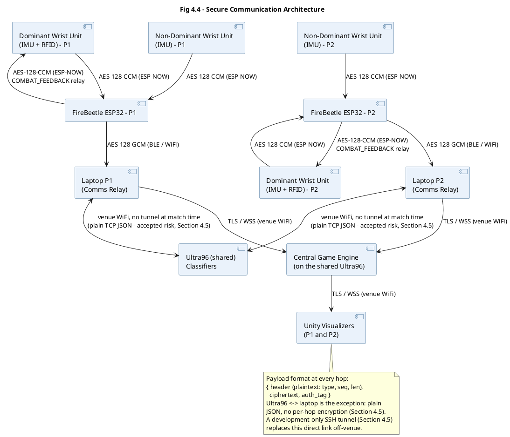
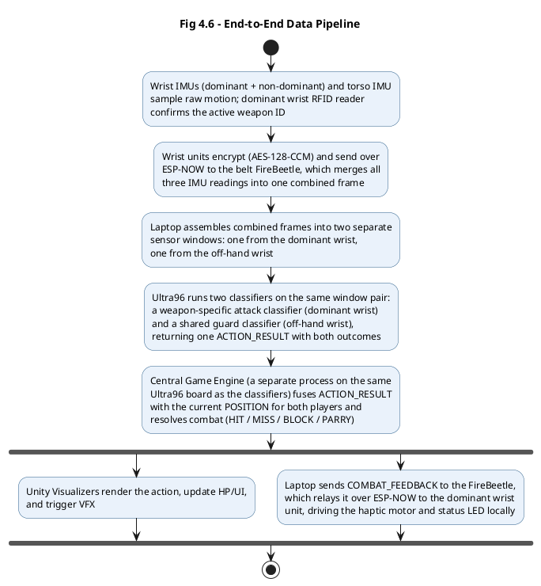
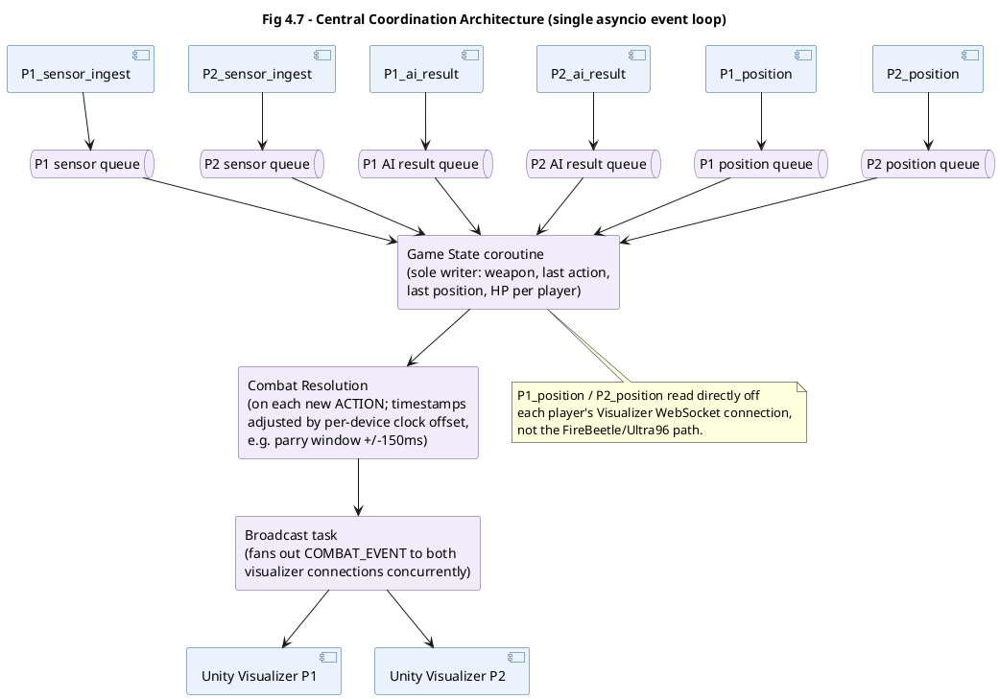
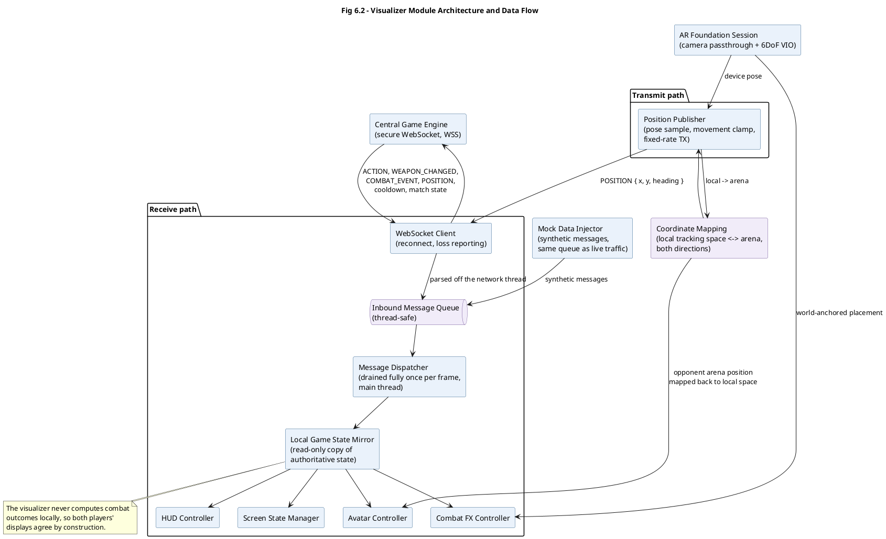

# Figure Diagrams

All figures below were originally AI-image-generation prompts. Since every one of them is a structural diagram (deployment, sequence, packet layout, or process flow), they have been converted to PlantUML instead, so the diagrams are exact and easy to keep in sync with the text, rather than approximated by an image model.

**This file is the single point of truth for every diagram in the report.** The previously checked-in
hand-built `figures/*.svg` files have been deleted — the Google Doc is populated by rendering the
PlantUML blocks below and pasting the results in, so keeping a second copy on disk only risked the two
drifting apart.

To render any block: paste it into https://www.plantuml.com/plantuml/uml/ (or the PlantUML VS Code extension, or `plantuml.jar` locally) and export as SVG/PNG. Colors are consistent across all diagrams (blue `#2c5f8a`, purple `#6a4c93`, light fills `#eaf2fb`/`#f1ecf9`).

Three figures in the report are *not* PlantUML and are not included here, because they are illustrations
rather than structural diagrams:

- **Fig 2.2** — Intended Wearable Configuration (labelled front/back sketch: FireBeetle, both wrist IMUs, torso IMU, RFID reader, battery placement).
- **Fig 6.1** — Gameplay display layout (UI mockup).
- **Fig 6.3** — Headset optics and enclosure requirements (camera opening + septum sketch).

Section numbering below follows the current report: Communications is Section 4, AI is Section 5,
Software Visualizer is Section 6, Project Management Plan is Section 7.

## Fig 2.1 — Overall System Deployment Diagram (System Architecture section)

Placement: Section 2.1 "High-Level Architecture", at the Fig 2.1 placeholder. Not part of Section 4.

## Fig 3.1 — Continuous Sense-Process-Communicate-React Loop

Placement: Section 3.1, at the Fig 3.1 placeholder immediately after the three-unit bullet list.

## Fig 4.1 — System Communication Architecture

Placement: Section 4.1 "FireBeetle Setup and Configuration", at the Fig 4.1 placeholder at the end of that subsection.

## Fig 4.2.1 — FireBeetle to Laptop Handshake

Placement: Section 4.2, right after the "Handshake Process" paragraph, before the "Packet Types" table.

## Fig 4.2.2 — Packet Format

Placement: Section 4.2, right after the Packet Format table (after "The sequence number is used to detect duplicate, missing, or out-of-order packets.").

## Fig 4.3 — Reliability Mechanisms

Placement: Section 4.3, directly under the "4.3 Reliability" heading, at the Fig 4.3 placeholder.

## Fig 4.4 — Secure Communication Architecture

Placement: Section 4.4, directly under the "4.4 Secure Communication" heading, at the Fig 4.4 placeholder.

## Fig 4.6 — End-to-End Data Pipeline

Placement: Section 4.6 "Ultra96 to Visualizer Communication", at the Fig 4.6 placeholder at the end of that subsection.

## Fig 4.7 — Central Coordination Architecture

Placement: Section 4.7 "Central Coordination, Parallelism and Synchronization", at the Fig 4.7 placeholder at the end of that subsection.

## Fig 6.2 — Visualizer Module Architecture and Data Flow

Placement: Section 6.2.2 "Module Breakdown", at the Fig 6.2 placeholder after the module bullet list.

