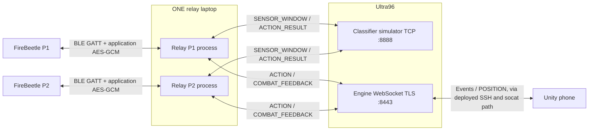
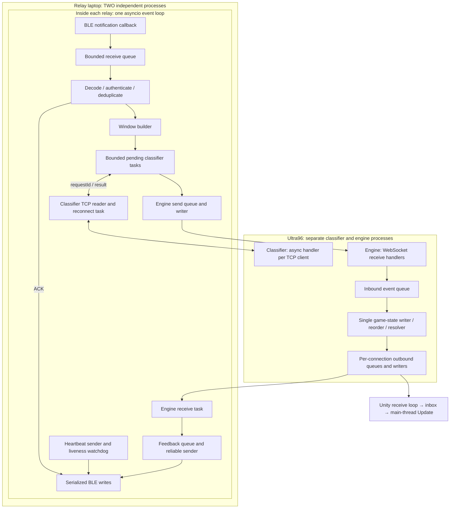

# Communications assessment: gap analysis and demonstration plan

Based on the supplied assessment requirements and repository inspection, 2026-09-23.
This is a preparation plan, not a hardware pass report. Proposed features below are not
implemented by this document. Existing hardware evidence and commands are in
[DEMO_RUNBOOK.md](../comms/DEMO_RUNBOOK.md), [PRE_DEMO_ROBUSTNESS.md](PRE_DEMO_ROBUSTNESS.md),
and [GUARD_LATENCY_FOLLOWUP.md](GUARD_LATENCY_FOLLOWUP.md).

For the detailed implementation specification, deployment commands, milestones and live/video
scripts, use [COMMS_ASSESSMENT_IMPLEMENTATION_PLAN.md](COMMS_ASSESSMENT_IMPLEMENTATION_PLAN.md).
Its explicit design decisions refine the initial suggestions in this checklist.

## 1. What is covered and what is missing

“Implemented” means a code path exists; it still needs demonstration on the actual devices.

| Assessment item | Current repository | What to prepare |
|---|---|---|
| Laptop ↔ Ultra96, live + video | Implemented: classifier TCP JSON request/reply; relay ↔ engine WebSocket | Run both servers on Ultra96; show matching request IDs, reply, and actual host |
| Ultra96 ↔ phone, live + video | Implemented: engine WebSocket, Unity receive/update and POSITION send | Show phone recognition and engine receipt of POSITION; explain the deployed tunnel path |
| FireBeetle setup, video | Firmware, board build environments, BLE setup and GPIOs exist | Record board model, wiring, player ID, build/flash and separate power |
| IDs/types/format, live + video | Implemented binary protocol and documentation | Packet diagram and one decoded sensor packet from each board |
| Two concurrent FireBeetles | One relay process per player is supported | Both processes on ONE laptop, distinct BLE addresses/player IDs, both counters increasing |
| Dummy sensors for >1 minute, live | Firmware continuously generates synthetic SENSOR_FRAME at 50 Hz, including between button presses | Receive-side statistics and a timed two-board run |
| kbps and maximum speed, live | Firmware has serial send counters; no assessment throughput dashboard found | Add receiver byte/rate counters, per-player colors, and a separate benchmark mode |
| File transfer | No file-transfer protocol/tool found | Add real chunk transfer through BLE and verify reconstructed bytes/hash |
| Power reset and out-of-range recovery, live | Reconnection, heartbeat, fresh handshake and reliable control retries implemented | Perform both physical tests while the other board continues streaming |
| Exact keyboard → board modification → Ultra96 → phone pipeline, live | Current input is a board button; feedback is a logged stand-in | Add keyboard command, actual board-side transformation, correlation and return path |
| Random dummy packet selection and random AI event | Firmware uses a synthetic sine pattern; simulator cycles scenarios or uses a deterministic trigger map | Add explicit random selection from editable valid packet/event pools |
| Change dummy data during demo | Trigger-map/scenario YAML is editable and loaded on server startup | Prepare editable sensor templates too; rehearse change, restart/reload, and observe changed values |
| Encryption walkthrough, video | BLE application AES-GCM; engine TLS; classifier encryption depends on SSH | Explain every deployed segment accurately, including local plaintext segments |
| Concurrency walkthrough, video | asyncio tasks, two relay processes, server client handlers, firmware queues and Unity inbox | Use diagram in section 7 and the exact functions listed below |
| TCP fragmentation | Binary accumulator, classifier readline, WebSocket message handling exist | Explain framing and demonstrate deliberately split/coalesced input in a software check |

The current button-to-phone demo does not satisfy the literal keyboard round trip. ACKing
COMBAT_FEEDBACK proves two-way control delivery, but does not prove received dummy sensor data
was modified by the board and forwarded to Ultra96.

The combined pipeline can replace the separate live channel demonstrations under the supplied
rubric. Keep the two-board maximum-speed test, file verification, recovery demonstrations and
video explanations. The rubric explicitly still asks for channel explanations/demos in the video.

## 2. Use the existing deployment



The current classifier replies to the relay; the relay forwards ACTION to the engine on Ultra96.
Explain that extra hop rather than presenting classifier-to-engine as a direct connection.
Use the working split deployment commands in GUARD_LATENCY_FOLLOWUP, steps 1–3. The all-laptop
mock launcher is useful rehearsal, but does not prove communication with a physical Ultra96.

The laptop initiates connections; classifier and engine servers run on Ultra96. There is no need
to introduce a broker. Direct connections can meet the topology requirement if the network permits
them, but direct classifier TCP currently has no encryption. Retain the working SSH forwarding
for that channel, or implement TLS before claiming a secure direct classifier connection.
`--no-tunnel` means the relay does not start its own tunnel; it can still use manually created forwards.

Use two independent power sources. During the live demonstration, neither board should have a USB
cable to the relay laptop. Keep firmware diagnostics visible through relay telemetry, or use a
separate laptop for serial monitoring. One powered board must be able to leave the room independently.
The rubric mentions “other two” despite specifying two concurrent boards elsewhere; prepare at least
the explicitly required two, and clarify the expected total if your team has a third device.

## 3. Add the assessment features

These are proposed implementation tasks, not existing commands or packet types.

### A. Keyboard round trip and editable random packets

Add an assessment mode that shares the existing relay BLE connection and session. A second tool
must not try to take ownership of a board already connected to its relay.

1. Keep several valid sensor templates in a small YAML/JSON file: weapon, flags and the real
   dominant/offhand/torso int16 fields. Randomly choose a template for each action keystroke.
2. Send a typed, encrypted request carrying a request ID, the structured sensor template and a
   documented transformation instruction. Preserve the existing header, authentication and CRC.
3. The board decodes the request and changes a visible field, for example adding a small bounded
   offset to dominant accelX with explicit int16 range validation. Log input and returned values.
4. The board returns correlated evidence of the transformation and generates the normal 40-frame,
   50 Hz capture from that transformed template. Use fresh board timestamps. Feed those returned
   sensor frames into the existing windower, then send SENSOR_WINDOW to Ultra96.
5. On Ultra96, randomly choose an event from a valid pool for the current weapon, create the normal
   ACTION_RESULT, and use the existing relay ACTION → engine → phone path.
6. Show one trace: key/request ID → template → board-modified value → classifier request ID → event
   → phone recognition. Serialize requests or report BUSY explicitly while one capture is active;
   never silently lose a keystroke. Correlation metadata must survive across any new wrapper/model.

For example, show `accelX raw 100 -> 125` on the laptop and the corresponding `125 / 2048 g` in the
window received on Ultra96. Selecting a different local template without sending it to the board
would not demonstrate the requested round trip.

Keep the existing gameplay mode and deterministic trigger map available. Add a separate random mode
to `mock/ultra96_sim.py`; current scenario cycling is not random. For the assessment, choose visible,
weapon-valid events rather than pure IDLE, which intentionally produces no recognition message.
Spacing requests avoids capture/cooldown confusion; ACTION_RECOGNIZED is the primary phone proof.

Rehearse changing a template's sensor values and the AI event pool during the demo, rerunning the
loader/server, and proving the new values traversed the board. A configuration change and rerun
satisfy the stated “recompile/rerun” wording; source changes still require the relevant build.

New message types require coordinated firmware, Python enums/payloads/codec, documentation and tests.
Do not disguise arbitrary file/command data as a real sensor reading or misuse COMBAT_FEEDBACK fields.

### B. Two-board throughput dashboard and benchmark

At the laptop, update a compact display about once per second, using cyan for P1 and magenta for P2
and explicit player labels. Include elapsed time, link/session state, valid sensor frames/s,
received frame kbps, unique sensor payload kbps, CRC/auth errors, duplicates, queue overflow,
reconnects and reliable retry counts. Save the full summary to disk.

Compute rates over monotonic elapsed time:

```text
received frame kbps = received framed bytes * 8 / elapsed_seconds / 1000
sensor payload goodput kbps = unique valid SENSOR_FRAME count * 42 * 8 / elapsed_seconds / 1000
```

Label byte accounting precisely. “Framed bytes” include your protocol header, GCM tag and CRC;
they exclude BLE/link/IP overhead and are not a measurement of radio bitrate. Separate duplicates,
invalid frames and control traffic. For a sensor-only framed rate, count only sensor frame bytes.

At an ideal 50 frames/s, each board produces 42-byte sensor payloads and 68-byte encrypted frames:
**16.8 kbps payload / 27.2 kbps framed sensors per board**, or **33.6 / 54.4 kbps for two boards**.
These are calculated baselines, not measured results and not a maximum-speed claim. Sixty seconds
at exactly 50 Hz corresponds to 3,000 generated sensor frames per board.

The wire SEQ counts every packet type, not just sensors; never treat gaps between sensor SEQs as
an exact sensor loss count. For exact loss reporting add sender generated/accepted counters and
session/sample identifiers, with measurement boundaries that account for in-flight packets.
Firmware notify acceptance alone does not establish laptop receipt.

Use a separate transport benchmark mode for speed exploration. Keep real sensor layouts and
encryption, but isolate high-rate traffic from the 50 Hz classifier's window/span assumptions.
Measure both boards simultaneously at increasing rates, report stable delivered goodput, drops,
latency and fairness, and select the highest sustained useful rate. Repeat with opposite connection
order. A short burst or one fast board starving the other is not a successful two-board maximum.

Already present: firmware requests 7.5–15 ms connection intervals; relay checks negotiated payload
MTU >=68; receive queues are bounded. Requests are not proof that the central accepted those timings.
Reduce per-packet terminal printing and measure the negotiated connection behavior before further
tuning. Do not change the normal game's sampling, grace or classifier deadlines just for this test.

### C. File transfer and verification

Add a small reliable transfer using typed start/chunk/end messages in the same authenticated binary
envelope. Include transfer ID, total length, chunk index or byte offset, chunk length and final
SHA-256. Bound total file size and memory use. ACK/retry chunks; deduplicate writes by transfer/offset.
Choose chunk sizes that fit the negotiated BLE payload capacity after metadata and the 26-byte
protocol overhead, and also respect firmware buffer limits.

For a clear demonstration, send a modest binary file laptop → board storage → laptop reconstruction
and compare source/reconstructed length and SHA-256. Ensure the board actually retains/retransmits
the bytes; a local copy or matching a preloaded constant is not evidence of file transmission.
Include zero and non-text bytes. Show retransmission after a deliberately lost ACK without duplicate
file bytes. On disconnect, explicitly restart a transfer unless resume is implemented and tested.

Application chunking can use complete independent frames; the current MORE_FRAGMENTS flag is
explicitly unsupported. Do not enable that flag and assume reassembly already exists.

## 4. Live demonstration sequence

1. **Topology and IDs:** show Ultra96 servers, one relay laptop, both independently powered boards,
   and phone. Label device BLE address/MAC and logical player ID separately; service UUID identifies
   the service, not a unique board. Wait for both handshakes and upstream connections.
2. **Packet explanation:** show a decoded SENSOR_FRAME from each board, sequence, timestamp,
   player, weapon, sensor values and CRC/auth validation. Explain GATT notify versus write direction.
3. **Combined pipeline:** use the proposed keyboard mode several times for different random packets.
   Show board transformation, matching Ultra96 request/result and phone recognition. Change a dummy
   template/event pool live, rerun/reload, and repeat. Until that mode exists, demonstrate the two
   existing channels separately and do not claim the combined-pipeline exemption.
4. **Concurrent stream:** run both boards for at least 60 seconds at the measured stable benchmark
   rate, with a visible timer and independent counters. Record per-board and aggregate results.
5. **File test:** transfer/reconstruct the file and display equal byte counts and SHA-256 values.
6. **Power failure:** power off P1 while P2 counters continue. Restore P1; show its automatic fresh
   handshake and rising counts without restarting P2 or both relays. After reboot, press GPIO4
   to select a weapon again before demonstrating gameplay.
7. **Range failure:** physically take one powered board out of range. Show the lost link while the
   other continues; return and show recovery. Switching off Bluetooth is not this physical test.
8. **Protocol reliability:** use a deterministic loss-injection mode to suppress one reliable ACK,
   show same-ciphertext retry, another ACK, and exactly one application effect. Show CRC/tamper
   rejection in a controlled test. Existing reliability code does not itself provide a user-facing
   loss-injection switch; add/rehearse the harness if using this step.
9. **Final recovery:** perform one fresh keyboard-to-phone request from each recovered board and
   save timestamped summaries. Measure recovery duration rather than promising an unverified bound.

Keep the >60-second steady run separate from intentional fault intervals so its rates are meaningful.
Best-effort SENSOR_FRAME is not retransmitted; explain that freshness matters for gameplay. Reliable
control and file data have ACK/retry semantics. Reconnection does not imply replay of missed actions.

## 5. Explain packet format and fragmentation

The normal sensor frame is little-endian:

```text
MAGIC  VERSION  TYPE  SEQ  PLAYER_ID  LEN  encrypted sensor payload  GCM tag  CRC16
  1       1      1    2       1      2             42                16      2 bytes
```

LEN is 58 for this frame (ciphertext plus tag); total size is 68 bytes. The plaintext sensor payload
is timestamp u32, flags u8, weapon u8, and three sets of six int16 readings. Acceleration scales by
1/2048 g per LSB and angular velocity by 1/16.4 degrees/s per LSB. Current demo flags also carry a
trigger ID in bits 5–7; the older reserved-bit table in wire_protocol.md has not caught up to the
implementation in constants.py and cg_protocol.h.

Explain HELLO/HELLO_ACK, TIME_SYNC_REQ/RESP, SENSOR_FRAME, RFID_EVENT, HEARTBEAT, ACK and
COMBAT_FEEDBACK. Distinguish physical identity, player assignment, connection session and sequence.

TCP handling already uses three appropriate boundaries:

- Binary mock transport: `protocol/framing.py:Framer.feed` keeps partial data until header + LEN +
  CRC are available, and can emit multiple frames from one input chunk.
- Classifier: `relay/ultra96.py` and `mock/ultra96_sim.py` use `StreamReader.readline()` for complete
  newline-delimited JSON. Validate that a complete delimiter was received before accepting EOF tails;
  reads can end at EOF, and enforce reasonable message-size limits.
- Python WebSocket library supplies application messages; Unity `EngineClient.ReceiveLoop` loops
  `ReceiveAsync` until `EndOfMessage` before decoding and queuing the message.

Demonstrate splitting one encoded frame at several offsets and delivering two concatenated frames;
the decoded results should be identical. Do the analogous split/coalesced-line check for classifier
JSON. TCP stream accumulation is distinct from your unused application MORE_FRAGMENTS extension.

## 6. Video: protocol FSM and encryption walkthrough

Use readable slides/snippets, then point to real implementation code. Suggested recording order:
setup/wiring → topology and packet format → protocol FSMs → channel/pipeline demo → encryption →
concurrency. Omit secrets from the recording; show field names and redacted configuration.

```mermaid
stateDiagram-v2
    [*] --> Advertising
    Advertising --> Connected: BLE central connects and subscribes
    Connected --> Handshake: HELLO / HELLO_ACK
    Handshake --> TimeSync: nonce and version accepted
    TimeSync --> Streaming: initial 8 exchanges complete
    Streaming --> Streaming: sensor / heartbeat / reliable control
    Handshake --> Disconnected: timeout or invalid session
    TimeSync --> Disconnected: timeout or invalid response
    Streaming --> Disconnected: power / range / watchdog
    Disconnected --> Advertising: device available; relay reconnects with backoff
```



For reliable delivery show `SEND -> WAIT_ACK -> DONE`, and `WAIT_ACK -> RETRY_SAME_BYTES` on timeout,
with bounded attempts and an explicit failed state. Receiver: validate → apply once → ACK;
authenticated duplicate → ACK again without applying again. Upstream TCP/WS has its own independent
`DISCONNECTED -> CONNECTING -> CONNECTED -> BACKOFF` lifecycle.

| Channel | What the current code actually does | Walkthrough targets |
|---|---|---|
| FireBeetle ↔ laptop | Application AES-128-GCM, 16-byte tag; header is authenticated AAD; CRC first; sequence/replay tracking | `protocol/crypto.py`, `protocol/codec.py`, `firmware_demo/lib/cg_protocol/cg_crypto.cpp`, `cg_frame.cpp` |
| Laptop ↔ classifier | Plain JSON over TCP in Python; SSH encrypts the network path only when that tunnel is used | `relay/ultra96.py:Ultra96Client._serve/request`, `relay/tunnel.py`, actual SSH forwarding command |
| Laptop ↔ engine | WSS when use_tls is true, certificate verification with configured CA, bearer authentication | `relay/engine_link.py:_serve`, `engine/ws_server.py:build_ssl_context` and handler |
| Ultra96 ↔ phone | Current workaround uses phone-local WS → socat TLS → SSH forward → engine WSS | active Unity `EngineClient.cs`, actual Termux commands, engine TLS configuration |

Explain the 12-byte GCM nonce: session u32 + player u8 + direction u8 + extended sequence u32 +
two zero bytes. HELLO uses its random device nonce before a session exists. Retries reuse the exact
sealed bytes; they do not encrypt altered plaintext under the same nonce. CRC is an error check,
not encryption. JSON and bearer tokens are not encryption either.

Describe the prototype honestly: 32-bit random session/device nonce domains do not provide an
absolute lifetime uniqueness guarantee. The documented phone socat command uses `verify=0`, so
that TLS segment does not authenticate the engine certificate; SSH host authentication and the
actual forwarding topology must be explained separately. Do not claim verified end-to-end TLS
from Unity when Unity uses local plaintext WS. Bind local sidecars/forwards to loopback for this setup.

## 7. Video: concurrency diagram and code map



Explain that asyncio is cooperative I/O concurrency, not a dedicated OS thread for each packet.
Awaiting classifier/network I/O lets BLE receive, ACK and heartbeat tasks continue. Blocking compute
or synchronous logging can still stall an event loop. A future real classifier needs an appropriate
worker strategy if inference blocks; the current simulator is a lookup/cycle handler.

| Block | Code to show |
|---|---|
| Per-player process and independent reconnect lifecycles | `relay/app.py:run_relay`, `relay/reconnect.py` |
| Receive/feedback/heartbeat/watchdog tasks and bounded classification | `relay/session.py:Session._stream`, `_handle_sensor_frame`, `_classify` |
| BLE callback queue and serialized writes | `transport/ble.py:BleTransport` |
| TCP reply correlation and timeouts | `relay/ultra96.py:Ultra96Client` |
| Concurrent engine receive/send tasks | `relay/engine_link.py:_serve` |
| Ultra96 client handlers | `mock/ultra96_sim.py:_handle_client`, `asyncio.start_server` |
| Engine network and state tasks | `engine/app.py:run_engine`, `engine/game_state_task.py:run`, `engine/ws_server.py` |
| Firmware callback to loop transfer | `firmware_demo/src/main.cpp:WriteCallback.onWrite`, FreeRTOS queue, `loop` |
| Unity network inbox consumed on main thread | active project's `Assets/Scripts/Net/EngineClient.cs` |

The active Unity project is `visualizer_demo/CG4002VisualizerDemo_UnityTemp/My project`.
Use its code in the recording rather than the older scaffold directory.

## 8. Readiness gate

Prepare the keyboard/transform/random mode first, then throughput reporting/benchmark, then file
transfer. Add focused checks for command correlation, duplicate suppression, transfer integrity and
stream fragmentation. Rehearse physical recovery after the paired firmware/relay changes.

Save: per-board 60+ second throughput summaries; transfer length/hashes; one correlated end-to-end
trace; power/range reconnect timings with unaffected-board counters; changed dummy-template evidence;
and readable protocol/concurrency slides. Keep detailed packet logs on disk and only sampled packet
decodes/status on screen. Current structlog colors are not a substitute for distinct P1/P2 colors.

No firmware, runtime source, configuration, scene or deployment was changed as part of this plan.
