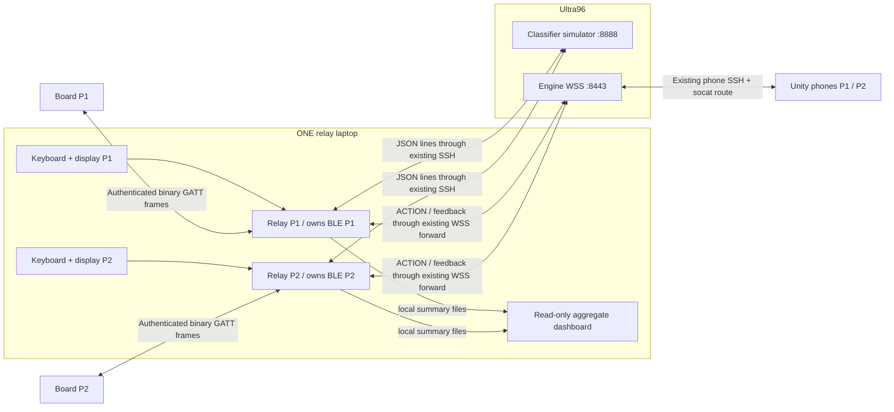
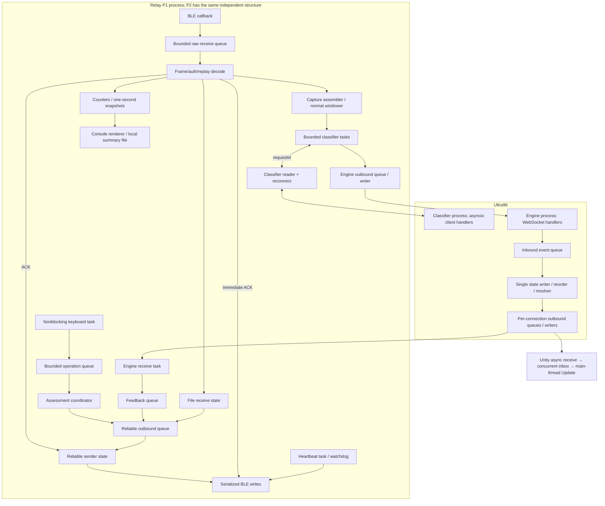
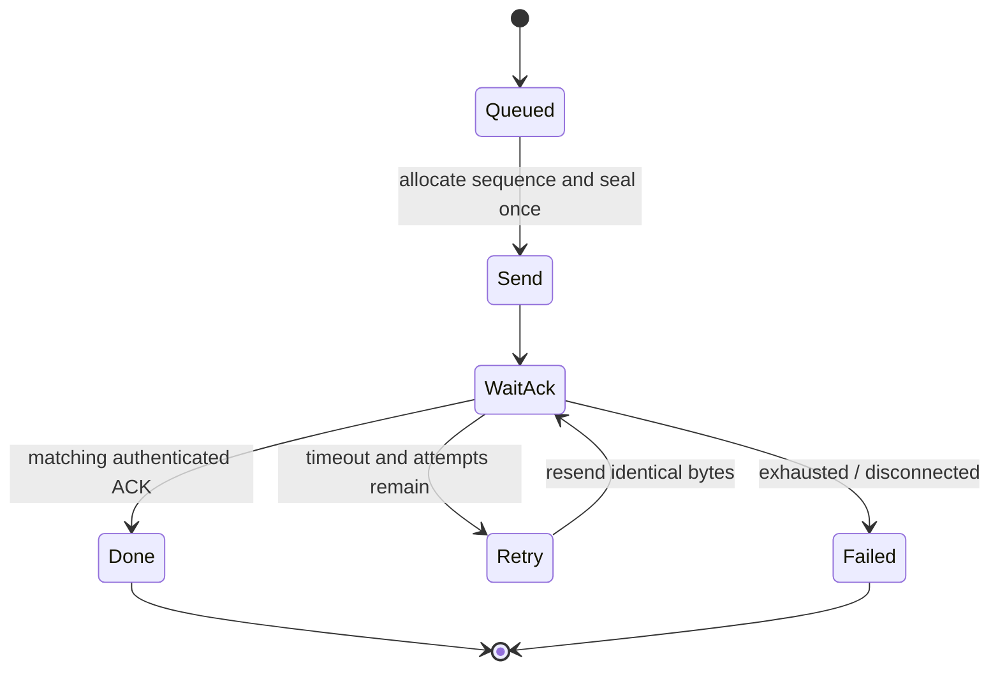

# Communications assessment implementation, live demo and video plan

> **Keyboard update, 2026-09-28:** use [DETERMINISTIC_KEYBOARD_DEMO.md](DETERMINISTIC_KEYBOARD_DEMO.md)
> for the current a=weapon / b,c,d=fixed IMU mappings, identity return, live edits and classifier command.
> Earlier random-key instructions below are historical. Timing-profile and unrelated test procedures remain applicable.

> **Reviewed implementation available:** use
> [COMMS_ASSESSMENT_REVIEW_AND_RUNBOOK.md](COMMS_ASSESSMENT_REVIEW_AND_RUNBOOK.md)
> for actual supported commands, review fixes, remaining hardware checks and the live/video script.
> This document records the original proposal; its proposed CLI flags are not an operator reference.

**Status:** proposed implementation plan, 2026-09-23. No features in this plan have been
implemented or physically verified by writing this document. Commands explicitly marked
**proposed** will work only after their implementation milestones pass.

**Objective:** extend the current two-player BLE → relay → Ultra96 → Unity demonstration to
cover the professor's communications assessment, using the existing machines, ports, tunnels,
player identities, firmware build environments and working gameplay path.

Companion documents:

- [Requirement gap checklist](COMMS_ASSESSMENT_CHECKLIST.md)
- [Current demo runbook](../comms/DEMO_RUNBOOK.md)
- [Recovery and protocol findings](PRE_DEMO_ROBUSTNESS.md)
- [Current deployment and guard retest](GUARD_LATENCY_FOLLOWUP.md)

## Contents

1. [Scope, decisions and acceptance matrix](#1-scope-decisions-and-acceptance-matrix)
2. [Existing deployment and hardware caveat](#2-existing-deployment-and-hardware-caveat)
3. [Target architecture and operating modes](#3-target-architecture-and-operating-modes)
4. [Protocol extension and compatibility contract](#4-protocol-extension-and-compatibility-contract)
5. [Keyboard-driven full pipeline](#5-keyboard-driven-full-pipeline)
6. [Editable dummy data and random Ultra96 events](#6-editable-dummy-data-and-random-ultra96-events)
7. [Throughput dashboard and maximum-speed benchmark](#7-throughput-dashboard-and-maximum-speed-benchmark)
8. [File transfer and integrity verification](#8-file-transfer-and-integrity-verification)
9. [Reliability, failure recovery and fault injection](#9-reliability-failure-recovery-and-fault-injection)
10. [Encryption, stream framing and concurrency](#10-encryption-stream-framing-and-concurrency)
11. [Changes by file/component](#11-changes-by-filecomponent)
12. [Implementation milestones and dependencies](#12-implementation-milestones-and-dependencies)
13. [Software and physical verification](#13-software-and-physical-verification)
14. [Build, deployment, startup and rollback](#14-build-deployment-startup-and-rollback)
15. [Live assessment script](#15-live-assessment-script)
16. [Video recording script and slide storyboard](#16-video-recording-script-and-slide-storyboard)
17. [Evidence, troubleshooting and final readiness checklist](#17-evidence-troubleshooting-and-final-readiness-checklist)

For implementation, begin with sections 4–8 and the milestone table in section 12. For the actual
assessment, use section 14 as the terminal command sheet, section 15 as the live script and section
16 as the recording outline. Proposed command names and wire layouts are specifications to build,
not statements that those features already exist.

## 1. Scope, decisions and acceptance matrix

### 1.1 Decisions

- Preserve the existing GPIO button demo as the default. Assessment features are explicitly enabled.
- Keep two relay processes on ONE laptop, one BLE owner per board. Add keyboard input inside each
  relay process. Do not create a second BLE client or a laptop network server to control it.
- Keep the existing SSH jump-host route, loopback forwards, classifier on Ultra96 port 8888,
  engine TLS WebSocket on Ultra96 port 8443, and phone-local port 8080.
- Add an assessment protocol extension with typed encrypted messages and the same real sensor
  representation. Preserve existing frame types and normal SENSOR_FRAME layout.
- Add an optional trace ID from keyboard to the Unity event feed so there is visible end-to-end
  evidence, including the physical board's transformation.
- Build a bounded file round trip through board RAM. Use a small binary file and SHA-256; avoid
  filesystem/flash-wear complexity on the board for this assessment.
- Measure receiver goodput. Do not call an ideal 50 Hz calculation the measured maximum.
- Keep normal 50 Hz capture, classifier timeout, guard grace, reorder delay and combat rules intact.
  High-rate benchmarking is an isolated mode that does not submit windows/actions to gameplay.
- Remain compatible with Python 3.10 on Ultra96. Do not introduce Python 3.11-only concurrency APIs.
- No new service, broker, cloud dependency or cryptographic algorithm is necessary.

### 1.2 Requirement-to-deliverable matrix

| ID | Professor's requirement | Existing foundation | Required deliverable / pass evidence |
|---|---|---|---|
| R1 | Laptop ↔ Ultra96, live + video | SENSOR_WINDOW/ACTION_RESULT TCP; relay/engine WSS | Physical Ultra96 logs matching request/reply, plus protocol explanation |
| R2 | Ultra96 ↔ phone, live + video | Engine events and Unity POSITION | Phone displays the traced event; engine logs phone POSITION; actual route explained |
| R3 | FireBeetle setup, video | PlatformIO firmware and GPIO wiring | Board model, IDs, build/flash, wiring and independent power shown |
| R4 | IDs, packet types and format, live + video | Binary header, sensor payload, CRC/GCM | Readable field diagram and real decoded packet from each board |
| R5 | Concurrent TWO FireBeetles, live | Two relay configs/processes | Both connected to one laptop and receiving throughout the timed test |
| R6 | Dummy sensors for over a minute, live | Continuous synthetic sensor generation | 65-second receiver report from both boards with explicit duration and counters |
| R7 | kbps and maximum speed, live | 50 Hz sender counters | Per-player + aggregate dashboard and a documented simultaneous rate sweep |
| R8 | Transfer a file | Binary transport and reliable controls | Laptop → board RAM → laptop reconstruction; length and SHA-256 all match |
| R9 | Power reset, live | Independent reconnection and handshake | P1 recovery while P2 continues; new session, fresh data and post-recovery pipeline |
| R10 | Out-of-range disconnect, live | BLE watchdog/reconnect | Physically move a powered board away and back, other board remains active |
| R11 | Exact keyboard-to-board-modification-to-Ultra96-to-phone pipeline, live | Most upstream path exists | Accepted key sends random structured input; board changes it; Ultra96 random event reaches phone |
| R12 | Multiple random dummy packets, editable during assessment | YAML loaders and synthetic sensors | Editable template/event pools, random choice, live edit/reload or restart demonstration |
| R13 | Encryption walkthrough, video | Application AES-GCM, WSS, SSH | Code and route walkthrough, accurate encryption/authentication boundaries |
| R14 | Concurrency walkthrough, video | asyncio, queues, separate processes | Diagram, source snippets and explanation of data/ownership/dependencies |
| R15 | Readable display and packet logs | structlog JSONL | P1 cyan/P2 magenta; explicit IDs; decoded samples and one-second summaries |
| R16 | TCP fragmentation | Framer/readline/WebSocket assembly | Split/coalesced-input tests and a clear explanation, including EOF/oversize handling |
| R17 | Server location and power constraints | Ultra96 hosts both services | No broker/listener on relay LAN; boards powered separately from relay laptop |

The complete live pipeline can replace separate live channel demos under the supplied wording.
Still prepare the individual explanations and video channel demonstrations, and retain the
concurrent maximum-speed, file and failure demonstrations. Do not use that exemption to omit
requirements unrelated to channel connectivity.

## 2. Existing deployment and hardware caveat

### 2.1 Deployment to preserve

| Component | Current location / setting |
|---|---|
| Relay laptop working tree | `C:\Users\T0332075\Desktop\CG4002` on the development machine; use the actual checkout path on a different relay laptop |
| P1 board build | `firebeetle32`, currently uploaded through COM8 |
| P2 board build | `esp32dev_p2`, currently uploaded through COM7 |
| Relay configs | `comms/configs/relay.p1.yaml` and `relay.p2.yaml`; retain working local overrides if used |
| SSH jump host | `e1138443@stujump.comp.nus.edu.sg` |
| Ultra96 target | `xilinx@makerslab-fpga-53.ddns.comp.nus.edu.sg` |
| Laptop forwards | Loopback 8888 → Ultra96 loopback 8888; loopback 8443 → Ultra96 loopback 8443 |
| Phone forwards | Each phone independently forwards loopback 8443 → Ultra96 loopback 8443 |
| Phone bridge | socat accepts WS at port 8080 and opens TLS to loopback 8443 |
| Unity | Host 127.0.0.1, port 8080, UseTls=false, correct PlayerId per phone |
| Ultra96 simulator | Current deterministic `--trigger-map configs/scenarios/demo_trigger_map.yaml` |
| Active Unity project | `visualizer_demo/CG4002VisualizerDemo_UnityTemp/My project` |

COM port numbers must be checked before every upload; they are observed ports, not device identity.
Do not copy the backslashes before `@` or underscores from escaped Markdown into shell commands.

### 2.2 Hardware identity is a real readiness item

`firmware_demo/platformio.ini` describes `esp32dev_p2` as a generic ESP32 DevKitC stand-in.
Do not describe that board as a second FireBeetle in the recording. Confirm the physical model.
If the professor requires two actual FireBeetles, obtain the second and add a `firebeetle32_p2`
environment inheriting `firebeetle32`, with player ID 2 and BLE name `CG4002-Demo-P2`.
Rescan/update only that board's BLE address and retest both links after replacement. Otherwise obtain
explicit acceptance of the stand-in before relying on it for the two-FireBeetle requirement.

During live radio tests use two independent power banks or other permitted power sources. Neither
board is USB-connected to the relay laptop. Flashing on USB before the assessment is separate.
Test power-bank automatic shutoff in advance. The rubric's phrase “other two” is inconsistent with
its explicit two-board requirement; confirm total hardware count if a third board is expected.

## 3. Target architecture and operating modes



The classifier still returns ACTION_RESULT to the relay, which forwards ACTION to the engine on
Ultra96. Do not draw a direct classifier → engine connection that does not exist in the code.
The aggregate dashboard reads local files only; it neither controls devices nor listens on the LAN.

### Modes

| Mode | Input and traffic | Gameplay | Exit / recovery |
|---|---|---|---|
| NORMAL | Existing GPIO buttons and 50 Hz SENSOR_FRAME | Existing behavior | Default after boot/session loss |
| ASSESS_READY | Keyboard enabled; ordinary stream and heartbeat continue | Existing buttons can work while no assessment operation is active | Quit returns NORMAL |
| CAPTURE | One keyboard transaction, 40 board-modified samples at 50 Hz | One normal SENSOR_WINDOW and recognition event | Complete/fail explicitly, return READY |
| BENCHMARK | Timed high-rate structured sensor stream, counters and heartbeat | No classifier/engine action submission from benchmark samples | Duration limit, operator stop or disconnect |
| FILE_UPLOAD / FILE_DOWNLOAD | Bounded reliable chunks through RAM | No new captures; keep liveness and receive loop alive | Verified completion, explicit failure, cancel or disconnect |

One foreground operation per board. P1 and P2 can run independently. Do not allow a file transfer,
capture and benchmark to fight over one board's data path. Button presses during a foreground
assessment operation produce a visible busy counter/notice rather than an accidental extra capture.
ACKs, heartbeats and connection recovery continue in every mode.

All long operations carry a bounded duration and an operation ID. On session loss, cancel pending
operations and clear assembly state; do not replay old keystrokes or file chunks into a fresh session.

## 4. Protocol extension and compatibility contract

### 4.1 Preserve the envelope

Existing normal sensor frame, little-endian:

```text
MAGIC VERSION TYPE SEQ PLAYER_ID LEN ciphertext(sensor payload) GCM_TAG CRC16
  1      1     1    2      1      2            42                 16      2 bytes
```

Normal overhead = 26 bytes, total = 68. LEN includes ciphertext + 16-byte tag.
Sensor payload remains `timestamp:u32, flags:u8, weapon:u8, dominant[6]:i16,
offhand[6]:i16, torso[6]:i16`. Reuse those field definitions and scaling everywhere.

Assessment samples add operation/sample identity around that exact sensor layout. This makes
loss/correlation measurable while retaining the real IMU representation. Describe this wrapper
openly; it is a typed extension of the working protocol, not arbitrary text or unstructured numbers.
The ordinary SENSOR_FRAME type remains available for the unchanged gameplay demonstration.

### 4.2 Proposed extension revision 1

Reserve the following currently unused type IDs after a final repository collision check.
Freeze the byte layouts in milestone M1 before writing both implementations. All integers below
are little-endian; unused fields/padding are zero and validated. `sensor42` is the existing payload.

| Type | ID | Proposed plaintext layout | Plain / total bytes | Delivery |
|---|---|---|---|---|
| ASSESS_CAPS_REQ | 0x40 | probeId:u32, revision:u16 | 6 / 32 | Bounded request/reply |
| ASSESS_CAPS_RESP | 0x41 | probeId:u32, revision:u16, features:u32, maxFrame:u16, maxFile:u32 | 16 / 42 | Reply; request retry recovers loss |
| ASSESS_COMMAND | 0x42 | operationId:u32, opcode:u8, reserved:u8, arg0:u32, arg1:u32, sensor42 | 56 / 82 | ACK + retry |
| ASSESS_RESULT | 0x43 | operationId:u32, opcode:u8, status:u8, arg0:u32, arg1:u32, sensor42 | 56 / 82 | ACK + retry |
| ASSESS_SAMPLE | 0x44 | operationId:u32, sampleIndex:u32, sensor42 | 50 / 76 | Best effort |
| FILE_META | 0x45 | transferId:u32, totalBytes:u32, direction:u8, reserved:u8, sha256[32] | 42 / 68 | ACK + retry |
| FILE_CHUNK | 0x46 | transferId:u32, offset:u32, validBytes:u8, reserved:u8, data[32] | 42 / 68 | ACK + retry |
| FILE_END | 0x47 | transferId:u32, totalBytes:u32, direction:u8, status:u8, sha256[32] | 42 / 68 | ACK + retry |
| ASSESS_STATS | 0x48 | operationId:u32, deviceElapsedMs:u32, generated:u32, notifyAccepted:u32, notifyRejected:u32, rxOverflow:u32, lastSampleIndex:u32, flags:u32 | 32 / 58 | Best effort periodic snapshot |
| ASSESS_STATS_FINAL | 0x49 | Same fields as ASSESS_STATS | 32 / 58 | ACK + retry |

All new frames fit the current `CG_MAX_FRAME_SIZE=96` firmware buffer. CAPTURE requires an actual
usable notify/write payload capacity of at least 82 bytes, stronger than today's 68-byte check.
Check both directions and firmware support; the BLE write-without-response maximum may differ from
the general MTU report. Refuse assessment mode clearly if insufficient; normal 68-byte mode can
still work. Do not treat a requested MTU as evidence of negotiation.

Fixed 32-byte file chunks deliberately fit the existing fixed-length codec tables and 68-byte frame
size. Use `validBytes` for the final partial chunk and require zero padding. An optimization to larger
chunks is optional after correctness; it would require a new negotiated layout and buffer review.

### 4.3 Commands and statuses

Freeze enum values and field meaning in shared C/Python definitions:

| Opcode | arg0 / arg1 | sensor42 | Effect |
|---|---|---|---|
| CAPTURE | sampleCount=40 / signed transform delta encoded by a documented int32 convention | Selected template; timestamp is a placeholder | Transform dominant accelX, capture 40 samples at 50 Hz |
| BENCH_START | requested rate Hz / duration ms | Selected valid sensor template | Generate indexed structured samples at requested rate |
| STOP | target operation ID / 0 | Zero | Stop benchmark or cancel current capture/file operation |
| FILE_READBACK | transfer ID / 0 | Zero | Board sends retained file back after verified upload |
| STATUS | target operation ID / 0 | Zero | Return cached progress/result without repeating effects |

Result statuses include ACCEPTED, COMPLETE, BUSY, INVALID, UNSUPPORTED, CANCELLED, INCOMPLETE and
HASH_MISMATCH. A wire ACK means an authenticated message was accepted for handling, not that the
whole operation succeeded. RESULT/FILE_END supplies the application outcome. When useful, a result's
sensor42 contains the actual transformed first sample, with `arg0=produced count, arg1=reason/detail`;
per-op meanings must be documented rather than guessed.

CAPS probing happens only with `--assessment`. Limit it, for example to three one-second attempts.
Old firmware need not understand the extension; it times out to `assessment_unsupported` while
ordinary BLE/gameplay remains usable. Keep binary protocol version 1 for unchanged base types and
negotiate extension revision separately. Do not send any other extension type before CAPS succeeds.

### 4.4 Reliability is a coordinated change, not just adding enum values

Today `codec.py` gives special reliable duplicate handling to RFID_EVENT/COMBAT_FEEDBACK, and
firmware has similarly specific paths. Extend the actual decode/cache/ACK logic on both sides.
Merely adding new types to `RELIABLE_PACKET_TYPES` is insufficient.

- Use a shared definition of delivery policy. CAPS uses bounded request/reply; SAMPLE and periodic
  STATS are best effort; commands/results/file records and STATS_FINAL are reliable. The separate
  final type allows the decoder to choose its reliable replay path before unpacking the payload.
- Serialize reliable sends per direction, including existing RFID/feedback and new assessment
  records. Allocate sequence numbers when dequeuing for transmission. A later reliable packet
  must not overtake a pending earlier one and advance the current reliable replay watermark.
- Keep ACK generation outside that reliable queue; ACKs are never ACKed. Reads must continue while
  a sender waits. Do not await full transfer/capture/retry completion inside the BLE receive handler.
- Retry exactly the originally encrypted bytes. Never regenerate altered plaintext with the same
  nonce/sequence. Authenticate before committing replay/operation state.
- Preserve current retry defaults initially. Verify the 16-entry/20-second duplicate cache covers
  the bounded retry schedule with the new send ordering. Test ACK loss while ordinary samples flow.
- Key application operations by session + player + operation ID. Cache recent results; a repeated
  command must return the prior status and must not transform/capture twice.
- New session clears pending operations, queued reliable records and file buffers. No cross-session
  retry. Abort/rekey before extended sequence exhaustion; bound rates/operation length so 16-bit
  ACK identity and delayed sequence inference cannot become ambiguous within the retry horizon.

## 5. Keyboard-driven full pipeline

### 5.1 Operator interface

Proposed addition to each relay: `--assessment --assessment-config <path>`.
Keep the current commands valid without either option.

| Key | Proposed action |
|---|---|
| Space | Send one randomly chosen structured capture request to this relay's board |
| R | Atomically validate/reload the local template/config file while idle |
| B | Start the configured timed benchmark |
| S | Stop/cancel the current foreground operation |
| F | Round-trip the configured binary file |
| D | Toggle one decoded packet sample per second |
| L | Arm one narrowly scoped reliable ACK-loss experiment while idle |
| Q | Stop assessment input and return to normal operation; Ctrl-C still shuts down relay |

Every action keystroke gets an explicit outcome: accepted operation ID or rejected with reason
(BUSY, OFFLINE, NO_WEAPON, BAD_CONFIG, UPSTREAM_OFFLINE). Use one pending capture, with no unbounded
keyboard queue. Holding a key should not silently create hundreds of captures. This fulfills the
interactive intent while making the existing approximately 0.8-second capture time visible.

Implement Windows input using nonblocking `msvcrt.kbhit/getwch` polling in a cancellable asyncio
task, ignoring extended/control key prefixes appropriately. Keep it outside the receive callback.
If adding POSIX input, restore terminal settings in `finally`. Do not block the event loop with
`input()` and do not make an uncancellable stdin thread prevent shutdown. Disable key controls with
a clear message when stdin is not a TTY; scripts can still use ordinary relay mode.

### 5.2 One accepted key, end to end

1. Require active BLE/CAPS, confirmed weapon, classifier and engine connection. Select randomly
   among validated templates for the currently selected weapon. Initially rehearse SWORD only.
2. Allocate a relay-run identifier and a monotonic u32 operation ID; log template ID and config hash.
   The human trace ID is `relayRunId:playerId:sessionId:operationId`.
3. Encode/send CAPTURE using the existing key/session/envelope. Its sensor values actually traverse
   the laptop → BLE → board direction; do not fabricate the return on the laptop.
4. Board validates type/length/authentication, weapon match, allowed operation and int16 bounds.
   Transform `dominant.accelX` by a fixed configurable delta, e.g. +25 raw LSB. Reject overflow;
   do not rely on signed overflow/wrap. Replace timestamp with the board's measurement time.
5. Board reports ACCEPTED, then emits exactly 40 indexed ASSESS_SAMPLEs at 50 Hz from the transformed
   template. Other axes retain supplied values. Tagged capture flags use the real trigger encoding.
   Input timestamp/flags are normalized under the documented capture contract, not trusted as clock data.
6. Relay validates operation/player/session and sample index 0..39, deduplicates samples, checks
   the returned transform, and assembles only this operation's frames. Missing indices invalidate
   the capture. A late frame from an old operation cannot fill a current window.
7. Feed the inner sensor fields through shared scaling and existing span/staleness/weapon gates.
   Refactor a public window-building interface or add a small assessment assembler that delegates
   to the same validation logic. Avoid bypassing gates or reaching into windower private state.
8. Keep ordinary idle SENSOR_FRAMEs outside that assessment assembler. Do not mix their data with
   the capture or let the trigger refractory state swallow a later capture. Normal/button windowing
   is reset/paused at mode boundaries, with confirmed weapon restored explicitly.
9. Assign a classifier request ID from the SAME per-relay request-ID allocator used by normal
   windows. Map trace ID to request ID. Send ordinary SENSOR_WINDOW plus optional trace metadata.
10. Ultra96 validates the request and randomly selects a visible, weapon-valid ACTION_RESULT.
    Its result echoes request ID, player, timestamp and optional trace ID.
11. Relay performs existing response/confidence checks and verifies trace correlation when present,
    then sends ACTION with the captured weapon/timestamp and optional trace ID.
12. Engine preserves trace metadata through inbound event creation, reorder and resolution, and
    includes it in ACTION_RECOGNIZED. It does not change combat rules for assessment packets.
13. Unity displays the normal action/guard line with a short trace suffix when present. A recording
    can match the laptop/Ultra96/phone trace without relying on log print order.

Example explanatory values (not a measured run): `input ax=100`, board output `ax=125`, Ultra96
first dominant ax `0.06103515625 g` (125/2048), random event HORIZONTAL_SWING, same trace on phone.
Show the real values captured at runtime, not this example preprinted as a success message.

### 5.3 Completion, timings and failures

Firmware capture completion is distinct from classifier success, engine admission and phone display.
Display those stages separately. Receipt of a phone event is visually verified; do not show an
automatic PHONE_CONFIRMED badge unless a real phone acknowledgement has been implemented.
Trace metadata on ACTION_RECOGNIZED makes visible verification sufficient without adding a new ACK API.

Use bounded capture/result waits independent of the 120 ms classifier request deadline. Forty 50 Hz
samples span approximately 780 ms, so a whole key-to-phone deadline cannot be 120 ms. Start with a
documented configurable capture deadline around 2 seconds, then verify on hardware. A failed stage
must show its actual reason; no generated replacement event or silent retry as a new command.
A fresh key after recovery begins a new operation.

Define deadlines per phase: bounded reliable command delivery, then capture completion measured
from board acceptance/first sample, then the existing classifier deadline. The overall coordinator
also has a bounded lifetime. A capture deadline is not a replacement for the current longer reliable
retry horizon. After local cancellation/timeout, ignore late results/samples for that operation,
request STOP where the link is healthy, and wait for idle confirmation before admitting a new
operation. STOP must have a bounded scheduling path; do not allow a long queued file to prevent
cancellation. Never cancel receive/ACK servicing while cancelling an application operation.

Do not require HP to change for communications proof: guard produces STATE_ONLY and an attack can
be ON_COOLDOWN/IGNORED. ACTION_RECOGNIZED is the relevant message. Retain optional combat/reset
demonstrations, both POSITION feeds and the corrected avatar rotations from the existing follow-up.

## 6. Editable dummy data and random Ultra96 events

### 6.1 Proposed laptop config

New `comms/configs/assessment.yaml`; this example is the target schema, not currently loadable:

```yaml
revision: 1
capture:
  samples: 40
  rate_hz: 50
  transform_delta_raw: 25
  deadline_ms: 2000
templates:
  - id: sword_a
    weapon: SWORD
    trigger_id: 1
    dominant: [100, 0, 2048, 164, 0, 0]
    offhand: [0, 0, 2048, 0, 0, 0]
    torso: [0, 0, 2048, 0, 0, 0]
  - id: sword_b
    weapon: SWORD
    trigger_id: 2
    dominant: [-200, 100, 2048, 0, 328, 0]
    offhand: [10, 0, 2048, 0, 0, 0]
    torso: [0, 10, 2048, 0, 0, 0]
  - id: sword_c
    weapon: SWORD
    trigger_id: 3
    dominant: [400, -100, 1900, 0, 0, 164]
    offhand: [0, 20, 2048, 0, 0, 0]
    torso: [0, 0, 2000, 0, 0, 0]
benchmark:
  rate_hz: 50
  duration_s: 65
  sweep_rates_hz: [50, 75, 100, 150, 200]
file:
  source: logs/assessment/input.bin
  output_dir: logs/assessment/received
  max_bytes: 4096
display:
  refresh_hz: 1
  decoded_samples_per_second: 1
```

Resolve paths relative to a documented base (recommended: `comms/` for this CLI) and print resolved
paths. Validate six int16 values per array, weapon enum, trigger range, transform range, file size
and bounded benchmark settings. Reject empty candidate pools and duplicate template IDs. Reload
atomically only when idle; invalid edits keep the last good config and display the offending field.
Record config SHA-256, selected template ID and random seed if explicitly set for testing.

Choose randomly per capture; repeats are valid random behavior. For benchmark streaming, select
randomly from a small validated board-side pool or generate bounded random sensor values in the
same fields after the template command initializes the run. Record the generation rule. Do not
promise random selection of multiple stored board templates without implementing their upload;
per-key laptop random template selection is the primary R12 demonstration.

### 6.2 Proposed Ultra96 mode

Add `--random-events <yaml>` to `cg-ultra96-sim`, mutually exclusive with `--trigger-map` and
`--scenario`. Preserve both current modes. Optional `--seed` is for reproducible testing; live
default is an independently initialized random generator, not round-robin selection.

New `configs/scenarios/assessment_events.yaml` contains a nonempty list for each supported weapon:

```yaml
revision: 1
events:
  SWORD:
    - action: HORIZONTAL_SWING
      actionConfidence: 0.95
      guardState: IDLE
      guardConfidence: 0.0
    - action: IDLE
      actionConfidence: 1.0
      guardState: GUARDING
      guardConfidence: 0.95
```

Validate candidates against existing enums/weapon rules, confidence ranges and visibility rule
(`action != IDLE OR guardState != IDLE`). Never choose an invalid attack for the captured weapon.
Load at startup; changing the event YAML and restarting only the classifier is sufficient for the
professor's rerun requirement. Live reload on Ultra96 is optional, not a blocking deliverable.
After restart wait for classifier reconnection before pressing another key.

The simulator log includes trace/request ID, chosen event index, pool hash and sampled input sensor
values. This proves that the server received the board-modified data. It is explicitly dummy AI,
not a claim of inference accuracy.

### 6.3 Trace metadata changes

Add optional `demoTraceId` to SENSOR_WINDOW, ACTION_RESULT, ACTION and ACTION_RECOGNIZED and their
Python models, shared schemas/documentation and active Unity models. Use a bounded string length;
omit the field for normal traffic. Carry it through `ActionEvent` and every timestamp-normalization,
copy/reorder/snapshot construction site. Locate those sites during M2; do not assume changing only
the wire models preserves the value. Check old messages still parse and existing peers safely
ignore additive fields. If a schema forbids extras, update the paired deployment before enabling it.

Classifiers must echo the trace when supplied. Normal timestamp/player/request correlation remains
mandatory; trace is additional evidence, not an authentication token or clock synchronization method.

## 7. Throughput dashboard and maximum-speed benchmark

### 7.1 Receiver measurements

Add per-session and per-operation counters at framing, decode and application stages:

| Counter | Meaning |
|---|---|
| rx_transport_bytes | BLE callback bytes accepted into the relay path |
| rx_complete_frame_bytes | Complete framed bytes, classified by type |
| rx_valid_unique_samples | Authenticated, valid, nonduplicate sample identities |
| rx_duplicates / crc_errors / auth_errors | Distinct reasons; not combined into a vague loss count |
| rx_queue_overflows / malformed / wrong_operation | Local capacity or protocol rejection |
| sender_generated / accepted / rejected | Board reports; stack acceptance is not radio delivery |
| sample_indices_missing / out_of_order | Within one benchmark/capture operation only |
| reconnects / session ID / sample age | Link recovery and fresh-data evidence |

Use monotonic elapsed time. Dashboard reports sliding one-second rates and final whole-run rates:

```text
sensor goodput kbps = unique valid samples * 42 * 8 / elapsed_seconds / 1000
sample frame kbps  = received valid unique sample frame bytes * 8 / elapsed_seconds / 1000
transport kbps     = all BLE bytes received * 8 / elapsed_seconds / 1000
```

Label denominators and whether duplicates/control packets are included. These are application-frame
and payload rates, not BLE radio/PHY bitrate. Count upload/file transfer separately.

At 50 Hz, ordinary 68-byte frames give 16.8 payload / 27.2 framed kbps per player. The proposed
76-byte indexed sample frames give the same 16.8 sensor goodput / 30.4 framed kbps per player.
Those are ideal calculations only. The wrapper's extra bytes must not inflate a sensor-goodput claim.

Wire SEQ spans all packet types; gaps between sensor SEQs cannot directly measure sensor loss.
Use operation-specific sampleIndex and sender final generated count. Increment sampleIndex on each
generation attempt even when notify fails. Classify missing indices after the run/drain boundary,
not immediately as packets can arrive later. If the final sender summary is missing or a reconnect
occurred, mark loss/whole-run result incomplete rather than presenting an exact percentage.

### 7.2 Display and aggregate report

Show one compact row per player, colored cyan/magenta and labelled P1/P2. Include mode, session,
rate, valid samples, errors, missing samples and elapsed timer. Color is supplementary; monochrome
logs still identify players. An example layout (no invented measured values):

```text
P1 STREAMING  run=...  elapsed=...s  samples/s=...  payload=...kbps  frame=...kbps  gaps=...
P2 STREAMING  run=...  elapsed=...s  samples/s=...  payload=...kbps  frame=...kbps  gaps=...
TOTAL common interval=...s  payload=...kbps  P1/P2 balance=...
```

Each relay writes a small latest-summary JSON by temporary-file + atomic replace, plus append-only
JSONL measurements. The optional `tools.assessment_dashboard` reads both files and renders them;
it opens no socket. Handle absent/stale files visibly, including relay restart/run ID changes.
Keep stdin controls in the two relay terminals, not in this read-only dashboard.

Compute aggregate final rates from per-second counter samples over the SAME overlap interval.
Use laptop monotonic timestamps from both processes; do not merely add averages of unrelated runs.
Retain a paired trial ID/times in the exported report. Report missing/stale peer data as incomplete.

Do not print every sensor frame during the benchmark. Full-rate counters and sampled decoded packets
are sufficient; offer full packet logging for a separate inspection run and record whether it was
enabled. Never hide actual errors from the on-screen summary. Include readable SEQ, packet type,
player, timestamp, sensor values and CRC/auth status in sampled packet records.

### 7.3 Find the highest sustained useful rate

1. Record board model/firmware, adapter/OS, negotiated MTU, requested versus observed connection
   interval where obtainable, crypto enabled, frame size and logging mode.
2. Run a normal 50 Hz baseline with both boards connected.
3. Sweep both together through 50, 75, 100, 150 and 200 Hz as initial candidate rates. These are
   trials, not claims of achievable speed. Extend the sweep if the top rate is stable and measured
   headroom justifies it; stop when delivered goodput plateaus/falls or reliability degrades.
4. Use short exploratory trials, then 65-second confirmation trials for promising settings. Start
   each board for long enough to guarantee more than 60 seconds of simultaneous overlap.
5. Repeat finalist settings and swap connection order. Choose the fastest sustained received
   goodput with acceptable loss/fairness, not the largest configured send rate.
6. Save a table of requested rate, achieved per-board goodput, generated/received counts, loss,
   overflow, heartbeat responsiveness and reconnects. Preserve rejected settings too.

Set an explicit project acceptance target before testing, e.g. >=99% received unique samples during
an uninterrupted steady run and no queue overflows/reconnects. This is a proposed internal target,
not a numeric requirement quoted from the professor. Report actual loss even when below target.
If fastest goodput and near-zero loss occur at different settings, present both with the tradeoff.

Implement a monotonic/microsecond scheduler with bounded sends per loop iteration. Service incoming
ACK/control/heartbeat each turn, count missed deadlines, and avoid unlimited catch-up bursts after
a stall. Do not raise normal capture rate or weaken span/staleness gates to make benchmark output
appear valid. Firmware already requests 7.5–15 ms BLE intervals; only measurements establish what
the laptop central grants and sustains.

## 8. File transfer and integrity verification

### 8.1 Small, real round trip

Default input: a 1,037-byte binary fixture containing zeros, high-byte values and a short readable
marker; use an odd length to exercise the final partial 32-byte chunk. Permit operator replacement
up to a proposed 4,096-byte RAM cap. Generate the fixture once via a small tool, then use that exact
file. Do not produce expected output by reading the source again on the receiving side.

1. Laptop computes size/SHA-256; FILE_META starts an upload with a new transfer ID. Allocate transfer
   IDs from the same session-scoped operation namespace, so results/STOP cannot refer to two operations.
2. Board validates size/direction/capacity, reserves bounded RAM, records metadata and reports ready.
3. Laptop sends one FILE_CHUNK at a time, with offset and validBytes. Board accepts only the next
   expected offset, validates final length and padding, stores bytes, and ACKs. Duplicates are
   ACKed again without an extra append. Different bytes for an already committed offset fail.
4. FILE_END asks the board to finalize. Board hashes its actual received RAM contents and compares
   size and digest. Report board HASH_OK or HASH_MISMATCH, never infer it from transport ACKs.
5. Laptop requests FILE_READBACK. Board sends its retained bytes using the same reliable records,
   direction reversed, and includes the digest it actually computed.
6. Laptop reconstructs into a new `.part` file using validated offsets, hashes the received bytes
   and compares source/board/returned length and SHA-256. Rename to the final received filename only
   on success. Never overwrite the input file.

Use a bounded file-operation state machine on each side. No filename supplied over the wire is
used as a filesystem path. Select the output directory locally; distinguish files by run/player/
transfer ID. Serialize per direction as in section 4 so reliable replay handling remains valid.

### 8.2 Errors, retries and performance

Missing chunk ACK causes identical-frame retry. A lost FINAL/result can be recovered by the existing
bounded result/status exchange; it must not allocate a new buffer or clear a completed transfer.
Stop, link loss or reboot aborts the transfer and leaves an explicit incomplete `.part` artifact or
removes only that tool-owned partial file under a documented policy. First implementation restarts
from byte zero with a NEW transfer ID. Do not claim resumable transfer.

During file transfer keep heartbeat/receive processing and the other player's stream active.
Measure upload/download/round-trip time and unique file bytes/s separately from sensor goodput.
Stop-and-wait is adequate for a small integrity demonstration; it is not the maximum sensor speed
measurement. Larger sliding windows and flash persistence are optional future work, not prerequisites.

The FILE_CHUNK application records are independent complete encrypted frames. MORE_FRAGMENTS remains
unsupported; this plan does not enable it. File assembly by offset and TCP stream framing are two
different mechanisms and should be explained separately in the video.

## 9. Reliability, failure recovery and fault injection

### 9.1 Three different demonstrations

| Demonstration | What it proves | What it does not prove |
|---|---|---|
| Lost ACK, retransmit, one application effect | Application-level reliable control/file delivery and deduplication | Zero-loss best-effort sensor transport |
| CRC/authentication rejection | Invalid frames do not reach application state | Automatic recovery of every corrupt sensor sample |
| Power/out-of-range recovery | Link failure detection, fresh session and independent reconnect | Persistence/replay of old actions or file resume |

Add an assessment-only, one-shot fault hook for a specified player/operation/type. Default disabled.
The `L` key arms suppression of the next ACK for a valid FILE_CHUNK received during file readback.
The receiver still commits the chunk once; the retransmitted identical ciphertext is recognized,
ACKed and not appended twice. Display `FAULT ARMED` and `FAULT CONSUMED`; automatically disarm on
use, timeout, operation end or reconnect. Never suppress all ACKs or heartbeat messages globally.
The expected outcome is one retransmission, one unique chunk write and matching final hashes.

Test corruption with two controlled cases: (a) flip a byte without fixing CRC, expect BAD_CRC;
(b) alter ciphertext and recompute CRC, expect AUTH_FAILED. The second is necessary to demonstrate
GCM rather than merely CRC. Do not send malformed packets through an unrelated live match. A
software harness using the real encoder/decoder is adequate for the video explanation; show its
test label, not a claim that it is an uncontrolled radio fault.

### 9.2 Physical failure contract

- Keep P2 streaming and its counters visible while failing P1; then repeat roles during rehearsal.
- Power test: remove/restore P1's independent power. Board starts a new session; weapon returns to
  NONE after reboot, so select SWORD again with GPIO4 before the next keyboard capture.
- Range test: keep power connected, physically leave BLE range, return without restarting the
  healthy relay. Use sufficient distance/walls to show a real disconnect, not merely reduced rate.
- Observe BLE callback loss or heartbeat/watchdog timeout, reconnect attempts, handshake/time-sync,
  CAPS negotiation and fresh samples. Do not require one fixed log sequence; abrupt disconnect and
  silent failure can take different detection paths.
- On reconnect, assessment mode can re-enable after CAPS, but the interrupted operation stays
  failed. Normal 50 Hz fresh streaming resumes; the operator deliberately starts a NEW test.
- P2 must not reset/re-handshake just because P1 failed. Save both streams of evidence.

Measure separate intervals: last valid frame → detected loss; power restored/board returned → new
BLE connection; new connection → streaming; new operation → recognition. Manual timestamps are
coarser evidence than instrumented ones; label them accordingly. Existing backoff contributes to
recovery time, so do not promise instantaneous recovery.

### 9.3 Preserve the previous latency investigation

Retain the current 120 ms classifier deadline for the first assessment measurement. If requests
time out, use the existing classifier probe and GUARD_LATENCY_FOLLOWUP procedure. Do not mask an
engine watermark rejection by only raising the classifier timeout. A justified 200/250/50 trial
remains a separate measured configuration change, with paired relay/engine restart and retesting.
Do not compare independent host wall clocks as exact one-way latency. Whole-key response time
includes the deliberate approximately 0.8-second capture, classification, network and engine hold.

## 10. Encryption, stream framing and concurrency

### 10.1 Explain the actual encrypted paths

| Segment | Current protection | Code/config to show | Accurate wording |
|---|---|---|---|
| Board ↔ laptop BLE | Application AES-128-GCM + CRC16 + replay checks | `protocol/crypto.py`, `codec.py`, firmware `cg_crypto.cpp`, `cg_frame.cpp` | Real application encryption; not a claim about BLE pairing/bonding configuration |
| Relay → local 8888 | Plain TCP on laptop loopback | `relay/ultra96.py` | JSON lines have no application TLS |
| Laptop → Ultra96 classifier network path | SSH forwarding through jump host | User's `ssh -J ... -L ...` command, `relay/tunnel.py` only for optional managed mode | SSH protects the forwarded connection across the network; current manual tunnel is external to Python |
| Relay ↔ engine | WSS plus SSH forwarding | `relay/engine_link.py`, `engine/ws_server.py:build_ssl_context` | TLS is configured/verified in the relay using its CA; SSH is an additional transport layer |
| Unity → phone-local socat:8080 | Plain local WS | active Unity `EngineClient.cs`, UseTls=false | This phone-local segment is not TLS |
| socat → engine via phone SSH:8443 | TLS inside SSH forwarding | Actual Termux commands and engine TLS | Current `verify=0` disables engine-certificate verification in socat |

Explain SSH jump forwarding to the Ultra96 destination; do not imply the jump host is the classifier
or engine. Check host keys normally; do not disable SSH host-key checks for the demo.
Explain the socat authentication limitation explicitly. Keeping the known-working path avoids an
unplanned migration; verified socat TLS or direct Unity WSS is a separately rehearsed improvement,
not a hidden assumption in the video. A bearer token authenticates application access; it is not
encryption. CRC detects accidental corruption; GCM supplies authenticated encryption.

Video crypto snippets should cover: plaintext/header construction, AAD, 12-byte nonce layout,
AESGCM encrypt/decrypt in Python, mbedTLS equivalents in C++, CRC-before-decrypt, rejection behavior,
replay state committed only after validation and identical-ciphertext retries. HELLO has a random
device-nonce exception before session establishment. Acknowledge the existing 32-bit random nonce/
session collision limitation; do not claim a persistent globally unique session scheme.

Keep keys, bearer tokens, private cert material and passwords out of slides/recording. Show redacted
configuration field names. There is no need to rewrite cryptography or expose credentials to explain it.

### 10.2 TCP fragmentation acceptance work

- `transport/tcp.py` reads arbitrary chunks; `protocol/framing.py:Framer.feed` buffers until
  header/LEN/CRC are complete and emits zero/one/many frames. This is the binary mock stream path.
- Classifier peers use `StreamReader.readline()`, so split TCP chunks accumulate until newline.
  Enforce a documented maximum line size, require the delimiter even on EOF, handle over-limit and
  invalid UTF-8/JSON cleanly, and reconnect according to existing policy.
- WebSocket libraries handle TCP/WebSocket framing. Active Unity `ReceiveLoop` accumulates fragments
  until EndOfMessage. Add/review a bounded maximum assembled message size without changing valid
  game messages; fail cleanly on over-limit input and preserve reconnect behavior.
- File chunks are separate application records; no assumption that TCP `recv()` equals one message.
- Existing MORE_FRAGMENTS hard-drop tests remain valid. Do not remove them to make file transfer pass.

Tests should split the same frame/JSON line at every meaningful boundary, concatenate several
messages, end mid-message, and deliver malformed/oversized data. Assert exact decoded results and
no partial application effect. Record a short automated test/demo output for the walkthrough.

### 10.3 Concurrency diagram



Firmware has BLE callbacks posting incoming writes to its FreeRTOS queue; the Arduino loop drains
bounded work and handles handshake, capture/benchmark scheduling, reliable sends and file state.
Do not perform blocking file transfers inside a BLE callback. The existing single pending RFID
sender/feedback cache must be refactored deliberately to support serialized assessment records.

Explain task versus thread versus process. Two relays are two processes; each has one cooperative
asyncio event loop. The classifier and engine are separate Ultra96 processes. Awaited I/O allows
other tasks to proceed, but a CPU-bound classifier or synchronous slow logging can block its own
loop. Unity UI work remains on the main thread. Do not claim a new thread per packet, hard real-time
scheduling, or that `async def` makes blocking compute parallel.

## 11. Changes by file/component

Paths are relative to repository root. New filenames below are proposed and may be consolidated
where doing so keeps ownership clear. Update documentation and tests alongside implementation.

| Area | Existing files | Planned change / proposed new files |
|---|---|---|
| Shared binary contract | `shared/protocol/cg_protocol.h`, `wire_protocol.md` | Extension IDs/layouts/enums, fixed sizes, capabilities, delivery table; fix stale reserved trigger-bit documentation |
| Python codec | `comms/src/cg_comms/protocol/constants.py`, `payloads.py`, `codec.py`, `crypto.py` | New fixed payload tables, shared reliability policy, validated duplicate handling; preserve existing vectors |
| Firmware framing/reliability | `firmware_demo/lib/cg_protocol/cg_frame.*`, `cg_reliable.h`, `cg_sequence.h` | Size assertions, serialized reliable send ownership, new type validation and duplicate semantics |
| Firmware application | `firmware_demo/src/main.cpp` | Factor `assessment.h/.cpp` for mode state, transform/capture, benchmark, file RAM and stats; normal loop delegates bounded work |
| Firmware builds | `firmware_demo/platformio.ini`, `include/cg_config.h` | Opt-in runtime capability; retain P1/P2 environments; add real FireBeetle P2 env if hardware changes; never duplicate secrets into configs |
| Relay wiring | `relay/app.py`, `session.py`, `config.py` | New CLI switches/config validation; CAPS; coordinator lifecycle; cancel/reset at session replacement |
| Relay assessment | New `relay/assessment.py`, `assessment_input.py`, `assessment_metrics.py`, `file_transfer.py` | Keyboard/task ownership, per-op correlation, counters, bounded transfers and one-shot fault hook |
| Shared window behavior | `relay/windowing.py`, `session.py` | Public complete-capture validation/scaling and shared classifier request-ID allocation; keep normal windows unchanged |
| Reliable I/O | `relay/reliability.py`, `transport/ble.py` | Serialize reliable frame admission and sequence allocation; preserve ACK/read liveness; enforce assessment MTU both ways |
| Classifier transport | `relay/ultra96.py`, `mock/ultra96_sim.py` | Trace echo/checks, randomized event mode, received-sample evidence, strict bounded JSON-line framing |
| App models/schemas | `messages/models.py`, `shared/schemas/{sensor_window,action_result,action,action_recognized}.schema.json`, `app_messages.md` | Optional bounded demoTraceId; backward-compatible omitted fields |
| Engine trace propagation | `engine/game_state_task.py`, `engine/resolver.py:ActionEvent`, inbound routing as needed | Carry trace through normalized/reordered action to recognition; no combat semantics change |
| Unity | Active project `Assets/Scripts/Net/AppMessages.cs`, `EngineClient.cs`, `Controllers/DemoHudController.cs` | Optional trace label and bounded receive assembly; preserve scene/network settings |
| Config/data | New `comms/configs/assessment.yaml`, `configs/scenarios/assessment_events.yaml` | Validated templates, timing/file/display settings and event pools |
| Tools | New `tools/assessment_dashboard.py`, `assessment_fixture.py`, optional report helper | Read-only paired display, binary fixture generation, evidence export; invoke with `python -m` |
| Mock board | `mock/firebeetle_sim.py` | Same capability/command/transform/file state contract for automated integration tests |
| Tests | Existing `comms/tests/`, `firmware_demo/test/` plus assessment-focused files | Cross-language payload checks, state machines, failure/correlation/throughput/hash tests |
| Docs | This plan, checklist, runbook and firmware README | Replace proposed CLI markers with implemented/help-verified commands only after delivery |

Do not edit the older `visualizer_demo/CG4002VisualizerDemo` scaffold by mistake. Preserve the user's
existing active scene/render changes; no scene regeneration is required for this work.

## 12. Implementation milestones and dependencies

Use these as small reviewable commits/work packages. Relative effort indicates complexity, not a
delivery promise; firmware/native/hardware availability can dominate the schedule.

| Milestone | Scope | Depends on | Completion gate | Effort |
|---|---|---|---|---|
| M0 Baseline | Record working versions/config paths/builds and hardware inventory; run current demo/tests | None | Existing P1/P2 button path and recovery baseline captured; no secrets in evidence | Small |
| M1 Wire contract | Freeze extension fields/IDs, byte counts, modes, reliable send ordering and CAPS | M0 | Shared spec + Python/C size/golden tests; all messages <=96 bytes; old types unchanged | Medium |
| M2 Small full pipeline | Keyboard/one template → real board transform → validated 40 samples → fixed visible event → trace on phone | M1 | One trace completes on hardware; duplicate command does not duplicate capture | Large |
| M3 Random/editable | Template pool/reload, random Ultra96 mode, proper config errors | M2 | Multiple random choices, live edit proven, restart recovers without board reconnect | Medium |
| M4 Metrics/benchmark | Receiver counters, board final counters, dashboard, indexed rate scheduler | M1; integrate with M2 lifecycle | Two simultaneous 65-second runs with correct denominators and no hidden errors | Large |
| M5 File round trip | RAM upload/readback/hash, reliable chunks, bounded cancel/retry | M1 and reliable queue from M2 | Odd-length binary matches all hashes; one dropped ACK causes one retry/effect | Medium–large |
| M6 Robustness | Fault hook, disconnect/mode/reset cleanup, framing bounds, regression suite | M2–M5 | Physical power/range recovery with peer continuity; software edge cases pass | Medium |
| M7 Delivery | Paired deployment, two APKs, final commands, evidence bundle, live/video rehearsal | M6 | Full dress rehearsal against every R1–R17 row | Medium |

Recommended implementation order: M0 → M1 → M2 → M3 → M4 → M5 → M6 → M7. M4/M5 can reuse the
protocol work independently, but neither should delay proving the key board-modification pipeline.
Complete a real vertical slice before polishing the dashboard or recording slides.

Do not defer R8/file transfer or R11/keyboard pipeline simply because the existing gameplay looks
convincing. If time is constrained, cut optional graphical polish, larger file sizes, automatic event
pool reload, resumable file transfer and expanded rate optimizations before removing rubric items.

## 13. Software and physical verification

### 13.1 Automated acceptance checks

| Test group | Required cases |
|---|---|
| Payload interoperability | Every extension type fixed size and round trip; Python/C byte order; data[32] padding; max 96-byte buffer; no old-vector changes |
| Crypto/replay | Tamper with/without repaired CRC; wrong player/session; duplicate reliable cache; replay outside cache; fresh reconnect; sequence wrap; failed auth leaves state unchanged |
| Reliable scheduling | Lost command ACK, lost result ACK, file ACK loss, old reliable packet delayed behind many sensors, feedback/RFID queued with file traffic, no overtaking/deadlock |
| Keyboard/coordinator | Non-TTY, held/extended keys, busy/offline result, cancellation during operation, config reload failure, disconnect clears pending input |
| Capture | Exactly 40 unique indexed frames; overflow transform rejected; wrong op/player; missing/duplicate/out-of-order frame; span/stale/weapon gates; normal idle data cannot fill gaps |
| Trace | Trace preserved in classifier response/ACTION/normalized ActionEvent/recognition and Unity decode; mismatched trace rejected; old messages without trace still work |
| Random events | Seeded deterministic tests, only pool members, weapon validity, visible guard representation, empty/invalid pool rejected; tests do not require every live random draw to differ |
| Metrics | Known synthetic frame counts and elapsed times give exact kbps; wrapper vs sensor bytes; retries excluded from goodput; wrap/reconnect reset; final summary missing -> incomplete |
| File | Zero-length policy explicitly defined; 1, 31, 32, 33, 1037 and 4096-byte cases; oversized rejected; content mismatch, truncation, duplicate offset, bad padding, changed duplicate, disconnect |
| Stream framing | Split/coalesced binary and JSON messages; partial EOF; oversize; invalid UTF-8; WebSocket fragment assembly/limits |
| Two-player integration | P1 failure while P2 progresses; benchmark never forwards ACTION; file/control traffic do not stall ACKs/heartbeat; no stale operations after reconnect |
| Regression | Existing button triggers, one classification per capture, guard/block/parry behavior, reset, late-event logging, phone reconnect and presence |

Choose an explicit zero-byte policy in M1; supporting an empty file with SHA-256 of empty bytes is
simple, but zero data chunks and META/END still need testing. No flaky wall-clock assertions for
rate math; inject monotonic clocks/counters. Use real socket delayed/split-write tests for framing.

### 13.2 Existing verification commands

From `comms/`, existing environment:

```powershell
.\.venv\Scripts\python.exe -m pytest -q
.\.venv\Scripts\python.exe -m ruff check src tests --select E9,F63,F7,F82
```

Also run full Ruff on all new/modified assessment modules and the configured mypy check; report
new errors separately from the documented baseline rather than claiming the repository is clean.
Run the meaningful existing soak tests and new paired assessment integration test after integration.
Verify source parses/executes under Python 3.10, not only the laptop's interpreter.

From `firmware_demo/`:

```powershell
& "..\pio-venv\Scripts\pio.exe" run -e firebeetle32
& "..\pio-venv\Scripts\pio.exe" run -e esp32dev_p2
& "..\pio-venv\Scripts\pio.exe" test -e native_test
```

Native tests require a host C++ toolchain. A missing compiler is a blocked native check, not a
firmware pass. Native tests do not exercise ESP32 mbedTLS/radio behavior; real BLE interoperation
and both target builds are separate gates. If P2 becomes a FireBeetle, test that build too.

### 13.3 Physical rehearsal matrix

Record outcomes, evidence filenames and actual values; leave unchecked until performed:

- [ ] Normal GPIO demo works unchanged with assessment disabled after new firmware deployment.
- [ ] CAPS succeeds on both boards; unsupported old firmware fails assessment gracefully.
- [ ] Ten isolated keyboard requests per player show correct before/after data and phone trace.
- [ ] Simultaneous P1/P2 capture does not mix windows/traces.
- [ ] Edit template and event file live; prove new data/result after reload/restart.
- [ ] Both connection orders complete 65+ seconds of simultaneous traffic at baseline/final rates.
- [ ] Sender-final/receiver counts reconcile or report clear incomplete/loss categories.
- [ ] File upload and readback hashes match on P1 and P2.
- [ ] One ACK suppressed; retry seen; no duplicate effect/bytes; final file still matches.
- [ ] Power-cycle P1, then P2; healthy player continuously streams.
- [ ] Range loss P1, then P2; powered devices reconnect after return.
- [ ] Interrupt capture/file/benchmark; no stale work leaks into the new session.
- [ ] Restart classifier only; BLE stays connected and new keys work after classifier reconnect.
- [ ] Restart/foreground both phones; fresh state arrives, trace rendering still works.
- [ ] Known-good commands/configs/builds and the final report are saved before recording.

## 14. Build, deployment, startup and rollback

### 14.1 Save the baseline and deploy paired versions

Before changes, record Git revision/dirty paths, firmware build environments, config filenames and
APK versions. Back up only the intended source/config artifacts without putting keys/tokens in the
evidence bundle. Preserve all working BLE addresses, certificate paths and SSH setup.

Deploy the SAME reviewed implementation revision to the development/relay laptop and Ultra96;
shared Python models and schemas are needed on both. Prefer an existing Git workflow or a manifest-
based source archive. The older six-file guard-followup archive is NOT sufficient for this feature.
Include new modules, configs, shared definitions and updated tests/docs as appropriate. Do not
overwrite `.env*`, certs, working local relay configs or logs during source transfer.

If entry points/dependencies change, reinstall the editable package in that machine's existing
venv. The proposed `python -m` tools avoid requiring new executable wrappers, but new files still
must exist on the target. Keep current dependencies unless a demonstrated implementation need arises.

Deploy updated relay/protocol support before flashing the assessment-capable boards. With flags
off the old path should remain compatible. Build/install P1/P2 APKs from the active Unity project
for the optional trace display; retain each phone's existing network/PlayerId values. Hardware
flashing/APK installation remain explicit operator steps in this plan.

### 14.2 Firmware preparation: existing commands

Development laptop PowerShell, repository root:

```powershell
Set-Location C:\Users\T0332075\Desktop\CG4002
& ".\pio-venv\Scripts\pio.exe" device list
Set-Location firmware_demo
& "..\pio-venv\Scripts\pio.exe" run -e firebeetle32
& "..\pio-venv\Scripts\pio.exe" run -e esp32dev_p2
```

After confirming board-to-port mapping, upload individually:

```powershell
& "..\pio-venv\Scripts\pio.exe" run -e firebeetle32 -t upload --upload-port COM8
& "..\pio-venv\Scripts\pio.exe" run -e esp32dev_p2 -t upload --upload-port COM7
```

Optional setup recording/diagnostics while USB is permitted:

```powershell
& "..\pio-venv\Scripts\pio.exe" device monitor -p COM8 -b 115200
```

Close the monitor before uploading again. Disconnect both USB cables from the relay laptop before
the live wireless/power/range trials. Run the BLE scan from `comms/` if addresses need checking:

```powershell
.\.venv\Scripts\python.exe scripts\ble_scan.py
```

### 14.3 Ultra96 terminals: existing and proposed commands

Connect using the existing helper:

```bash
ssh -J e1138443@stujump.comp.nus.edu.sg xilinx@makerslab-fpga-53.ddns.comp.nus.edu.sg
```

In each Ultra96 terminal, `cd` to the ACTUAL repository's `comms/` directory. The user's commands
do not establish its absolute remote path; do not assume it is the Windows path or invent one.

Terminal U1, engine (unchanged):

```bash
.venv/bin/cg-engine --config configs/engine.yaml
```

Terminal U2, normal button demo classifier (unchanged):

```bash
.venv/bin/cg-ultra96-sim --port 8888 --trigger-map configs/scenarios/demo_trigger_map.yaml
```

Terminal U2, assessment classifier (**PROPOSED; replace the previous process, do not run both**):

```bash
.venv/bin/cg-ultra96-sim --port 8888 --random-events configs/scenarios/assessment_events.yaml
```

Only one classifier listens on port 8888. Switching modes means Ctrl-C the old classifier and start
the other. Relays reconnect; wait for `classifier_connected` before sending a new key.

### 14.4 Laptop tunnel: unchanged

Terminal L0, keep open for the entire demonstration:

```powershell
ssh -J e1138443@stujump.comp.nus.edu.sg -L 127.0.0.1:8888:127.0.0.1:8888 -L 127.0.0.1:8443:127.0.0.1:8443 xilinx@makerslab-fpga-53.ddns.comp.nus.edu.sg -N
```

One tunnel serves both laptop relay processes. Do not launch a second copy competing for the same
local ports. `--no-tunnel` on cg-relay is correct: it prevents a second relay-managed SSH tunnel,
not use of this manually established tunnel. Optional SSH keepalive/forward-failure options should
be rehearsed separately rather than edited spontaneously during assessment.

### 14.5 Laptop relay terminals

In terminals L1 and L2, set location to the relay laptop's actual `CG4002\comms` directory. Existing
working commands remain valid:

```powershell
.\.venv\Scripts\cg-relay.exe --config configs\relay.p1.yaml --no-tunnel
.\.venv\Scripts\cg-relay.exe --config configs\relay.p2.yaml --no-tunnel
```

Run ONE command per terminal. Use existing local config paths instead if those contain the working
addresses. Do not run old and new relay processes simultaneously for the same player/board.

After implementation, assessment variants (**PROPOSED**, one per terminal):

```powershell
.\.venv\Scripts\cg-relay.exe --config configs\relay.p1.yaml --no-tunnel --assessment --assessment-config configs\assessment.yaml
.\.venv\Scripts\cg-relay.exe --config configs\relay.p2.yaml --no-tunnel --assessment --assessment-config configs\assessment.yaml
```

The assessment renderer must work with the normal log configuration; it cannot rely on hiding all
INFO/error evidence. It should suppress high-volume routine console lines while retaining full
structured event logs/counters. The selected local config path appears in the startup summary.

Optional terminal L3 (**PROPOSED**):

```powershell
.\.venv\Scripts\python.exe -m cg_comms.tools.assessment_dashboard --p1 logs/assessment/p1-latest.json --p2 logs/assessment/p2-latest.json
```

Create the file fixture before F is used (**PROPOSED**):

```powershell
.\.venv\Scripts\python.exe -m cg_comms.tools.assessment_fixture --output logs/assessment/input.bin --size 1037
```

### 14.6 Each phone: preserve current working route

On BOTH phones separately, Termux terminal A:

```bash
ssh -J e1138443@stujump.comp.nus.edu.sg -L 127.0.0.1:8443:127.0.0.1:8443 xilinx@makerslab-fpga-53.ddns.comp.nus.edu.sg -N
```

Termux terminal B, existing working command:

```bash
socat TCP-LISTEN:8080,reuseaddr,fork OPENSSL:127.0.0.1:8443,verify=0
```

The existing command does not explicitly restrict the listener to loopback. A small separately
verified refinement, retaining the same Unity settings and TLS behavior, is:

```bash
socat TCP-LISTEN:8080,bind=127.0.0.1,reuseaddr,fork OPENSSL:127.0.0.1:8443,verify=0
```

Use only one socat listener per phone. This binding change is proposed and has not been tested by
this document. It does not fix `verify=0`; explain that distinction. Start Unity after both Termux
processes are running, with Host=127.0.0.1, Port=8080, UseTls=false and the correct PlayerId.

### 14.7 Startup gates and mode changes

Recommended order: Ultra96 engine/classifier → laptop tunnel → phone tunnels/bridges → two relays
→ both Unity apps. Automatic reconnect exists, but this order makes failures easier to diagnose.

Wait for engine listener, both relay engine/classifier connections, both BLE streaming handshakes,
assessment CAPS and both phone connections. Press GPIO4 until each relay confirms SWORD. Reset the
match if needed, from Ultra96 `comms/`:

```bash
.venv/bin/python -m cg_comms.tools.reset_match --config configs/engine.yaml --host localhost
```

Use the existing certificate hostname if localhost is not valid for that deployment. Wait two
seconds for positions before a combat demo. SPACE then starts an assessment capture in the focused
relay terminal. B/F/L are explicit mode controls; the dashboard must show which mode is active.

### 14.8 Rollback

Stop active assessment operations, then stop only the assessment relay processes. Restore the
existing relay commands and deterministic `--trigger-map` classifier. Stop the read-only dashboard.
Compatible assessment-capable firmware and trace-aware APKs should still run normal mode; that is
a regression gate, not an assumption. If firmware regression requires rollback, flash the saved
known-good revision with the same correct board/player environment and preserve current config.

Never use a blanket repository reset/clean to roll back, as this workspace contains user scene and
configuration edits. Restore only reviewed feature files/build artifacts using the saved baseline.
Do not claim the fallback meets the missing keyboard/file/maximum-speed requirements; it is a
working communications fallback with a clearly stated incomplete rubric.

## 15. Live assessment script

The times below are a proposed rehearsal schedule, not an official assessment duration. Confirm
the allotted slot. The timed concurrent run and physical range test need real elapsed time; do not
compress those away to fit a presentation. Complete startup beforehand where allowed.

### 15.1 Screen and physical arrangement

- Laptop screen: P1 relay on left, P2 relay on right; optional aggregate dashboard below. Use large
  fonts and compact rows. Keep the chosen template/event files ready in an editor tab.
- Phone screen: show at least one readable live Unity feed; have both phones connected for the
  existing two-player/position setup. Project/mirror the screen only if already rehearsed.
- Show independent power banks and P1/P2 labels. Keep the second board close to the laptop when
  taking the first away. Have a teammate handle the walk while the presenter explains the counters.
- Keep Ultra96 shell ready with classifier logs and the event-pool YAML, plus a separate engine log.
- Have the packet diagram and maximum-speed measurement table ready; slides supplement real output.

### 15.2 Step-by-step live run

| Segment | Suggested time | Action | Say/show | Pass evidence |
|---|---|---|---|---|
| Topology and identity | 1 min | Point to laptop, Ultra96, both powered boards and phones | “These are two separate BLE connections; TCP servers run on Ultra96.” Identify actual board models | Both P1/P2 counters and correct hardware |
| Protocol | 1–2 min | Toggle decoded samples; show one per player | Header/type/SEQ/player/LEN, real IMU fields, GCM/CRC; GATT notify/write directions | Human-readable decoded records |
| Keyboard full pipeline | 2 min | SPACE on P1 three or more times, spaced until READY; repeat P2 | Trace input ax → modified ax → Ultra96 request/result → phone recognition; random repeats are allowed | Matching IDs and values, visible phone event |
| Live dummy change | 1–2 min | Change template ax=100 to 300; R while idle; send new captures | Show new config hash and the selected changed template giving ax=325 | Actual board return and Ultra96 scaled 325/2048 value |
| Random AI change | 1 min | Edit candidate event pool; restart only classifier; wait connected | Explain that packet schema stays the same while dummy content changes | New event pool hash and subsequent permitted event |
| Concurrent speed | >=65 s plus setup | Set measured finalist rate; B in both terminals with enough overlapping time | Both receive streams, timer, payload/frame kbps, loss; show prior rate sweep table | >60 s common uninterrupted interval and final summaries |
| File and retry | 1–2 min, measure in rehearsal | F for normal round trip; arm L and repeat | Source/board/returned hashes; suppressed ACK → same-frame retry → one chunk commit | Equal lengths/digests, actual retry evidence |
| Power loss | Allow measured recovery time | Keep P2 in long timed stream; power-cycle P1 | P2 count keeps rising; P1 offline then new session; reselect weapon and SPACE | Peer continuity and new complete P1 trace |
| Range loss | Allow travel and recovery time | Take independently powered P1 out of range and return | P2 continues, P1 times out/reconnects without restarting P2 | Physical separation, failure logs and fresh P1 samples |
| Final recovery | 30–60 s | Stop long stream, return READY; new capture each player | Both links healthy, saved report paths | Final new traces and exported evidence |

For power/range demonstrations, configure the healthy player's benchmark/stream duration long
enough for the whole fault segment, with an explicit upper bound. Do not let a 65-second test end
halfway through the walk and mistake its intentional stop for peer failure.

The changed-template experiment must select the modified template. Random selection can repeat
other templates, so display template IDs and continue until that entry is chosen, or temporarily
use a validated changed pool whose members all contain the new range. Do not fake a random choice
or claim an unchanged template demonstrates the edit. Rehearse a quick edit that preserves schema.

For an event-pool edit, keep at least two valid visible candidates if demonstrating randomness in
the same step. If reducing to one event to prove configuration, label that particular step as a
configuration test, then restore the multi-event random pool.

### 15.3 Short spoken explanations

**Keyboard path:** “This key selects a structured IMU template. These values travel to the board
over BLE. The board adds 25 to accelX and returns 40 timestamped samples. The relay validates the
capture and sends the normal sensor window to Ultra96. The simulator chooses a valid random event,
the engine broadcasts recognition, and the phone displays the same trace ID.”

**Speed:** “This is received sensor payload goodput in decimal kilobits per second. The other rate
includes our frame overhead; neither is the BLE PHY bitrate. Both devices are active together.
The table shows the rates we tried and why we selected this stable setting.”

**Reliability:** “Sensors are best effort to preserve freshness. Control and file messages are
acknowledged and retried. Here we intentionally lost one ACK: the same encrypted frame arrives
again, is acknowledged again, and the file chunk is applied once.”

**Recovery:** “Only this player's connection failed. The other continues. On return the failed
player establishes a fresh session; old commands are cancelled, and this new request proves the
recovered path.”

### 15.4 If the full pipeline is not ready

Demonstrate existing GPIO → board → relay → classifier and phone separately using the normal
commands; show ACTION_RECOGNIZED and normal sensor packets. State clearly that the keyboard-driven
board modification is incomplete, so do not claim the full-pipeline exemption. Similarly, a local
file checksum without actual BLE transfer is not a substitute for R8. Record any unmet requirement
honestly rather than modifying the visible demo to suggest a pass.

## 16. Video recording script and slide storyboard

### 16.1 Recording strategy

Suggested recording length is approximately 12–18 minutes, adjustable to the professor's limit.
Use separate short takes with readable code/slides and a clear chapter list. Capture the real board
setup, actual working communications and real packet values. Keep prerecorded results labelled as
such; they do not replace the live-only tests.

Use large code fonts, roughly 6–12 relevant lines per slide, a highlighted function/file name and
one clear explanation. Hide credentials before recording. Test a short exported/uploaded clip for
legibility; do not assume a readable local IDE capture will remain readable after compression.

### 16.2 Chapters and evidence

| Chapter | Suggested duration | Screen/physical content | Narration and code references |
|---|---|---|---|
| 1. System overview | 45–60 s | Topology diagram and actual devices | Which process runs where, two relay processes on one laptop, server location, SSH path |
| 2. Board setup | 1–2 min | Physical board models, wiring/buttons/power, PlatformIO environments | P1/P2 IDs, GPIO4/25/26/27, BLE addresses, build/flash, disconnect USB for live trials |
| 3. Packet format and identity | 1–2 min | Header/payload diagram plus decoded P1/P2 records | MAC vs player ID vs session vs sequence; scaling; existing and assessment packet types |
| 4. FSMs | 1–2 min | Connection, reliable delivery and operation FSM diagrams below | Handshake/time sync/stream/reconnect; bounded retry and dedup; mode transitions |
| 5. Laptop ↔ Ultra96 | 1–2 min | One actual sensor window and correlated result on Ultra96 | JSON lines, requestId, SSH forwarding; show split-message handling code |
| 6. Ultra96 ↔ phone | 1–2 min | Engine broadcast, Unity action feed and POSITION input | WebSocket message models, actual Termux path, receive assembly and main-thread rendering |
| 7. Complete pipeline | 1–2 min | Keyboard, board-modified values and phone trace | Random input/event pools; one edit/reload example; synthetic data retains actual schemas |
| 8. Encryption walkthrough | 2–3 min | Python/C GCM snippets, nonce/AAD diagram, TLS/SSH code/config | Encrypt/decrypt, CRC vs authentication, duplicate replay policy, each channel boundary |
| 9. Concurrency walkthrough | 2–3 min | Section 10 diagram, selected source snippets | Tasks vs processes/threads, queues, single state writer, bounded I/O and cancellation |
| 10. Limits and evidence index | 30–60 s | Saved artifacts/readiness table | Mark measured versus calculated rates, hardware used and any remaining limitations |

The setup, encryption and concurrency explanations are explicitly video deliverables. Include
R1/R2 channel explanations even if the live combined pipeline qualifies for the exemption. The
one-minute run and physical faults are live-only in the supplied wording; short clips/results may
be included for context but cannot replace doing them live.

### 16.3 FSM slides

**Connection and protocol FSM** (simplified joint view; explain relay/device ownership verbally):

```mermaid
stateDiagram-v2
    [*] --> Advertising
    Advertising --> Connected: central connects and subscribes
    Connected --> Handshake: HELLO / HELLO_ACK
    Handshake --> TimeSync: accepted version and fresh nonce
    TimeSync --> Streaming: initial exchanges valid
    Streaming --> AssessReady: optional CAPS succeeds
    AssessReady --> Streaming: assessment disabled
    Handshake --> Disconnected: timeout / refusal
    TimeSync --> Disconnected: timeout / invalid response
    Streaming --> Disconnected: power / range / watchdog
    AssessReady --> Disconnected: link lost
    Disconnected --> Advertising: device advertises; relay retries with backoff
```



CAPS failure stays in ordinary Streaming and reports assessment unavailable. The current time-sync
estimate has known accuracy limits; do not describe it as exact cross-player clock synchronization.

**Reliable delivery FSM:**



Receiver companion: validate CRC/auth/identity → new reliable record applies once and is ACKed;
exact authenticated duplicate is re-ACKed without applying again; invalid/replayed input is rejected.
An application operation can still fail after its command delivery was ACKed.

**Assessment operation FSM:**

```mermaid
stateDiagram-v2
    [*] --> Ready
    Ready --> Capturing: accepted SPACE command
    Capturing --> WaitingAI: 40 valid transformed samples
    WaitingAI --> Forwarded: correlated valid ACTION_RESULT
    Forwarded --> Ready: ACTION queued; phone evidence observed separately
    Ready --> Benchmark: accepted B
    Benchmark --> Ready: duration / stop + final counters
    Ready --> Upload: accepted F
    Upload --> VerifyBoard: all chunks received
    VerifyBoard --> Download: board hash matches
    Download --> VerifyLaptop: returned bytes complete
    VerifyLaptop --> Ready: hashes match
    Capturing --> Failed: missing samples / timeout
    WaitingAI --> Failed: timeout / invalid result
    Upload --> Failed: retry exhaustion / invalid chunk
    Download --> Failed: retry exhaustion / mismatch
    Failed --> Ready: report and reset operation state
```



Any active state also aborts on disconnect, cancel or bounded deadline. A new BLE session must pass
normal handshake/CAPS before Ready. The diagram omits some error arrows for readability, not behavior.

### 16.4 Exact code walkthrough order

1. `shared/protocol/cg_protocol.h`: normal header/sensor payload and extension declarations.
2. `protocol/payloads.py` and firmware packing: same field sizes/order; a single sensor example.
3. `protocol/crypto.py:derive_nonce/seal/open_sealed`; corresponding `cg_crypto.cpp` mbedTLS calls.
4. `protocol/codec.py:encode_packet/decode_packet`: AAD, tag, CRC, replay/duplicate order.
5. `relay/reliability.py` and firmware reliable coordinator: bounded identical-frame retries.
6. `relay/ultra96.py` / `mock/ultra96_sim.py`: newline framing, pending request correlation and random
   result selection; show manual SSH command as the encryption provider for this TCP path.
7. `relay/engine_link.py` / `engine/ws_server.py`: TLS context, CA verification and bearer validation.
8. Active Unity `EngineClient.cs`: local WS settings, fragmented receive assembly and inbox `Update`;
   show socat/SSH separately so the encryption claim matches the deployed code.
9. `relay/session.py:_stream`, keyboard task and reliable worker: separate coroutine responsibilities;
   ACK handling continues during classification/file waits.
10. `engine/app.py`, `game_state_task.py`, `ws_server.py`: network handlers enqueue; single owner mutates
    game state; per-client writers broadcast without one slow phone blocking all clients.
11. Firmware `WriteCallback.onWrite`, FreeRTOS queue and main loop: callbacks hand work off, bounded
    work per loop, no file/capture busy-wait in callback.

Use the final implementation's actual function names in slides. Avoid narrating proposed filenames
as existing code before the feature has been built.

## 17. Evidence, troubleshooting and final readiness checklist

### 17.1 Evidence folder contract

Proposed output root: `comms/logs/assessment/<trial-id>/`. Each relay writes its own uniquely named
records to avoid concurrent truncation. Collector/exporter writes aggregate files separately.

```text
<trial-id>/
  manifest.json                 # build revisions, board models, config hashes, paths, time, modes
  p1-events.jsonl
  p2-events.jsonl
  p1-metrics.jsonl
  p2-metrics.jsonl
  paired-throughput-summary.json
  throughput-sweep.csv
  pipeline-traces.jsonl
  file-transfer-summary.json    # source/board/returned size/hash and retries
  recovery-summary.json         # physical fault steps, timings, peer continuity
  source-fixture.bin
  received-p1-<transfer-id>.bin
  received-p2-<transfer-id>.bin
  ultra96-classifier.jsonl      # collected from Ultra96 after run
  engine.jsonl                  # collected from Ultra96 after run
  recording-index.md           # clip names and which requirements each demonstrates
```

A copied remote log needs its source host/process/run identified. Logs must preserve clock-domain
labels; correlate traces/request IDs instead of subtracting unsynchronized wall timestamps. A UI
trace appearing in a recording is visual receipt evidence, not an instrumented one-way latency.

The manifest records implemented feature revision, actual hardware identity, actual transfer size,
actual rates and logging mode. Do not include secrets/cert private keys. Final packet examples
contain actual decoded values; raw hex may be optional additional evidence, not the only readable log.

### 17.2 Troubleshooting card

| Symptom | Check first | Correct response |
|---|---|---|
| Port 8888/8443 already in use on laptop | Duplicate SSH process | Keep one known tunnel; do not randomly change app ports |
| Classifier connection refused | Ultra96 process/forward and port | Start/check service, then wait for reconnect |
| CAPS unavailable but normal stream works | Old firmware/extension mismatch or usable MTU <82 | Rebuild paired firmware/protocol or use normal fallback; do not send unsupported types |
| SPACE says NO_WEAPON | Board rebooted or GPIO4 not selected | Select SWORD and wait for relay confirmation |
| SPACE says BUSY | Existing operation/held key | Wait for completion or S; no unbounded queued requests |
| Board transformation seen, no AI request | Missing sample index or failed capture gate | Inspect complete capture summary; do not fill from idle stream |
| AI timeout | Current 120 ms tail or classifier/tunnel unavailable | Inspect classifier_response/timeout/probe; keep timeout tuning separate |
| AI reply but no phone trace | Trace propagation, engine admission, phone connection | Check ACTION → ACTION_RECOGNIZED/drop reason and active project build |
| Phone shows action but HP unchanged | STATE_ONLY/cooldown/positions/range | Recognition proves comms; inspect outcome for optional combat test |
| High sender rate but low receive rate | Stack rejection, adapter fairness, queue/logging pressure | Compare generated/accepted/received counts and rate-sweep results |
| File transfer ACKs but hash differs | Bounds/padding/duplicate handling or wrong output path | Fail integrity test; preserve evidence and fix; never label transport ACKs as hash success |
| Reliable packets fail only at high stream rate | Replay watermark/sequence inference/serialization/cache | Inspect delayed reliable cases; do not expand caches blindly |
| P2 stops when P1 fails | Shared state/ownership, exhausted loop, insufficient test duration | Verify processes/mode timers; peer continuity is a required regression test |
| Phone connects intermittently | Termux SSH/socat, app foreground state, local port | Use existing known route; reconnect on correct PlayerId, do not reset all services first |

### 17.3 Final gate before declaring assessment-ready

- [ ] Every requirement R1–R17 has a recorded pass or an explicit unresolved exception.
- [ ] Actual P2 board model is acceptable for the professor's two-FireBeetle wording.
- [ ] Both radios operate from independent power sources, with no relay USB connection.
- [ ] Original commands still demonstrate normal gameplay after the additions.
- [ ] Proposed CLI switches are implemented, `--help` checked, and commands tested on target machines.
- [ ] Keyboard data demonstrably crosses BLE both ways and is modified on the board.
- [ ] Random template/event choices and an in-session content change are rehearsed.
- [ ] More than 60 seconds of simultaneous measured traffic is saved; maximum-speed selection has evidence.
- [ ] File bytes traverse the board in both directions and actual hashes match.
- [ ] Power and physical range failures recover with the healthy player continuing.
- [ ] Reliable retry/dedup and corruption rejection are demonstrated with labelled controlled faults.
- [ ] Protocol FSM, encryption boundaries, fragmentation and concurrency slides match actual code.
- [ ] All required video chapters are readable; real hardware/code/config claims are accurate.
- [ ] Final deployment revision, firmware builds/APKs and fallback commands are saved.

This document is the implementation and demonstration specification. It deliberately does not mark
planned functionality, calculations, tests or hardware trials as completed work.
