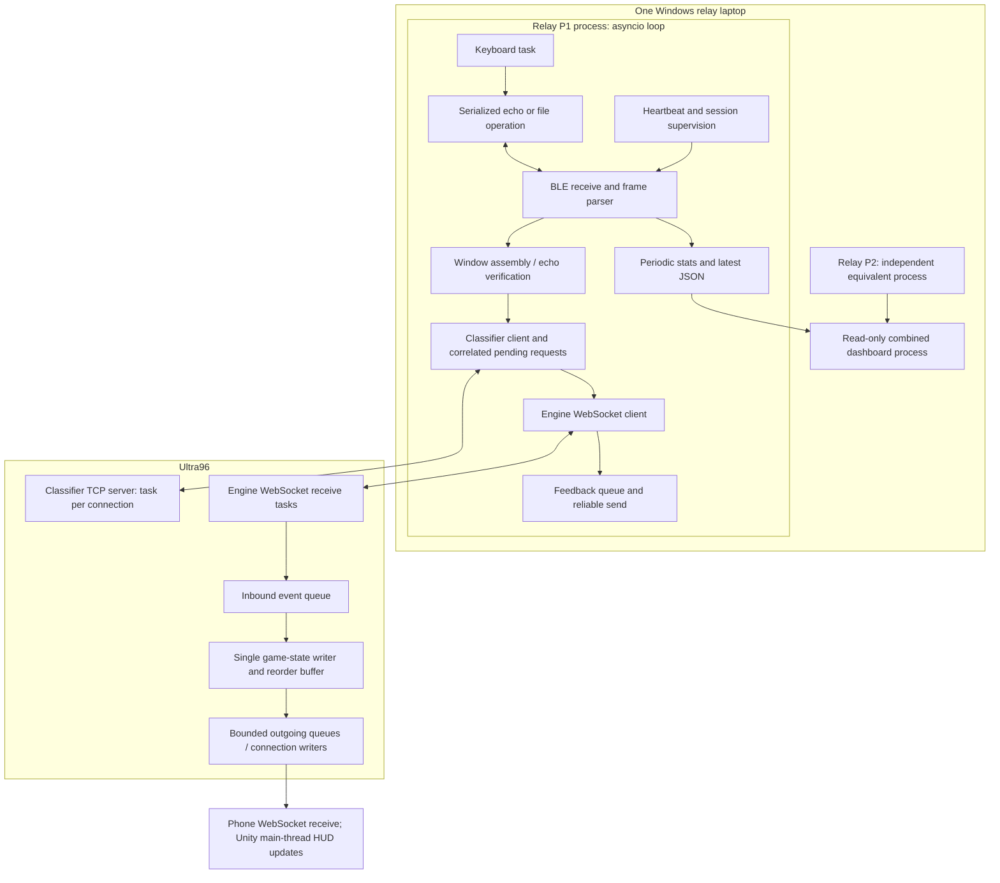

# Communications assessment: reviewed implementation and operator runbook

Reviewed 2026-09-23 against the implementation at `fd63e23` and the professor's supplied requirements.
Use this document for the **implemented commands**. The earlier implementation plan remains a design
record; some proposed commands there were never implemented.

The review includes local fixes, Python integration tests and ESP32 firmware compilation. It does
**not** certify physical BLE operation, measured maximum speed, Ultra96 deployment, Android builds,
power-reset recovery or out-of-range recovery. Those are the rehearsals below. Review fixes are delivered in a follow-up commit after
`fd63e23`; pull the latest `main`, not that earlier commit alone.

## 1. Review verdict and changes

The original implementation provided a useful assessment mode, but its success messages and tests
did not establish every claimed property. These issues were corrected:

| Finding | Reviewed behavior |
|---|---|
| Keyboard payload held only three generic numbers; classifier input duplicated them without IMU unit conversion | Request/response now carry the exact 42-byte sensor body inside an assessment envelope. Board transforms dominant acceleration. Relay forwards the returned sample using the normal g/deg/s scaling. |
| An ACK could arrive while the echo response was lost | Relay retries the identical request; board returns its cached response without applying the transform twice. Late/expired responses cannot create an action. |
| Trace stopped before the phone | Optional `demoTraceId` travels through SENSOR_WINDOW, ACTION_RESULT, ACTION and ACTION_RECOGNIZED. The active Unity HUD displays it. |
| File evidence was a running CRC and a hash of the source | Board now stores up to 4096 bytes in RAM; relay reads those actual bytes back, compares bytes and SHA-256, and saves the returned file. |
| Old file replies could be mistaken for current replies | Every file request/reply carries a fresh transfer ID plus chunk index. |
| Session shutdown could leave assessment work in progress | Session owns/cancels assessment operations; echo/file work is serialized and bounded. |
| Sequence gaps were easy to present as exact sensor loss | Dashboard labels them as gaps across all packet types; bounded reports record simultaneous coverage and per-player receiver goodput. |
| Global `PLATFORMIO_BUILD_FLAGS` override risked discarding inherited flags/P2 identity | Dedicated 100/200 Hz build environments retain normal includes and player identities. |
| No simple live retransmission demonstration | Uppercase `L`, then `F`, intentionally ignores one upload ACK locally, forcing an observable retry. |
| TCP peer could accept an unterminated final JSON record at EOF | Both classifier endpoints require a terminating newline; partial records are not accepted as complete messages. |
| `.env` player ID string could fail settings validation | String `"1"`/`"2"` is normalized before the existing player-ID validation. |

Normal combat rules, classifier timeout, guard grace, reorder hold, endpoints and credentials were
not changed. Existing Unity scene/render/settings edits were preserved. Normal application JSON
omits the new optional trace field when it is unused.

**Compatibility:** the assessment binary payloads changed together on Python and firmware. Flash
both boards and update all Python runtime machines as a set. Base protocol version remains 1;
the demo firmware now reports firmware version 2. Do not mix the old assessment firmware with the
reviewed relay. The largest new frame is 76 bytes; hardware must support the negotiated BLE capacity.

**Important scope:** keyboard assessment sends one returned sample per hand in a valid SENSOR_WINDOW
to the random classifier simulator. It is a communications demonstration, not a real 40-sample AI
inference capture. Normal GPIO-triggered capture is unchanged. The 120 ms classifier deadline starts
when submitting a completed window, not when sensor capture starts.

## 2. Requirement coverage and remaining physical evidence

| Professor's item | What to show | Where |
|---|---|---|
| Laptop ↔ Ultra96, real-format dummy data | Same trace/request across relay and classifier logs; typed JSON over newline-framed TCP | Pipeline below; live + video |
| Ultra96 ↔ phone | Matching ACTION_RECOGNIZED trace on phone; phone POSITION feed arriving at engine | Pipeline; live + video |
| FireBeetle setup | Board model, GPIO wiring, BLE name/address, build target, flash and separate power | Video |
| Device IDs, types, packet format | P1/P2, header diagram, decoded sample with sequence, sensor values and CRC | Live + video |
| Two simultaneous FireBeetles | Both physical devices stream to two relay processes on **one laptop** | Live |
| >1 minute dummy sensors and kbps | Save a 75-second paired trial with >60 seconds common coverage | Live |
| Maximize speed | Compare normal/100/200 Hz receiver rates; select highest stable measured rate | Rehearsal + live selected rate |
| File verification | Source file → board RAM → returned file; equal SHA-256 | Live; also useful in video |
| Reliability | Deliberate one-ACK loss, power reset, and actual out-of-range test while other board continues | Live |
| Full keyboard pipeline | Lowercase key → random sensor packet → board modification → Ultra96 random valid event → phone | Live |
| Change dummy data | Edit `assess_dummy.py`, restart that relay, observe new input and correct transformed return | Live rehearsal |
| Encryption walkthrough | BLE application AES-GCM, classifier SSH route, engine WSS, phone SSH/TLS/local bridge | Video |
| Concurrency and FSMs | Diagrams and actual code anchors in section 10 | Video |

**Hardware gap remains:** your current `esp32dev_p2` target is a generic ESP32 DevKit stand-in, not a
second FireBeetle. Software compatibility does not satisfy a literal requirement for two FireBeetles.
Use the correct physical boards for assessment, or obtain the professor's acceptance of the stand-in.
If replacing P2 with a FireBeetle, add a FireBeetle P2 environment retaining the two P2 identity flags;
do not flash a board with an unrelated board target merely to rename it.

## 3. Prepare and deploy once

### 3.1 Put the reviewed source on the runtime machines

On the relay laptop and Ultra96, from the existing repository root, run `git pull --ff-only origin main`
while on `main`. If Git reports local changes or divergence, preserve those changes before resolving it;
do not reset them away. Preserve the working
BLE addresses, `.env` files, PSK, certificates and machine-local YAML configurations. Do not print
those secrets in the recording.

Existing editable Python installs see the updated source. The module-form commands below avoid
depending on newly generated `.exe` entry points or accessing PyPI. If installation is actually
needed, from `comms/` use the existing interpreter and installed build dependencies:

```powershell
.\.venv\Scripts\python.exe -m pip install --no-deps --no-build-isolation -e .
```

Ultra96 equivalent: `.venv/bin/python -m pip install --no-deps --no-build-isolation -e .`.
This assumes dependencies/build tooling are already installed; it does not provision a new machine.

Keep **both relay processes on the same laptop** for the two-board assessment. A second laptop may
be a deployment/helper machine, but splitting the relays across laptops does not show the requested
concurrent two-board load on one laptop.

### 3.2 Flash the normal 50 Hz firmware

Only preparation uses USB on the relay laptop. Close serial monitors before uploading. COM numbers
below are your existing ones; confirm with `device list` if Windows reassigns them.

```powershell
cd C:\Users\T0332075\Desktop\CG4002
& ".\pio-venv\Scripts\pio.exe" device list
cd firmware_demo
& "..\pio-venv\Scripts\pio.exe" run -e firebeetle32 -t upload --upload-port COM8
& "..\pio-venv\Scripts\pio.exe" run -e esp32dev_p2 -t upload --upload-port COM7
```

For the actual demonstration, disconnect both boards' USB connections from the relay laptop. Use
two independent power banks or permitted separate power sources, verified not to switch off at low
current. One board must be movable out of range while the other remains powered beside the laptop.

### 3.3 Rebuild the phone apps for trace display

Open the existing active project at
`visualizer_demo/CG4002VisualizerDemo_UnityTemp/My project`.
Rebuild/install the P1 and P2 Android apps with their respective EngineClient PlayerId. Keep your
existing phone host `127.0.0.1`, port `8080`, `UseTls=false`, bearer configuration and scene setup.
Preserve Player1Avatar yaw 90 and Player2Avatar yaw 270 if demonstrating directional guard.

The C# change adds the assessment trace to the existing recognized-action HUD. An old APK may still
show actions but will not provide this final trace evidence. No APK was built or installed in this review.

## 4. Startup: your usual terminals with the assessment changes

### A. Ultra96: login, then two service terminals

```powershell
ssh -J e1138443@stujump.comp.nus.edu.sg xilinx@makerslab-fpga-53.ddns.comp.nus.edu.sg
```

In each Ultra96 terminal, change to **the existing repository's `comms/` directory**. Terminal A1:

```bash
.venv/bin/cg-engine --config configs/engine.yaml
```

Terminal A2:

```bash
.venv/bin/python -m cg_comms.mock.ultra96_sim --port 8888 --random --seed 7
```

`--random` replaces `--trigger-map`; do not supply both. Seed 7 makes the event sequence reproducible;
omit the seed for a fresh logged seed. Random events are restricted to valid moves for the selected
weapon, including guard. This is the required dummy AI service, not a claim of trained-model inference.

### B. Relay laptop: keep the existing SSH tunnel running

```powershell
ssh -J e1138443@stujump.comp.nus.edu.sg -L 127.0.0.1:8888:127.0.0.1:8888 -L 127.0.0.1:8443:127.0.0.1:8443 xilinx@makerslab-fpga-53.ddns.comp.nus.edu.sg -N
```

The TCP and WebSocket application servers run on Ultra96. These loopback forwards are clients of
that deployment, not a laptop-hosted broker. The professor's direct-TCP option is usable if the
network permits it, but do not remove your working jump-host route during the assessment.

### C. Each phone: existing two Termux terminals, then launch Unity

Phone terminal C1:

```bash
ssh -J e1138443@stujump.comp.nus.edu.sg -L 127.0.0.1:8443:127.0.0.1:8443 xilinx@makerslab-fpga-53.ddns.comp.nus.edu.sg -N
```

Phone terminal C2:

```bash
socat TCP-LISTEN:8080,reuseaddr,fork OPENSSL:127.0.0.1:8443,verify=0
```

Launch the correct P1/P2 app and confirm connection. Keep both terminals alive. This preserves the
working setup: local Unity→socat is plaintext loopback; socat opens TLS through the SSH forward.
`verify=0` disables socat's TLS certificate verification. Say this accurately in the security walkthrough;
do not describe it as certificate-verified end-to-end TLS from Unity. SSH host-key verification remains
a separate property of the existing SSH connection.

### D. Relay laptop: two separate PowerShell windows

P1 window:

```powershell
cd C:\Users\T0332075\Desktop\CG4002\comms
.\.venv\Scripts\python.exe -m cg_comms.relay.app --config configs\relay.p1.yaml --no-tunnel --assessment --assess-seed 11 --console-level INFO
```

P2 window:

```powershell
cd C:\Users\T0332075\Desktop\CG4002\comms
.\.venv\Scripts\python.exe -m cg_comms.relay.app --config configs\relay.p2.yaml --no-tunnel --assessment --assess-seed 22 --console-level INFO
```

If your working BLE addresses are in `logs/relay.p1.local.yaml` / `logs/relay.p2.local.yaml`, substitute
those exact paths. Keep the usual `.exe` command if preferred; it accepts the same flags.

Wait for both `session_streaming`, `classifier_connected` and `engine_connected`. Select SWORD on
both boards using GPIO4 (cycle until SWORD is confirmed), or use your configured RFID input. Until
weapon confirmation, keyboard actions are rejected with `NO_WEAPON`.

The keyboard reader requires a real Windows console. Do not pipe relay stdin or run the interactive
relay in a terminal without keyboard support. Click the intended relay window before typing.

### E. Relay laptop: the combined dashboard

```powershell
cd C:\Users\T0332075\Desktop\CG4002\comms
.\.venv\Scripts\python.exe -m cg_comms.relay.throughput
```

Expect P1 cyan, P2 magenta and `both boards live`. `INCOMPLETE` means at least one record is missing,
stale or final; an old log file cannot establish a live second connection. If configs use a different
logs directory, pass that common directory with `--logs-dir`. Monotonic timestamps are comparable
here because both relays and the dashboard run on one laptop.

## 5. Show the complete pipeline

If the game has ended, reset on Ultra96 from `comms/`, then wait two seconds for phone positions:

```bash
.venv/bin/python -m cg_comms.tools.reset_match --config configs/engine.yaml --host localhost
```

Use your existing certificate hostname if it differs from localhost. Reset does not select a board's
weapon for you; confirm both relays still report a real weapon.

1. Put the phone beside the corresponding relay window. On that relay, press lowercase `a` once.
2. Find `assess_echo_sent`: it shows random variant, original values, expected transform and a
   `demo_trace_id` such as `P1-<session>-<trace>`. This is a real encrypted BLE request to the board.
3. Find `assess_echo_verified`: actual returned values must equal the independently calculated
   expected values. A successful transport ACK alone is insufficient.
4. Find `assess_pipeline_forward`: the returned accelerometer/gyro values are converted to normal
   classifier units and submitted with a request ID and the same demo trace.
5. On Ultra96, `ultra96_sim_classified` shows that trace, received `dominant_first` sample and the
   random valid classification. Relay `action_classified` reports the correlated reply.
6. The engine sends ACTION_RECOGNIZED. On the phone, read the action/guard label and its `[P1-...]`
   trace. This closes the demonstrated chain; relay verification alone does not prove phone delivery.
7. Repeat with lowercase `b` and `c`, then repeat in the P2 relay. Wait for each operation to finish.
   Random guard events can leave HP unchanged; recognition plus matching trace is the pipeline proof.

```mermaid
sequenceDiagram
    participant K as Keyboard on relay laptop
    participant R as Relay P1 or P2
    participant B as Physical board
    participant U as Ultra96 classifier simulator
    participant E as Ultra96 engine
    participant V as Phone Unity
    K->>R: lowercase key; choose random variant
    R->>B: ECHO_REQ(trace, key, real sensor body), AES-GCM
    B->>B: transform dominant acceleration; retain other axes
    B-->>R: ECHO_RESP + transport ACK
    R->>R: verify transform and scale returned sample
    R->>U: newline-framed SENSOR_WINDOW + demoTraceId
    U-->>R: random valid ACTION_RESULT + demoTraceId
    R->>E: ACTION + demoTraceId over WSS
    E-->>V: ACTION_RECOGNIZED + demoTraceId
    V->>V: show recognized action and trace
    V-->>E: normal POSITION messages independently
```

| Key in a relay window | Implemented action |
|---|---|
| Lowercase letters, digits, space | One random-dummy full pipeline operation |
| Uppercase `F` | Upload, read back and verify the configured file |
| Uppercase `L`, then `F` | Ignore exactly one upload ACK locally and demonstrate recovery |
| Uppercase `D` | Toggle sampled decoded packets on that relay's console |
| Uppercase `Q` | Stop keyboard control; relay streaming continues |
| Ctrl+C | Stop that relay |

Keys are not queued. `BUSY`, `OFFLINE`, `NO_WEAPON` or `UPSTREAM_OFFLINE` is a rejected request,
not a successful demo event. There is no implemented `B` benchmark key, hot-reload key or global
keyboard controller. File transfer occupies the assessment operation until completion.

### Change the dummy data when asked

Open `comms/src/cg_comms/relay/assess_dummy.py`. Change, for example, the `primes` tuple from
`(7, 13, 31)` to `(17, 23, 47)`. Keep three integers in -32768..32767 and unique one-byte variant IDs.
Stop/restart that relay with the same command; no firmware reflash is needed for value changes.
Press several keys until the changed randomly selected variant appears. Show its new input and
correct returned transform. Editing the table affects the next process start, not an already-running
relay. Record the change and seed. Changing the transform formula itself requires coordinated Python
and firmware edits/reflash, so use value edits for the requested live variation.

## 6. Demonstrate a real file round trip

From relay-laptop `comms/`, create a visible copy of the default source:

```powershell
.\.venv\Scripts\python.exe -m cg_comms.tools.assessment_fixture --output logs\assessment\input.bin
Get-FileHash -Algorithm SHA256 -LiteralPath logs\assessment\input.bin
```

Default file: 1037 bytes, 33 chunks (32 full chunks plus a 13-byte final chunk).
SHA-256: `1ab796c7ec1d4700fac503e7394b2707f7377d8de931a2ac5e19061f941a8ba6`.
CRC16/CCITT-FALSE: `0x05D6`.

Press uppercase `F` in P1. Expect `assess_file_verified`, then `assess_file_saved` with the path to
`logs/assessment/received-p1-<session>-<time>.bin`. Compare that **specific newly saved file**:

```powershell
Get-FileHash -Algorithm SHA256 -LiteralPath logs\assessment\input.bin
Get-FileHash -Algorithm SHA256 -LiteralPath 'logs\assessment\received-p1-REPLACE-WITH-LOGGED-NAME.bin'
```

The second command is a placeholder: paste the actual path reported by `assess_file_saved`.
Show equal hashes and lengths. Repeat on P2. The board stores the file in RAM, not persistent flash;
power loss clears it. The board computes running CRC; the relay computes SHA-256 of the returned
bytes. Do not claim the board calculates SHA-256.

For a different real file, restart the selected relay with `--assess-file path\to\file.bin` added.
Allowed size is 1..4096 bytes. Empty/oversized files fail startup validation. The displayed source
hash then changes; do not compare it against the built-in fixture hash.

Press `L`, then `F`. Show `assess_fault_armed`, `assess_fault_consumed`, a reliable retry, and the
same successful returned-file verification. Explain that this is deliberate software ACK loss,
not evidence of a naturally occurring radio fault. An upload ACK/reply retry must not append a chunk
twice. File failure or a missing saved file must be investigated, not counted as a pass.

## 7. Two-board robustness and maximum-speed measurement

### 7.1 Record a normal-rate baseline

Keep both relays running with `--assessment`, with boards separately powered. Leave the GPIO action
buttons and keyboard alone during the timed measurement. In the dashboard terminal:

```powershell
.\.venv\Scripts\python.exe -m cg_comms.relay.throughput --duration-s 75 --output logs\assessment\rate50.json
```

The extra time allows the default five-second reporting cadence to provide more than one minute of
common coverage. Inspect `over_60_seconds_both`, `errors`, `common_coverage_s` and each player's
measured duration/rates in the saved report. A reconnect, a long reporting gap, no sensor frames or
missing second player invalidates the continuous paired trial; repeat after correcting it.

Measured quantities:

- **Sensor goodput:** unique valid sensor frames × 42 bytes × 8 / elapsed seconds / 1000.
- **Sensor frame rate in kbps:** the same frames × 68 wire bytes × 8 / seconds / 1000.
- **Transport receive rate:** bytes delivered to the laptop BLE callback, including other traffic.
- **Sequence gaps:** missing allocations across all packet types within the observed sequence span.
  These include local notify refusal, rejected/corrupt frames and radio loss; they are not an exact
  sensor-only loss percentage, and cannot see missing traffic beyond the observed endpoints.

The dashboard's instantaneous total sums recent per-player intervals, which are not synchronized.
The saved report lists each player's actual cumulative measurement window and their common coverage.
These are application-layer receive measurements, not a measurement of the BLE PHY bitrate.

At a perfect 50 Hz, the arithmetic reference is 16.8 kbps sensor goodput / 27.2 kbps sensor-frame bytes
per board, or 33.6 / 54.4 combined. These are reference calculations, **not observed results**.

### 7.2 Compare dedicated faster firmware environments

Stop relays before reflashing. During preparation only, reconnect USB, then from `firmware_demo/`:

```powershell
& "..\pio-venv\Scripts\pio.exe" run -e firebeetle32_bench100 -t upload --upload-port COM8
& "..\pio-venv\Scripts\pio.exe" run -e esp32dev_p2_bench100 -t upload --upload-port COM7
```

Return to separate power, restart both assessment relays, wait for both connections, and record from
`comms/`:

```powershell
.\.venv\Scripts\python.exe -m cg_comms.relay.throughput --duration-s 75 --output logs\assessment\rate100.json
```

Repeat using `firebeetle32_bench200` and `esp32dev_p2_bench200`, recording `rate200.json`.
Do **not** set a global `PLATFORMIO_BUILD_FLAGS` override; these environments preserve P2 identity.
Do not press GPIO gesture buttons at these rates: normal gesture-window assumptions remain 50 Hz.

| Requested rate | P1 goodput | P2 goodput | Common coverage | Gaps/rejections/reconnects | Decision |
|---|---|---|---|---|---|
| 50 Hz | Measure | Measure | Measure | Record | Baseline |
| 100 Hz | Measure | Measure | Measure | Record | Compare |
| 200 Hz | Measure | Measure | Measure | Record | Compare |

Select the fastest stable measured setting, not the highest requested setting. Repeat the selected
rate with both boards for the live >1-minute trial. If 200 Hz still improves measured goodput without
instability, these trials have not established the maximum: extend the build-rate experiment during
rehearsal and compare negotiated BLE connection parameters, notification capacity, logging cost and
receiver CPU. Do not claim theoretical maximum or secretly measure only one board.

After the speed segment, **reflash both normal environments** from section 3.2 before returning to
the usual GPIO gameplay demo. Keep the working classifier/engine timeout and match timing unchanged.

## 8. Physical reliability demonstrations

Run these separately from the uninterrupted timed throughput trial. Keep the dashboard visible.

**Power reset:** while both streams are live, remove only P1's external power. Show P1 becoming
offline/stale and its attempted keyboard action being rejected; P2's rate must remain live. Restore
P1 power. Wait for reconnect, a fresh handshake/session and streaming. Confirm/select weapon again,
then send a new key and match its phone trace. Start a new file transfer if the old one was interrupted;
there is no file resume across reset. Save before/during/after logs.

**Out of range:** keep P2 and its independent power source near the laptop. Walk P1 away until the
link actually fails. Show detection and P2 continuing. Return P1, wait for automatic reconnect,
reconfirm weapon, then show a new successful trace and file transfer. Merely walking a few metres
without a disconnect does not demonstrate recovery; record the real loss and recovery times.

Neither unplugging a relay-laptop USB cable nor stopping the relay process substitutes for these
two physical tests. Do not deliberately disconnect both boards together: that hides whether their
sessions are independent. If an operation is cancelled or fails during loss, report failure accurately;
the successful retry after reconnection is a new operation.

## 9. Suggested live order and evidence bundle

1. **1 minute:** show topology, independent power, board identities and both live relay connections.
2. **2 minutes:** explain the binary header and show `D` decoded sensor samples from P1 and P2;
   toggle `D` off afterward to keep output readable.
3. **3 minutes:** show complete keyboard pipeline with matching phone traces on both players;
   change one dummy variant and restart that relay when asked.
4. **2 minutes:** transfer/read back the fixture, compare hashes; repeat with `L` then `F`.
5. **2 minutes:** selected maximum stable two-board throughput run, 75 seconds, save report.
6. **3–5 minutes:** power reset and actual out-of-range recovery, with the other board still streaming.
7. **Optional:** restore normal 50 Hz firmware and trigger-map classifier for the previous combat demo.

Prepare the speed comparison before assessment rather than spending the live slot compiling several
firmware variants. The complete pipeline can replace separate channel demonstrations under the
professor's stated exemption; it does not replace concurrent two-board maximum-speed evidence.

Save a dated evidence folder containing relay P1/P2 JSONL, classifier and engine JSONL, the bounded
throughput reports, source/returned files and hashes, screenshots/video of matching phone traces,
board/build identities, seeds, and a short outcome sheet. Copy relevant logs after stopping services
cleanly, or preserve their original timestamped files. Avoid overwriting a previous failed trial with
a successful run of the same report name. Redact credentials before sharing or recording.

## 10. Video script: protocol, encryption, concurrency and FSMs

Use readable slides with short source extracts, then show the running hardware. This is a suggested
10–15 minute sequence, not a claimed course time limit.

| Segment | Narration and concrete evidence |
|---|---|
| Setup, 1–2 min | Physical board models, IDs, BLE names/addresses, buttons, correct P1/P2 build flags, flashing, independent power. State that IMU values are dummy data in the actual sensor layout. |
| Protocol, 2 min | Show header, sensor body, AES tag, CRC, endian order; types and reliable versus best-effort delivery. Show decoded packet examples rather than walls of hex. |
| FSM/reliability, 2 min | Fresh handshake, time sync, streaming, heartbeat failure, reconnect; ACK/retry and duplicate suppression; interrupted transfer starts anew. |
| Pipeline, 2–3 min | Show key, sent/returned values, Ultra96 random event and phone trace. Explain TCP newline framing and WebSocket message handling. |
| Encryption, 2–3 min | Walk each deployed channel in the table below, including where encryption terminates and which authentication checks actually run. |
| Concurrency, 2–3 min | Use the task diagram and source anchors. Explain queues, backpressure, single-writer state and per-device isolation. |

### Wire-format slide

```text
magic(1) | version(1) | type(1) | seq(2 LE) | player_id(1) | len(2 LE)
         | ciphertext(len - 16) | GCM tag(16) | CRC16(2 LE)

SENSOR_FRAME plaintext (42 bytes):
deviceTimestampMs(4) | flags(1) | weaponId(1)
| dominant(ax,ay,az,gx,gy,gz: 12)
| offhand(ax,ay,az,gx,gy,gz: 12)
| torso(ax,ay,az,gx,gy,gz: 12)
```

All axes are signed int16. Normal sensor frame: 42 plaintext + 26 framing/authentication = 68 bytes.
Header `len` includes ciphertext **and** the 16-byte tag; the packet view calls it `len_ct_plus_tag`.
BLE address identifies the peripheral; player ID associates it with the game. They are different fields.
The assessment envelope adds trace/key/variant data around the same sensor layout (74-byte request,
76-byte response). File chunks have transfer ID, chunk index, length, bounded bytes and running CRC
acknowledgments; readback returns the actual stored bytes.

### Connection and operation FSMs

```mermaid
stateDiagram-v2
    [*] --> DiscoverConnect
    DiscoverConnect --> Handshake: BLE available
    Handshake --> TimeSync: HELLO / HELLO_ACK; fresh session
    TimeSync --> Streaming: bounded sync succeeds
    Handshake --> Backoff: timeout or invalid exchange
    TimeSync --> Backoff: timeout
    Streaming --> Backoff: disconnect or heartbeat failure
    Backoff --> DiscoverConnect: reconnect delay
    Streaming --> Streaming: sensor / heartbeat / reliable control
```

```mermaid
stateDiagram-v2
    [*] --> Idle
    Idle --> Request: accepted key or F
    Request --> AwaitReply: send reliable request
    AwaitReply --> Request: bounded retry; identical request
    AwaitReply --> Verify: matching authenticated reply
    Verify --> NextStage: correct transform or chunk/readback
    NextStage --> Idle: pipeline submitted or full file verified
    Request --> Failed: exhausted ACK attempts or disconnect
    AwaitReply --> Failed: response deadline
    Verify --> Failed: invalid content
    Failed --> Idle: report; new user operation required
```





Late duplicates do not create a second action or append the same file chunk twice. Sensor frames are
best-effort; reliable control and file operations use ACK/retry. Do not claim every IMU frame is resent.

### Encryption walkthrough by channel

| Channel | What actually provides protection | Source to show |
|---|---|---|
| Board ↔ relay BLE | Application AES-128-GCM; header authenticated as AAD; 16-byte tag; nonce includes session, player, direction and extended sequence. CRC is a corruption precheck, not encryption. | `comms/src/cg_comms/protocol/crypto.py`, `codec.py`; `firmware_demo/lib/cg_protocol/cg_crypto.cpp`, `cg_frame.cpp`; `shared/protocol/wire_protocol.md` |
| Relay ↔ classifier | Newline-delimited JSON TCP inside your SSH forwarded route. The classifier's raw TCP application protocol has no separate AES/TLS layer. | `relay/ultra96.py`, `mock/ultra96_sim.py`, actual SSH command |
| Relay ↔ engine | WebSocket JSON over configured TLS, additionally carried through the existing SSH route | `relay/engine_link.py`, `engine/ws_server.py`, sanitized TLS config |
| Engine ↔ phone | Engine TLS connection from socat through SSH; local Unity↔socat loopback uses plaintext WebSocket. Current `verify=0` caveat applies. | `engine/ws_server.py`; active Unity `Assets/Scripts/Net/EngineClient.cs`; Termux commands |

Show code responsible for encryption, decryption, tag rejection, nonce construction and exact-byte
retries. Do not show the PSK, private keys, bearer tokens or credential files. The previously reported
PSK-in-history concern is not fixed by this review; coordinate key replacement on all peers if you
choose to rotate it. A code walkthrough cannot certify deployment secrets were rotated.

For TCP fragmentation, point to `readline()` buffering until newline on both classifier endpoints;
multiple or partial socket reads do not define application messages. An EOF without newline is rejected.
For the engine, the WebSocket library performs transport framing/reassembly before typed JSON parsing.
BLE frame accumulation and length/CRC checks are separate from TCP stream handling.

### Concurrency diagram and code anchors



Walk `relay/app.py` (process lifecycle and keyboard), `relay/session.py` (read/stats/feedback tasks,
operation lock, teardown), `relay/ultra96.py` (request correlation/deadline), `relay/reliability.py`
(ACK futures/retries), `mock/ultra96_sim.py` (per-connection handler), `engine/app.py`,
`engine/game_state_task.py` (one ordered state writer), and `engine/ws_server.py` (per-connection queues).
On firmware, show `main.cpp` BLE callback-to-main-loop handoff and continuous sensor scheduling.

Describe these as **async tasks**, not one Python OS thread per packet. Separate relay processes
isolate devices. A single state writer prevents concurrent game-state mutation; it still depends on
timely queued inputs. The engine's reorder buffer and classifier deadlines are distinct mechanisms.
Do not claim asynchronous code cannot stall: synchronous logging/work can delay the event loop.

## 11. Troubleshooting and return to the previous demo

| Symptom | First checks |
|---|---|
| No keyboard events | Correct focused Windows console; `--assessment`; `assess_keyboard_ready`; no piped stdin; uppercase/lowercase distinction |
| `NO_WEAPON` | Confirm GPIO4/RFID selection after startup or reconnect |
| `UPSTREAM_OFFLINE` | Laptop SSH terminal, Ultra96 classifier/engine, relay connection logs |
| `BUSY` | Wait for current echo/file completion; keys are deliberately not queued |
| Echo mismatch/size errors | Both boards flashed with reviewed firmware and all Python source updated; do not mix assessment revisions |
| Echo verified but no phone event | Follow trace through classifier result, relay ACTION, engine drop/end-of-match logs and phone connection; reset match if needed |
| Phone action appears without trace | Rebuild the active Unity project APK with the reviewed two C# changes |
| `INCOMPLETE` or invalid 75-second report | Both relays on this laptop, same logs directory, live sessions, no reset during measurement; inspect report errors |
| File fails | Matching transfer revision, live BLE, <=4096 bytes, packet/retry logs; use saved returned file only after verification |
| Faster firmware suppresses GPIO windows | Restore normal 50 Hz firmware before gameplay; do not loosen normal capture gates |
| Phone cannot connect | Both Termux commands still running, correct PlayerId, 8080/UseTls=false, no duplicate app occupying player path |

To return to your previous deterministic combat demo: restore normal firmware on both boards, stop
the random classifier, restart it with your original `--trigger-map configs/scenarios/demo_trigger_map.yaml`,
and restart the relays without `--assessment`. Keep the existing engine/tunnels/phone configuration.
Reset the match and use [GUARD_LATENCY_FOLLOWUP.md](GUARD_LATENCY_FOLLOWUP.md) for combat-specific checks.

## 12. Verification performed in this review

- Full Python suite: **343 passed**, two existing WebSocket deprecation warnings.
- Local integration exercises simulated BLE board exchange → actual localhost classifier TCP →
  engine WebSocket → visualizer WebSocket receipt with a matching trace. This does not run Android.
- Regression tests cover reply loss, expired echoes, session cancellation, transfer-ID filtering,
  deliberate ACK loss, actual returned file bytes, corrupted readback, incomplete TCP records,
  sensor-layout/unit conversion and paired-run evidence validation.
- Both normal firmware targets and the four 100/200 Hz benchmark targets compile successfully.
  Compilation does not execute the real board handlers or establish RF performance.
- Ruff correctness checks across `src/tests` pass; focused full Ruff checks on reviewed assessment
  modules/new tests pass. The configured mypy run still reports **61 errors in 14 files**, matching
  the previously documented count; this is not a clean type-check result.
- The original nine golden protocol vectors remain unchanged; assessment vectors were updated and
  extended for the revised contract. Python firmware-semantic mirrors are not native C++ runtime tests.
- No board flash, Ultra96 deployment, phone build/install, hardware retest, push or commit was
  performed by this review. Complete sections 3–8 before claiming assessment readiness.
