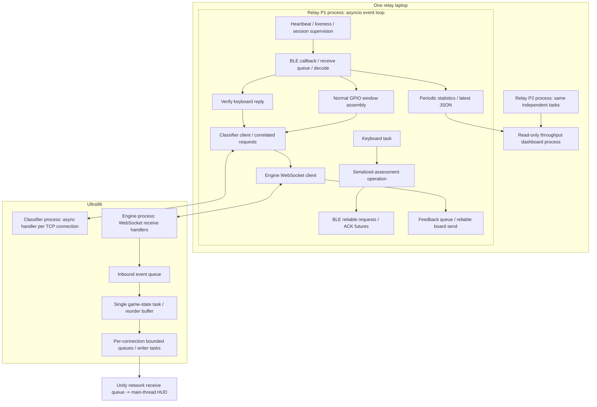

# Communications assessment: speed trials, live demonstration and video script

Prepared 2026-09-28 against the deterministic keyboard implementation `d11c7b2`.
This is an operator/presentation guide, not evidence that new hardware tests have been executed.
Use [DETERMINISTIC_KEYBOARD_DEMO.md](DETERMINISTIC_KEYBOARD_DEMO.md) for deployment and keyboard details.

## 1. The current position and the agreed exception

Your supplied physical-test write-up is the baseline: both devices streamed at approximately 50 Hz;
the paired 75-second test recorded 74.779 seconds of common coverage; the earlier keyboard pipeline,
packet inspection, file RAM round trip, controlled ACK loss and individual component restarts worked.
The deterministic keyboard revision still needs its physical regression. Actual out-of-range loss
and simultaneous 100/200 Hz trials have not been established by that baseline.

We follow your updated instructions for the keyboard demonstration:

- `a` cycles the existing board weapon selection.
- `b/c/d` select fixed editable B/C/D IMU values, with board identity return.
- `--assessment-deterministic` makes keyboard classification a reproducible function of received
  IMU content and weapon. Ordinary GPIO requests use the existing trigger map.
- Random dummy choice, modifying arithmetic and random classifier actions are not requirements
  for this revised presentation. Describe this as the agreed deterministic demonstration.

Do not extend that exception to other rubric items. In particular, the instructions still request
**live concurrent two-device streaming for over a minute, live kbps, maximum-speed evidence,
power-reset recovery and an actual out-of-range demonstration**.

Two corrections to the pasted AI presentation advice:

1. A previously saved 75-second result is good supporting evidence. It does not replace the
   professor's explicitly live over-one-minute streaming demonstration unless separately waived.
2. Demonstrating one restart does not replace the separate out-of-range test. Both are live items.

## 2. What 50 Hz and kbps mean

The normal firmware targets use `CG_DEMO_SENSOR_FRAME_INTERVAL_MS=20`:

```text
1000 milliseconds / 20 milliseconds = 50 requested SENSOR_FRAMEs per second per board
```

The already-created benchmark environments use 10 ms (100 Hz) and 5 ms (200 Hz). These change
firmware sensor-frame generation pacing. They do not set the BLE PHY bitrate, change UART baud,
increase classifier requests to that frequency, or remove the 500/650 ms assessment timing budgets.
The receiver's measured rate can be below the requested rate.

One normal frame contains 42 bytes of sensor payload and 26 bytes of header/tag/CRC overhead:

```text
sensor goodput kbps = valid unique received sensor frames / seconds * 42 * 8 / 1000
sensor-frame kbps   = valid unique received sensor frames / seconds * 68 * 8 / 1000
```

These are application receive rates. They exclude BLE radio/ATT/link-layer overhead. Serial monitor
115200 baud is a separate debug connection and is not the BLE transmission rate.

| Requested rate, EACH board | Interval | Per-board goodput | Per-board frame rate | BOTH goodput | BOTH frame rate |
|---|---|---|---|---|---|
| 50 Hz | 20 ms | 16.8 kbps | 27.2 kbps | 33.6 kbps | 54.4 kbps |
| 100 Hz | 10 ms | 33.6 kbps | 54.4 kbps | 67.2 kbps | 108.8 kbps |
| 200 Hz | 5 ms | 67.2 kbps | 108.8 kbps | 134.4 kbps | 217.6 kbps |

**The 100/200 Hz rows are arithmetic references, not measured results.** Your earlier hardware
write-up supports the approximate 50 Hz row. Two 50 Hz boards make approximately 100 frames/s
combined, not 100 Hz per board.

## 3. Rehearsal: establish the fastest stable measured setting

### 3.1 Keep the comparison controlled

1. Deploy the reviewed code and first confirm the new a/b/c/d path at normal 50 Hz.
2. Run both relays on **one laptop**, using the same adapter, positions and power arrangement.
3. Keep both boards independently powered during measurement. Close serial monitors before uploads.
4. Keep the engine/classifier/tunnels/phones running in the usual arrangement for comparable trials.
   The BLE-only throughput measurement itself does not require inference or an active game.
5. During each timed trial, leave action keys, physical action buttons and file transfers alone.
   Toggle uppercase `D` off. Keep the normal summary logs and dashboard visible.
6. Change only the firmware benchmark environment. Do not change relay windowing, sensor scaling,
   cryptography, packet layout, timeout profiles or guard/reorder rules to make a trial pass.

The no-action condition is deliberate: this is an isolated two-board stream measurement. Afterwards,
you can separately rehearse combined keyboard/file traffic at the chosen rate.

### 3.2 Optional fresh 50 Hz reference on the new revision

Your old 50 Hz baseline is already completed. A new measurement is useful for comparing the updated
firmware under the same conditions; it does not erase the old evidence.

From the relay laptop's repository `firmware_demo/`:

```powershell
& "..\pio-venv\Scripts\pio.exe" run -e firebeetle32 -t upload --upload-port COM8
& "..\pio-venv\Scripts\pio.exe" run -e esp32dev_p2 -t upload --upload-port COM7
```

These are your existing targets and example COM ports. Confirm the actual ports and board models.
`esp32dev_p2` is a generic ESP32 target; a build target does not prove the physical device is a
FireBeetle. Label the real hardware accurately and use the target appropriate to it.

Disconnect USB from the relay laptop, return to independent power, start both assessment relays
with the commands in section 4, and wait for both `session_streaming` messages. From `comms/`:

```powershell
.\.venv\Scripts\python.exe -m cg_comms.relay.throughput --duration-s 75 --output logs\assessment\rate50-trial1.json
```

Let this finish **before** stopping the relays. Use a new trial number for every measurement.

### 3.3 Test 100 Hz on BOTH devices

Stop both relays with Ctrl+C. From `firmware_demo/`, upload the existing 100 Hz environments:

```powershell
& "..\pio-venv\Scripts\pio.exe" run -e firebeetle32_bench100 -t upload --upload-port COM8
& "..\pio-venv\Scripts\pio.exe" run -e esp32dev_p2_bench100 -t upload --upload-port COM7
```

Return to independent power, restart both relays, wait until both are streaming, then from `comms/`:

```powershell
.\.venv\Scripts\python.exe -m cg_comms.relay.throughput --duration-s 75 --output logs\assessment\rate100-trial1.json
```

Both rows should approach 100 Hz if this setup can sustain it. The combined target is approximately
200 frames/s and 67.2 kbps sensor goodput. Record the observed numbers even when below target.

### 3.4 Test 200 Hz on BOTH devices

Stop both relays again. From `firmware_demo/`:

```powershell
& "..\pio-venv\Scripts\pio.exe" run -e firebeetle32_bench200 -t upload --upload-port COM8
& "..\pio-venv\Scripts\pio.exe" run -e esp32dev_p2_bench200 -t upload --upload-port COM7
```

Return to independent power, restart both relays, then from `comms/`:

```powershell
.\.venv\Scripts\python.exe -m cg_comms.relay.throughput --duration-s 75 --output logs\assessment\rate200-trial1.json
```

The combined arithmetic target is approximately 400 frames/s and 134.4 kbps goodput.
Do not use a global `PLATFORMIO_BUILD_FLAGS` override: the dedicated environments retain the
shared includes and P2 identity flags.

### 3.5 Read the result correctly

For example, inspect the 100 Hz report without printing its entire observations array:

```powershell
$speedReport = Get-Content -Raw -LiteralPath logs\assessment\rate100-trial1.json | ConvertFrom-Json
$speedReport | Select-Object common_coverage_s, over_60_seconds_both, errors
$speedReport.players.'1'
$speedReport.players.'2'
```

Each player summary contains `sensor_frames`, `elapsed_s`, `goodput_kbps` and `frame_kbps`.
Average Hz is `sensor_frames / elapsed_s`. The dashboard displays recent per-player Hz directly.

Check ALL of these:

- `over_60_seconds_both=true` and common coverage over 60 seconds.
- `errors=[]`; both players have valid measurement windows and actual sensor frames.
- No reconnect, stale/final player or sustained receive pause during the trial.
- Per-player receive rates, not just the total. A fast P1 must not hide a starved P2.
- Sequence-gap counts, decode/authentication/CRC drops and `ble_receive_overflow` in relay logs.
  If investigating device-side backpressure, inspect `notify_dropped`/`rx_dropped` on a permitted
  separate debug host during rehearsal; do not attach measured boards to the relay laptop by USB.

`errors=[]` checks measurement continuity; it is not a blanket declaration of zero packet loss or
maximum speed. Sequence gaps cover allocations across **all** packet types, not exact sensor-only
loss. They cannot detect every missing frame outside the observed endpoints or a sample never generated.
The instantaneous total combines recent intervals; the bounded report is better comparison evidence.

| Trial | Requested Hz each | P1 actual Hz/goodput | P2 actual Hz/goodput | Common seconds | Gaps/drops/reconnects | Conclusion |
|---|---|---|---|---|---|---|
| 50 | 50 | Fill from report | Fill from report | Fill | Fill | Baseline |
| 100 | 100 | Fill from report | Fill from report | Fill | Fill | Compare |
| 200 | 200 | Fill from report | Fill from report | Fill | Fill | Compare |

Repeat promising rates under the same conditions (for example three trials per candidate), then
choose the highest repeatable receiver goodput with reliable simultaneous operation. This is an
engineering selection rule, not an invented professor-specified loss threshold.

**200 Hz is not automatically the maximum.** If it still improves goodput cleanly, testing stopped
before the ceiling. Further rehearsal can add higher-rate environments while retaining all inherited
identity flags and compare until goodput plateaus or operation becomes unstable. Those higher-rate
environments are not currently implemented; do not run invented target names. Preserve the 100/200
reports first so any next adjustment is based on evidence.

If performance falls short, first locate the limit: device generation/notify rejection, negotiated
BLE capacity/connection parameters, both links sharing one adapter, receiver queue/CPU load, or
logging overhead. The firmware already requests shorter connection intervals and avoids per-frame
serial spam. A requested connection interval is not proof of what the central negotiated. Do not
disable encryption/CRC, shrink the real packet to a plain counter, or measure one board alone and
present it as the two-board maximum.

### 3.6 Return to the normal GPIO demo

Reflash both normal targets from section 3.2 and restart the relays before using physical action
buttons. The current GPIO gesture window assumes 50 Hz; benchmark firmware can violate its span
checks. Changing the relay's expected sample rate just to hide this would change the normal demo.

Keyboard B/C/D use a separate one-sample fixture and do not depend on the continuous stream's rate.
They can be rehearsed at a faster setting, but that does not establish that GPIO gameplay or file
traffic remains stable under that faster load. Test those combinations before presenting them.

## 4. Startup for the deterministic pipeline

Use the existing working repository paths and local YAML files. Runtime relay examples previously
used `C:\Users\Qian Hui\Desktop\CG4002`; the development machine uses a different user directory.
Both relays must run on the same laptop. Pull the current source on laptop and Ultra96; a later
documentation commit may mean HEAD is newer than `d11c7b2`, which is fine.

Ultra96, from `comms/`, one process per terminal:

```bash
.venv/bin/cg-engine --config configs/engine.yaml --latency-profile assessment
```

```bash
.venv/bin/cg-ultra96-sim --port 8888 --trigger-map configs/scenarios/demo_trigger_map.yaml --assessment-deterministic
```

Laptop SSH forward, leave running:

```powershell
ssh -J e1138443@stujump.comp.nus.edu.sg -L 127.0.0.1:8888:127.0.0.1:8888 -L 127.0.0.1:8443:127.0.0.1:8443 xilinx@makerslab-fpga-53.ddns.comp.nus.edu.sg -N
```

Laptop, from `comms/`, separate focused PowerShell consoles:

```powershell
.\.venv\Scripts\cg-relay.exe --config configs\relay.p1.yaml --no-tunnel --assessment --latency-profile assessment --console-level INFO
```

```powershell
.\.venv\Scripts\cg-relay.exe --config configs\relay.p2.yaml --no-tunnel --assessment --latency-profile assessment --console-level INFO
```

Each phone, two Termux sessions:

```bash
ssh -J e1138443@stujump.comp.nus.edu.sg -L 127.0.0.1:8443:127.0.0.1:8443 xilinx@makerslab-fpga-53.ddns.comp.nus.edu.sg -N
```

```bash
socat TCP-LISTEN:8080,reuseaddr,fork OPENSSL:127.0.0.1:8443,verify=0
```

Launch the correct P1/P2 Unity app: existing 127.0.0.1:8080, UseTls=false settings. Use the updated
firmware and APK preparation in the keyboard runbook. Wait for streaming and both upstream links.
The assessment profile deliberately pairs a 500 ms classifier deadline with a 600 ms base engine
hold plus 50 ms grace. This improves tolerance at the cost of response time; higher BLE Hz does
not remove that hold. Do not present this communications profile as optimized gameplay latency.

## 5. Live demonstration: actions, evidence and words to say

### 5.1 Order and the speed-switch decision

Rehearse two blocks: **normal 50 Hz functionality** and **highest stable two-board stream speed**.
The simplest conservative presentation is normal functionality/recovery first, then the speed block.
Prebuild the tested benchmark firmware and budget a preparation pause to switch firmware. If USB
upload is needed during that pause, use a permitted separate helper laptop; the boards must be on
independent power, not relay-laptop USB, for the live measurements/demonstrations.

Alternatively, arrive with the selected fast firmware and run the timed stream first, followed by
keyboard/file/recovery at that same rate **only if you rehearsed that combined setup successfully**.
In that option, show the old physical GPIO action demo separately at normal 50 Hz (e.g. in the video),
or arrange a normal-firmware preparation break. Do not silently exercise 50 Hz GPIO assumptions
with 100/200 Hz firmware. Choose and rehearse the order before assessment day.

### 5.2 Normal functionality block (50 Hz)

1. **Topology and identity.** Show both real boards and separate power sources, their BLE identities,
   P1/P2 relay consoles on one laptop, Ultra96 service terminals and the phone(s).
   Say: “Each player has a separate BLE session and relay process; the server processes run on Ultra96.”
2. **Normal packets.** Press uppercase `D` briefly on each relay. Explain one `SENSOR_FRAME`: sequence,
   player ID, raw axes, converted units, CRC and GCM authentication. Show both live throughput rows.
   Say: “This sampled display shows one decoded frame; the dashboard measures the continuing stream.”
   Toggle `D` off afterwards. It does not pause reception.
3. **Weapon.** Press `a`, show board confirmation, relay `weapon_changed`, engine `weapon_selected`,
   and Unity's weapon label/feed. Alternate `a` with GPIO4 to show one shared round robin. Select SWORD.
4. **Pipeline.** Press `b`, then `c`, then `d`, about four seconds apart for readable combat outcomes.
   Follow each trace from `assess_echo_sent` to `assess_echo_verified`, `assess_pipeline_forward`,
   classifier request/result, engine admission and the matching Unity action trace. Repeat on P2.
   Say: “The keyboard selects sensor data, not an action. The physical board returns that data;
   the relay verifies and scales it before using the normal classifier and engine message path.”
5. **Live edit.** In the running laptop's `assess_dummy.py`, copy C's values `(1000, -2000, 3000)` onto
   B's values row, retaining B's ID/name. Save; press `b` without restarting. Show `key=b variant=B`
   carrying the new raw values, identical return, converted values, classifier fingerprint and phone
   trace. Compare with `c` under the same weapon; restore B when done. Explain that equal classification
   does not imply equal damage. This is a deterministic simulator, not trained AI inference.
6. **GPIO independence.** At normal 50 Hz, press GPIO25/26/27 and show the original trigger-map
   attack/guard behaviour. The B edit must not change those mappings. Allow normal capture/press spacing.
7. **File.** Press uppercase `F`; show the 1037-byte/33-chunk upload, device RAM readback, CRC and
   returned-file SHA-256 verification. Compare the specific newly saved returned file with the source
   using `Get-FileHash -Algorithm SHA256 -LiteralPath ...`, as in the reviewed runbook. The board
   computes CRC; the relay computes SHA-256 of the returned bytes. File RAM is not persistent flash.
8. **Controlled retry.** Press `L`, then `F`; show fault armed/consumed, retransmission and successful
   readback verification. Say: “I deliberately suppressed one upload ACK locally; this demonstrates
   recovery and duplicate suppression, not a claim that the radio naturally lost this ACK.”
9. **Power reset, LIVE.** Remove P1 external power while P2 remains powered. Show detection and P2
   continuing. Restore P1, wait for a new handshake and streaming, reconfirm weapon and show a fresh
   keyboard action/phone trace. An interrupted file must be restarted, not claimed as resumed.
10. **Out of range, LIVE.** Keep P1 powered and walk it far enough away to cause actual link loss.
    Keep P2 beside the laptop and show its continuing stream. Return P1, show automatic reconnection
    and a new successful transaction. A short walk with no disconnect is not a loss/recovery test.

Reset before HP reaches zero. From Ultra96 `comms/`, using the existing working certificate hostname:

```bash
.venv/bin/python -m cg_comms.tools.reset_match --config configs/engine.yaml --host localhost
```

Wait two seconds for positions after reset. Reset does not select the physical weapon. Engine
`ON_COOLDOWN` or a guard with no HP change is not packet loss. Relay receipt alone is not proof of
phone rendering: show the matching visible phone trace.

### 5.3 Speed block, LIVE

1. State which benchmark environment is installed and show the earlier 50/100/200 comparison table.
2. Both devices must be connected to this one laptop and independently powered.
3. Start a new bounded dashboard run at the selected fastest stable setting:

   ```powershell
   .\.venv\Scripts\python.exe -m cg_comms.relay.throughput --duration-s 75 --output logs\assessment\live-selected-rate-trial1.json
   ```

4. Leave keys/buttons/files alone for this trial. Explain packet format, rate arithmetic or
   concurrency while the professor sees both rates running; do not replace the live interval with
   an old screenshot. Show per-player and total **kbps**, not Hz alone.
5. Let the report finish, show common coverage over 60 seconds and inspect errors/drop evidence.
   Save it before stopping the relays. A disconnect during the interval requires a new uninterrupted
   trial; the power/range demonstrations belong in their own intervals.

Say: “This is the highest stable rate we measured with both devices on this laptop under these
conditions.” State any tested ceiling/plateau and losses honestly. Do not claim a BLE theoretical
maximum from three firmware settings alone.

## 6. Professor requirement -> your evidence

| Requirement | Live evidence | Video evidence / explanation |
|---|---|---|
| Laptop <-> Ultra96 | Same trace/request in relay and classifier; normal engine action reception | Explain newline-framed TCP for classifier and JSON/WSS for engine; record pipeline across both terminals |
| Ultra96 <-> phone | Matching recognized-action trace and weapon/HP display; normal phone POSITION traffic in the engine path | Explain JSON/WebSocket messages and the SSH/socat route; show actual phone rendering |
| FireBeetle setup | Show identities/power arrangement as context | Actual board models, buttons, BLE names/addresses, P1/P2 build identity, flash procedure and separate power |
| Device IDs, packet types/layout | Uppercase D on P1/P2 and decoded packet explanation | Packet diagram and concrete source functions below |
| Two concurrent devices | Both physical boards on one laptop, two live relay rows | A topology clip is useful but does not replace live concurrency |
| Dummy sensor data over a minute, kbps | Fresh >60-second common interval and displayed per-player/total kbps | Explain arithmetic and sample results; the compulsory run is live |
| Maximize speed | Highest stable measured configuration, plus comparison evidence | Explain what changed, what limited throughput, and distinction from PHY rate |
| Transfer file | F, readback verification and hashes of the actual returned file | Optional concise replay; explain upload/readback reliability in protocol walkthrough |
| Power failure | Remove one external supply, other board continues, then recover | Explain failure/reconnect FSM; recorded rehearsal supports explanation |
| Out of range | Powered board actually loses radio range, other continues, then recover | Explain same recovery path; not equivalent to power-off |
| Complete keyboard pipeline | a/b/c/d and B := C live edit with matching phone trace | Record a representative full transaction to also demonstrate both network channels |
| Encryption in EACH channel | Explain briefly if asked | Required code walkthrough: BLE AES-GCM, SSH-protected classifier route, engine TLS, phone bridge boundaries |
| Concurrency/threading | Show block diagram if asked; concurrent operation is observable | Required task/process diagram and source walkthrough on laptop and Ultra96 |

The supplied pipeline exemption can cover the separate live channel demos when the complete chain
is shown. It explicitly leaves the concurrent maximum-speed two-device demonstration in place.
For the video, show a recorded complete chain with both network channel explanations so the
explicit live+video requirements are visibly addressed.

## 7. Protocol explanations you can say aloud

### 7.1 Device identity and BLE transport

“The laptop is the BLE central and each board is a peripheral. Notifications carry board-to-laptop
data; writes carry laptop-to-board data. P1 and P2 have distinct BLE identities and player IDs.
Our application frame carries its player ID and sequence number, so we can attribute and validate it.”

Distinguish physical BLE address/device identity from the application player ID 1/2. Show the actual
advertised names and scanned addresses, not a fabricated example. Your P2 build flags must retain
P2 identity; both relays attaching to one device would not demonstrate two-board concurrency.

### 7.2 Packet layout slide

```text
Normal SENSOR_FRAME, little-endian multi-byte fields:

MAGIC  VERSION  TYPE  SEQ  PLAYER_ID  LEN  CIPHERTEXT  GCM_TAG  CRC16
  1       1      1    2      1        2       42         16      2   bytes
|------------- 8-byte header ------------|

42-byte decrypted sensor body:
deviceTimestampMs(4) | flags(1) | weaponId(1)
| dominant: ax,ay,az,gx,gy,gz (6 x int16 = 12)
| offhand:  ax,ay,az,gx,gy,gz (12)
| torso:    ax,ay,az,gx,gy,gz (12)

Total = 8 + 42 + 16 + 2 = 68 bytes
LEN = ciphertext + tag = 58 bytes for this packet
```

“These are dummy IMU readings in our real binary sensor layout, not plain text or a standalone
integer. The header is authenticated, the body is encrypted, the tag verifies authenticity and
integrity, and CRC is a corruption precheck. The sampled log shows human-readable fields after
successful validation. Acceleration scales by 2048 LSB/g and gyro by 16.4 LSB/(deg/s).”

The keyboard echo's complete frames are 74-byte request / 76-byte response because the same sensor
body is wrapped in assessment metadata. Do not call them 68-byte `SENSOR_FRAME` packets; they carry
the sensor **body** inside different packet types. `D` samples the ordinary stream, not the B/C/D
assessment packet. Encrypted bytes differ across transactions because session/sequence metadata differs.

| Type code | Name / purpose | Recovery behaviour |
|---|---|---|
| 0x01 / 0x02 | HELLO / HELLO_ACK | Bounded handshake exchange; fresh session on recovery |
| 0x03 / 0x04 | TIME_SYNC_REQ / RESP | Bounded initial clock-estimation exchange |
| 0x10 | SENSOR_FRAME | Best-effort application stream; receive statistics report gaps/drops |
| 0x11 | RFID_EVENT, including GPIO weapon stand-in | ACK/retry and duplicate suppression |
| 0x20 | HEARTBEAT | Liveness traffic, best effort |
| 0x21 | ACK | Acknowledges a reliable packet; not acknowledged again |
| 0x30 | COMBAT_FEEDBACK | Reliable engine-result feedback to board |
| 0x40 / 0x41 | ASSESS_ECHO_REQ / RESP | Reliable request and cached response recovery; verify returned data |
| 0x42 / 0x43 | ASSESS_FILE_CHUNK / ACK | Reliable upload request and transfer/chunk/CRC reply |
| 0x44 / 0x45 | ASSESS_FILE_READ / DATA | Reliable read request, actual board RAM bytes returned |
| 0x46 / 0x47 | ASSESS_WEAPON_REQ / RESP | Reliable cycle command; retransmit must not cycle twice |

Do not claim every IMU frame is application-ACKed or retransmitted. Sensor traffic and reliable
control traffic intentionally have different policies. The generic frame's fragmentation flag
does not prove this demo implements arbitrary large-message BLE fragmentation; its small frames
must fit the negotiated capacity. The relay requires enough capacity for 68-byte sensor frames,
and assessment requires at least 76 bytes of BLE payload capacity.

### 7.3 Laptop <-> Ultra96

“We send typed SENSOR_WINDOW JSON to the classifier TCP service on Ultra96 port 8888. Each complete
JSON record ends in a newline. The service returns ACTION_RESULT with matching player, request and
timestamp correlation, plus the demo trace when present. The relay then sends ACTION to the separate
engine WebSocket service. Classification and game resolution are different stages.”

GPIO windows contain the normal multi-sample capture and trigger ID. Keyboard windows contain the
verified returned one-sample-per-hand fixture and a trace, with no GPIO trigger ID. The classifier
routes these using the trigger map and optional deterministic assessment mode respectively.

“TCP is a byte stream. Our receiver buffers with readline until a newline is present, so a record
can arrive in several reads, or several records can arrive together. We reject an unterminated
record at EOF. We do not assume one send equals one recv.”

Show `relay/ultra96.py` and `mock/ultra96_sim.py`. The WebSocket library handles TCP/WebSocket framing
before application JSON parsing in the engine; do not claim the BLE frame parser is the TCP solution.
No separate data broker is hosted on the laptop. The classifier and engine servers run on Ultra96.
Existing loopback SSH forwards provide the working route through the jump host. The rubric's
direct-TCP option does not mean that this deployment must discard a necessary working route.

### 7.4 Engine <-> Unity

“The engine validates and orders incoming events and owns the game state. It sends recognized
actions, weapon selections and combat/match updates to Unity. The phone independently sends
POSITION updates. Unity receives network messages into a queue and applies UI changes on its
main thread.”

Show the same trace on the phone. Explain that ACTION_RECOGNIZED reports recognition even when
damage is not applied. Position/heading, guard, cooldown and match state affect combat results.
The phone's current deployed route uses local plaintext WebSocket to socat and TLS through SSH
to the engine; the exact encryption boundaries are in the next section.

## 8. Video recording plan and source walkthrough

Use this as a chapter script, adapting duration to the course's actual video limit. A suggested
structure is 10-15 minutes. Record hardware clips only after the updated physical rehearsal succeeds.
Use readable slides for diagrams and short code extracts, followed by the actual terminal/phone
evidence. Do not try to make a full IDE window and four terminals legible in one tiny frame.

### Chapter 1: setup and topology (about 1-2 minutes)

Show both physical board models, GPIO buttons, P1/P2 identity, independent power sources and the
one-laptop/two-relay topology. Explain which values are simulated. Show the correct build/upload
environment and a short successful preparation clip. USB flashing is preparation; the demonstrated
communications use BLE and independent power. Demonstrate that the selected power supplies stay on.

Slide text: “Two independently powered devices -> two BLE sessions -> one relay laptop -> Ultra96
classifier and engine -> Unity.” Add keyboard -> relay -> board as an extra request path, not a
keyboard connection directly to the classifier. `a` is a weapon-selection path and bypasses
classification in the same way as physical weapon selection; B/C/D are the IMU classification path.

### Chapter 2: frame structure and protocol FSMs (about 2 minutes)

Use the packet slide above and show a real `D` sample from each player. Explain sequence, identity,
raw sensor units, LEN including the tag, and the distinction between sensor best effort and reliable
control. Use the following FSM slides rather than narrating only a list of functions.

```mermaid
stateDiagram-v2
    [*] --> Advertising
    Advertising --> Connected: laptop connects and subscribes
    Connected --> Handshake: HELLO / HELLO_ACK
    Handshake --> TimeSync: accepted fresh session
    TimeSync --> Streaming: initial bounded sync completes
    Handshake --> Recovery: invalid exchange or timeout
    TimeSync --> Recovery: timeout
    Streaming --> Recovery: disconnect or liveness failure
    Recovery --> Advertising: board advertises; relay retries with backoff
    Streaming --> Streaming: sensor frames / control / heartbeat
```

```mermaid
stateDiagram-v2
    [*] --> Idle
    Idle --> Send: accepted keyboard/file operation
    Send --> Wait: reliable request with correlation ID
    Wait --> Send: bounded identical-request retry
    Wait --> Verify: matching authenticated reply
    Verify --> NextStage: expected identity / selected weapon / file bytes
    NextStage --> Idle: forward IMU or finish verified operation
    Wait --> Failed: exhausted retries / response deadline / disconnect
    Verify --> Failed: wrong data or correlation
    Failed --> Idle: report failure; new user operation required
```





“The board caches the latest assessment response. A retry repeats the same request, so it returns
the cached response instead of cycling again or writing a chunk twice. The relay verifies content,
not just the existence of an ACK. Reconnection creates a new session; an interrupted file starts
again. Initial time synchronization is an estimate, not a proof of exact cross-player clocks.”

### Chapter 3: complete pipeline and editable data (about 2-3 minutes)

Record a successful B transaction, matching Ultra96 logs and phone trace. Show the before/after B := C
edit and compare classifier input IDs under the same weapon. State the exception and the honest
classifier explanation: “This content-based simulator supplies a reproducible dummy classification;
it is not a trained model. The keyboard supplies IMU data and does not directly select an action.”

Use selected readable log lines with their original trace IDs. A shortened console line may say
`trace`; the JSONL field remains `demo_trace_id`. `input_id` is a 16-hex-character display prefix;
the JSONL contains the full input SHA-256. Do not use an action-name match alone as data evidence.

### Chapter 4: encryption on each communication channel (about 2-3 minutes)

| Deployed channel | What to explain | Code / evidence to show |
|---|---|---|
| Board <-> relay | Application AES-128-GCM, 16-byte tag, header as AAD; CRC is not encryption | `comms/src/cg_comms/protocol/crypto.py`: `derive_nonce`, `seal`, `open_sealed`; `codec.py`; firmware `lib/cg_protocol/cg_crypto.cpp` and `cg_frame.cpp` |
| Relay <-> classifier | Application JSON TCP has no separate TLS/AES layer; the deployed SSH tunnel encrypts the remote route | `relay/ultra96.py`, `mock/ultra96_sim.py`, the actual `ssh -J ... -L ...` command |
| Relay <-> engine | WebSocket JSON over configured TLS through the existing SSH route; relay creates a CA-verifying SSL context for WSS | `relay/engine_link.py` (`ssl.create_default_context`), `engine/ws_server.py` (`build_ssl_context`), sanitized settings |
| Engine <-> phone | Unity -> socat is plaintext loopback; socat establishes TLS through SSH to the engine | Active Unity `Assets/Scripts/Net/EngineClient.cs`, engine TLS setup, both Termux commands |

For BLE, walk the order: encode header/body -> derive nonce -> GCM encrypt with header AAD -> append
CRC; receive -> length/CRC precheck -> reconstruct the receive sequence/nonce -> authenticated
decoding and replay/duplicate handling -> typed payload dispatch. Explain nonce fields: session,
player, direction and extended sequence. Exact cached retries can be recognized without reapplying data.
Identical-ciphertext retransmission is not encrypting different plaintext under a reused nonce.
Authentication failure is rejected, not rendered as a valid sensor sample.

For SSH/TLS, show where application code selects the transport and where credentials/certificates
are supplied. These use library/SSH implementations; do not claim your Python code implements SSH
ciphers itself. Bearer tokens authenticate an application connection; they are not encryption.

Say explicitly: “The current phone bridge uses `verify=0`, so socat does not verify the TLS
certificate. SSH host-key verification is a separate check. Unity itself uses plaintext loopback
in this deployed arrangement.” Do not describe it as certificate-verified end-to-end TLS from Unity.

Keep PSKs, tokens, passwords and private key contents off screen. Use sanitized snippets of public
constants and certificate configuration. The previously documented PSK-in-history issue is not
resolved merely by recording an encryption walkthrough; this guide does not claim key rotation.

### Chapter 5: concurrency and dependency walkthrough (about 2-3 minutes)



Say: “There are two relay OS processes, one per player. Within each process, asyncio tasks overlap
I/O waits; this is not one Python thread per packet. The classifier serves connections concurrently.
The engine has one ordered game-state writer, so connection handlers do not independently mutate
HP. Each outgoing connection has its own bounded queue and writer.”

Show these functions/files, with only the relevant blocks on screen:

| Source | Explain while pointing at code |
|---|---|
| `relay/app.py` | Starts classifier/engine clients and keyboard task; supervises the current BLE session |
| `relay/session.py` | Read, stats, feedback, heartbeat and watchdog tasks; classification tasks; assessment lock and cancellation |
| `transport/ble.py` | Notification callback enqueues bytes; bounded queue; overflow causes explicit recovery |
| `relay/reliability.py` | ACK futures, bounded retries and exact packet retransmission |
| `relay/assess_keyboard.py` | Focused key dispatch, BUSY rejection, no hidden backlog |
| `relay/assess_echo.py` / `assess_dummy.py` | Saved literal input selection, independent verification, normal IMU scaling |
| `mock/ultra96_sim.py` | `asyncio.start_server`, handler per connection, normal/GPIO and assessment selection |
| `engine/app.py`, `game_state_task.py` | Queued events, one state owner, ordering and callbacks |
| `engine/ws_server.py` | Connection receive handlers and independent outgoing writer tasks |
| `firmware_demo/src/main.cpp` | BLE callback queues incoming work; main loop services sensor schedule, buttons and bounded incoming work |
| Unity `EngineClient.cs` / `DemoHudController.cs` | Concurrent receive queue and main-thread message/HUD processing |

Explain the dependencies: no keyboard IMU forwarding before a verified board response; no classified
ACTION before a correlated classifier reply; weapon/position/guard state affect engine resolution.
The continuous stream does not wait for every classifier response. File/keyboard operations share
an assessment lock because the board has one latest-response cache; ordinary streaming continues.
Async tasks are not magic parallel CPU execution: synchronous work/logging can still delay the loop.

### Chapter 6: evidence and limitations (about 30-60 seconds)

Show your measured rate comparison, the successful file/readback fingerprint and a final pipeline
clip. Separate the old physically completed baseline, new physically rehearsed results and local
software tests. A firmware build or simulated WebSocket phone is not an on-device Android test.
Do not claim out-of-range or maximum speed until you actually perform the relevant tests.

## 9. General-guideline checklist

| Guideline | How this presentation addresses it |
|---|---|
| Real-format dummy data | Actual 42-byte IMU body and normal SENSOR_WINDOW/ACTION schemas; no plaintext counter substitute |
| Random selection/live edits | Agreed deterministic exception; B/C/D are explicit and B := C reloads on the next press |
| Concurrency block diagram | Section 8 diagram plus task/queue source walkthrough |
| Decluttered/coloured display | P1 cyan / P2 magenta, INFO stage logs, D only briefly, dashboard in its own terminal |
| FSM explanation | Connection and reliable-operation state diagrams above |
| Readable video code | Short sanitized code extracts on slides; large text; zoomed terminal clips instead of full-desktop mosaics |
| Separate power | Two independent sources proven to stay on; movable P1 and continuously powered nearby P2 |
| Sufficient code comments | Point to existing protocol, reliable cache, queue and scheduling explanations; narrate the actual functions |
| Human-readable packet logs | D shows sequence/identity/sensor/CRC/authentication fields; JSONL retains detailed evidence |
| TCP fragmentation | Buffered newline framing on both classifier endpoints; WebSocket library message framing for engine |
| Broker/server location | No local broker; classifier and engine servers run on Ultra96 |
| Direct TCP / tunnelling | Direct access is optional if network permits; your existing jump-host forwards remain the deployed route |

Suggested screen arrangement: P1/P2 consoles side by side, dashboard available on another desktop,
Ultra96 classifier/engine terminals ready to switch to, phone visible beside the laptop. During the
pipeline segment focus one transaction and trace; during the speed segment show both rows continuously.
Do not lower the console to WARNING for the action demo, since that hides the successful stages.

## 10. Evidence to save and next actions

Keep a dated folder with source commit, actual board models and firmware environments, relay configs'
non-secret identifiers, P1/P2 JSONL, classifier/engine JSONL, every throughput report, original/returned
file paths and hashes, and short clips of the matching phone trace and both recovery demonstrations.
Save failed trials too; do not overwrite them with successes. The dashboard's latest JSON files are
not substitutes for the bounded report, and a stopped relay's FINAL record is not a live connection.

Your next practical sequence is:

1. Update/flash normal firmware and physically verify a/b/c/d, B := C, D, F and L+F on the new revision.
2. Run the paired 100 Hz trial, then the paired 200 Hz trial, using section 3.
3. Compare received rates and failure evidence; repeat candidates and investigate/extend if necessary.
4. Restore normal 50 Hz for the GPIO demo; rehearse actual out-of-range loss and independent recovery.
5. Choose the live firmware-switch plan, prepare the source slides and record the required video.
6. At assessment, still perform the fresh live >1-minute paired speed test and BOTH physical loss tests.

This guide changes no runtime code or firmware configuration and records no new physical test pass.
