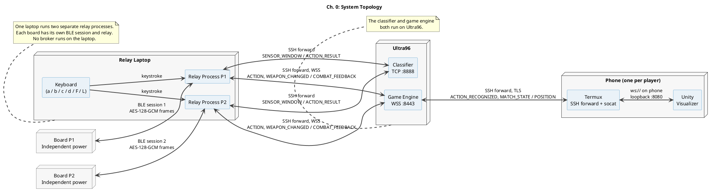

# Communications video: narration script

A word-for-word script for the chapters in [COMMS_VIDEO_GUIDE.md](COMMS_VIDEO_GUIDE.md).
`[SCREEN]` lines are editing cues and are not spoken. `{braces}` mark values you must fill in from your
own hardware or saved reports. At a normal pace (~140 words/min) the script runs about 13-14 minutes.

`[CODE Cx.y]` cues say exactly what code goes on screen. Each gives the file, the line range and
what to highlight, followed by the verbatim excerpt. The cue sits directly above the narration it
goes with; start showing the code as you begin that paragraph. `# ...` / `// ...` inside an
excerpt marks lines skipped between two ranges. Before recording, read
[Appendix A](#appendix-a-code-to-put-on-screen), which covers how to record code and the files
that must never appear on screen.

For your Clipchamp edit, each code cue now has an `[ON-SCREEN TITLE]` and an
`[ON-SCREEN TEXT]` directly above it. These are display text, not extra narration.
Copy only the words after the labels: use the title above the code and the short sentence
below it. Keep both visible for that code shot; for a very short insert, use just the title.
The existing blockquoted narration (green in your editor) and code excerpts are unchanged.
Use a plain, high-contrast text style with no word-by-word animation, and keep the code
and any voiceover subtitles unobstructed. Cue IDs such as C3.2 are editing references,
not text to paste into the video. Search for `[ON-SCREEN TITLE]` to jump between captions.

Before recording, check every sentence against your footage. If the clip shows something different,
change the words to match the clip.

---

## Ch. 0: Title and topology (~40 s)

`[SCREEN]` Title slide, then the Ch. 0 topology diagram (revised PlantUML in the appendix).

> This video covers the communications subsystem of our CG4002 project.
>
> Here is the topology. Each player has one sensor board. The two boards run on independent power,
> and each connects over its own Bluetooth Low Energy session to the same relay laptop.
> The laptop runs two separate relay processes, one per player, so a fault on one link cannot stall
> the other.
>
> Both servers run on the Ultra96: the classifier on port 8888 and the game engine on port 8443.
> The relays reach them through an SSH local forward. On each phone, Termux runs an SSH forward
> and socat, and the Unity visualizer connects to the engine through them.
>
> I'll go through each link in turn: the board setup, the packet format, laptop to Ultra96,
> Ultra96 to phone, then the full pipeline, reliability, speed, encryption and concurrency.

---

## Ch. 1: FireBeetle setup (~60 s)

`[SCREEN]` Clip S1: both boards, the buttons, both power sources, no USB to the relay laptop.

> These are our two boards. Player 1 is a FireBeetle ESP32. Player 2 is a ESP32 Devkit C.
> Each one runs from its own supply: external laptop power and power bank power. Neither board is
> connected to the relay laptop by USB. USB is only used for flashing.

`[ON-SCREEN TITLE]` **One firmware, two players**

`[ON-SCREEN TEXT]` Build settings give each board its own player ID and BLE name.

`[CODE C1.1]` `firmware_demo/platformio.ini` **4-8**, then **31-36**. Show the two blocks one above
the other. Highlight line 4 `[env:firebeetle32]`, line 31 `[env:esp32dev_p2]`, and lines 35-36.

```ini
[env:firebeetle32]
platform = espressif32
board = firebeetle32
framework = arduino
monitor_speed = 115200
```

```ini
[env:esp32dev_p2]
extends = env:esp32dev
build_flags =
    ${env:esp32dev.build_flags}
    -D CG_DEMO_PLAYER_ID=2
    -D CG_DEMO_BLE_DEVICE_NAME=\"CG4002-Demo-P2\"
```

> We build both boards from the same firmware source with different environments. The P2
> environment sets player ID 2 and the Bluetooth name CG4002-Demo-P2. So the two boards advertise
> under different names and addresses, and every packet each one sends carries its own player ID.

`[SCREEN]` Zoom on the buttons, then cut to C1.2.

`[ON-SCREEN TITLE]` **Physical button controls**

`[ON-SCREEN TEXT]` GPIO 4 changes weapon; GPIO 25, 26 and 27 trigger gesture captures.

`[CODE C1.2]` `firmware_demo/include/cg_config.h` **34** and **39-41**. **Crop hard: the window must
not include lines 1-12** (line 11 is the real PSK). Open the file already scrolled to line 30,
or paste these lines onto a slide instead.

```c
#define CG_DEMO_WEAPON_BUTTON_PIN 4
```

```c
#define CG_DEMO_ACTION_BUTTON_COUNT 3
#define CG_DEMO_ACTION_BUTTON_PINS { 25, 26, 27 }
#define CG_DEMO_ACTION_BUTTON_TRIGGER_IDS { 1, 2, 3 }
```

> GPIO 4 cycles the weapon. GPIO 25, 26 and 27 each start a gesture capture.

`[ON-SCREEN TITLE]` **Dummy data, real format**

`[ON-SCREEN TEXT]` Synthetic IMU readings use the same scaling and layout as real sensor data.

`[CODE C1.3]` `firmware_demo/src/main.cpp` **580-587** (inside `send_sensor_frame()`). Highlight the
comment on line 581 and the `2048.0f` / `16.4f` factors.

```cpp
    // Synthetic "swing" pattern: sine-wave accel/gyro on the dominant wrist, near-zero elsewhere.
    // Scaling per protocol/constants.py: accel 1 LSB = 1/2048 g, gyro 1 LSB = 1/16.4 deg/s.
    int16_t dominant[6] = {
        (int16_t)(sinf(phase) * 1.5f * 2048.0f), 0, (int16_t)(cosf(phase) * 0.5f * 2048.0f),
        (int16_t)(sinf(phase) * 200.0f * 16.4f), 0, 0,
    };
    int16_t offhand[6] = {0, 0, (int16_t)(1.0f * 2048.0f), 0, 0, 0};
    int16_t torso[6] = {0, 0, (int16_t)(1.0f * 2048.0f), 0, 0, 0};
```

> On each board the sensor readings are dummy IMU values, but they use exactly the binary format a
> real sensor frame would use.

`[SCREEN]` Relay connect log showing both names/addresses (Recording A, the two relay panes).

`[ON-SCREEN TITLE]` **Player labels in logs**

`[ON-SCREEN TEXT]` Cyan identifies P1 logs; magenta identifies P2 logs.

`[CODE C1.4]` *(optional, a two-second insert)* `comms/src/cg_comms/logging_setup.py` **38**.

```python
_PLAYER_TAGS = {"relay-p1": ("\x1b[1;36m", "P1"), "relay-p2": ("\x1b[1;35m", "P2")}
```

> Here you can see each relay connecting to its own board by address.

---

## Ch. 2: Device IDs, packet types and packet format (~2 min)

`[SCREEN]` Packet layout slide (live guide §7.2).

`[ON-SCREEN TITLE]` **Inside the packet header**

`[ON-SCREEN TEXT]` Eight bytes identify the protocol, packet type, sequence, player and payload length.

`[CODE C2.1]` `shared/protocol/cg_protocol.h` **109-118**. Show it next to the layout slide.
Highlight the six fields, then the comment on lines 109-110.

```c
/* Bytes [0, 8): authenticated as AAD, immediately followed by PAYLOAD (ciphertext || 16-byte tag),
 * then the trailing 2-byte CRC16 (not part of this struct). */
typedef struct CG_PACKED {
    uint8_t  magic;      /* CG_MAGIC */
    uint8_t  version;    /* CG_PROTOCOL_VERSION */
    uint8_t  type;       /* CG_TYPE_MORE_FRAGMENTS | packet type */
    uint16_t seq;        /* per-device, per-direction, wraps at 65535 */
    uint8_t  player_id;  /* 1 or 2; 0 = unassigned, only valid in HELLO */
    uint16_t len;        /* byte length of PAYLOAD (ciphertext + 16-byte tag) */
} cg_header_t;
```

> Every packet on the Bluetooth link has the same structure. First comes an 8-byte header: a magic
> byte, the protocol version, the packet type, a 16-bit sequence number, the player ID and a length
> field. Then comes the encrypted payload, followed by a 16-byte AES-GCM authentication tag. The last
> two bytes are a CRC-16.

`[ON-SCREEN TITLE]` **Three IMUs per frame**

`[ON-SCREEN TEXT]` Each IMU contributes six 16-bit readings: three acceleration and three gyroscope values.

`[CODE C2.2]` `comms/src/cg_comms/protocol/payloads.py` **84-91**. Highlight lines 88-90, the
three `I16_ARRAY, 6` lines.

```python
    PacketType.SENSOR_FRAME: (
        Field("device_timestamp_ms", FieldKind.U32),
        Field("flags", FieldKind.U8),
        Field("weapon_id", FieldKind.U8),
        Field("dominant", FieldKind.I16_ARRAY, 6),
        Field("offhand", FieldKind.I16_ARRAY, 6),
        Field("torso", FieldKind.I16_ARRAY, 6),
    ),
```

> For a sensor frame the decrypted payload is 42 bytes: a device timestamp, a flags byte, the
> weapon ID, then six 16-bit values for each of three IMUs: dominant hand, off-hand and torso.
> That makes 8 plus 42 plus 16 plus 2, which is 68 bytes on the air. Multi-byte fields are
> little-endian.

`[SCREEN]` Type code table on a slide (left half).

`[ON-SCREEN TITLE]` **Packet type selects purpose**

`[ON-SCREEN TEXT]` Type codes distinguish handshake, sensor, control, feedback and assessment messages.

`[CODE C2.3]` Right half: `comms/src/cg_comms/protocol/constants.py` **39-57** (the `PacketType`
enum). If you have time, cut to `shared/protocol/cg_protocol.h` **55-63** and **72-75** to show that
the C side has the same codes, with its direction and reliability comments.

```python
    HELLO = 0x01
    HELLO_ACK = 0x02
    TIME_SYNC_REQ = 0x03
    TIME_SYNC_RESP = 0x04
    SENSOR_FRAME = 0x10
    RFID_EVENT = 0x11
    HEARTBEAT = 0x20
    ACK = 0x21
    COMBAT_FEEDBACK = 0x30
    # Assessment/demo extension range (0x40-0x4F). Reserved for the comms-assessment features
    # (keyboard-driven echo pipeline, file transfer); the real game never sends these.
    ASSESS_ECHO_REQ = 0x40
    ASSESS_ECHO_RESP = 0x41
    ASSESS_FILE_CHUNK = 0x42
    ASSESS_FILE_ACK = 0x43
    ASSESS_FILE_READ = 0x44
    ASSESS_FILE_DATA = 0x45
    ASSESS_WEAPON_REQ = 0x46
    ASSESS_WEAPON_RESP = 0x47
```

```c
#define CG_PKT_HELLO           0x01 /* device -> laptop   reliable    */
#define CG_PKT_HELLO_ACK       0x02 /* laptop -> device   reliable    */
#define CG_PKT_TIME_SYNC_REQ   0x03 /* device -> laptop   reliable    */
#define CG_PKT_TIME_SYNC_RESP  0x04 /* laptop -> device   reliable    */
#define CG_PKT_SENSOR_FRAME    0x10 /* device -> laptop   best-effort */
#define CG_PKT_RFID_EVENT      0x11 /* device -> laptop   reliable    */
#define CG_PKT_HEARTBEAT       0x20 /* both               best-effort */
#define CG_PKT_ACK             0x21 /* both               never acked itself */
#define CG_PKT_COMBAT_FEEDBACK 0x30 /* laptop -> device   reliable    */
// ...
#define CG_PKT_ASSESS_ECHO_REQ    0x40 /* laptop -> device   reliable    */
#define CG_PKT_ASSESS_ECHO_RESP   0x41 /* device -> laptop   best-effort */
#define CG_PKT_ASSESS_FILE_CHUNK  0x42 /* laptop -> device   reliable    */
#define CG_PKT_ASSESS_FILE_ACK    0x43 /* device -> laptop   best-effort */
```

| Code | Type | Direction | Delivery |
|---|---|---|---|
| 0x01 | HELLO | board -> relay | request/response (handshake retried as a whole) |
| 0x02 | HELLO_ACK | relay -> board | request/response |
| 0x03 | TIME_SYNC_REQ | board -> relay | request/response |
| 0x04 | TIME_SYNC_RESP | relay -> board | request/response |
| 0x10 | SENSOR_FRAME | board -> relay | best effort, 50 Hz |
| 0x11 | RFID_EVENT | board -> relay | reliable (ACK + retransmit) |
| 0x20 | HEARTBEAT | both | best effort, 1 Hz |
| 0x21 | ACK | both | never ACKed itself |
| 0x30 | COMBAT_FEEDBACK | relay -> board | reliable (ACK + retransmit) |
| 0x40 / 0x41 | ASSESS_ECHO_REQ / _RESP | relay -> board / board -> relay | REQ reliable, RESP re-driven by the REQ retry |
| 0x42 / 0x43 | ASSESS_FILE_CHUNK / _ACK | relay -> board / board -> relay | CHUNK reliable |
| 0x44 / 0x45 | ASSESS_FILE_READ / _DATA | relay -> board / board -> relay | READ reliable |
| 0x46 / 0x47 | ASSESS_WEAPON_REQ / _RESP | relay -> board / board -> relay | REQ reliable |

Bit 7 of the type byte is the MORE_FRAGMENTS flag. It is always 0, and a frame with it set is
dropped, because no packet needs fragmenting. If you mention it, show C2.4.

`[ON-SCREEN TITLE]` **Fragmented packets rejected**

`[ON-SCREEN TEXT]` Frames with MORE_FRAGMENTS set are rejected because reassembly is not implemented.

`[CODE C2.4]` *(optional)* `comms/src/cg_comms/protocol/codec.py` **207-209**.

```python
    if type_byte & TYPE_MORE_FRAGMENTS:
        # §4.6: reassembly is not implemented. A set MORE_FRAGMENTS bit is a hard error.
        return DecodeError(DropReason.FRAGMENTED)
```

> The type byte decides how the payload is parsed. HELLO and HELLO_ACK form the handshake, and the
> two TIME_SYNC packets estimate the clock offset. SENSOR_FRAME is the continuous stream. RFID_EVENT
> carries a weapon change, HEARTBEAT is liveness, and ACK acknowledges reliable packets.
> COMBAT_FEEDBACK goes from the engine back to the board. The 0x40 range holds our assessment
> packets: the keyboard echo request and response, file chunk and chunk ACK, file read and data,
> and the weapon-cycle request and response.

`[SCREEN]` Recording B: `[handshake] complete, session_id=...` then `[tx] sensor_frames=50/s`.

`[ON-SCREEN TITLE]` **Check the player ID**

`[ON-SCREEN TEXT]` Each relay rejects packets addressed to the wrong player.

`[CODE C2.5]` `comms/src/cg_comms/protocol/codec.py` **205-206**. Highlight both lines.

```python
    if expected_player_id is not None and player_id != expected_player_id:
        return DecodeError(DropReason.PLAYER_MISMATCH)
```

> There are two separate identities. The Bluetooth address identifies the physical device. The
> player ID byte in the header identifies the player. The relay for player 1 rejects any frame whose
> player ID is not 1.

`[ON-SCREEN TITLE]` **Establish a fresh session**

`[ON-SCREEN TEXT]` Reject a recently seen HELLO nonce and assign a new session ID.

`[CODE C2.6]` `comms/src/cg_comms/relay/session.py` **235-248** (`_handshake`). Highlight line 238
`device_nonce`, lines 241-243 (a replayed HELLO is rejected), and line 248 `secrets.randbits(32)`.

```python
    async def _handshake(self) -> None:
        hello = await self._next_decoded(PacketType.HELLO, timeout_s=30.0)
        self._firmware_version = hello.fields["firmware_version"]
        device_nonce = hello.fields["device_nonce"]
        now = time.monotonic()
        self._prune_nonces(now)
        if device_nonce in self._seen_device_nonces:
            logger.error("hello_replay_rejected", device_nonce=device_nonce)
            raise HandshakeFailed("HELLO replayed within nonce TTL")
        self._seen_device_nonces[device_nonce] = now

        protocol_version = hello.fields["protocol_version"]
        version_ok = protocol_version == PROTOCOL_VERSION
        self.session_id = (secrets.randbits(32) or 1) if version_ok else 0
```

> At connection, the board sends HELLO with its MAC, player ID, protocol and firmware versions and
> a random device nonce. The relay replies with a fresh session ID. After a short time sync, the
> board starts streaming at 50 frames per second.

`[SCREEN]` Clip S2: freeze on one decoded P1 sample, then P2.

`[ON-SCREEN TITLE]` **Inspect a decoded frame**

`[ON-SCREEN TEXT]` Display player, sequence, sensor values and the passed CRC and authentication checks.

`[CODE C2.7]` `comms/src/cg_comms/relay/throughput.py` **144-160** (the dict `describe_frame`
returns, which is what the D key prints). Show it beside the frozen log line. Highlight lines 153-154
`crc ... ok` / `gcm ok` and line 156 `readings`.

```python
    return {
        "type": f"{type_name}(0x{h.packet_type:02X})",
        "seq": h.seq,
        "ext_seq": decoded.ext_seq,
        "player": h.player_id,
        # The header LEN field: ciphertext + 16 B GCM tag (a 42 B SENSOR_FRAME plaintext -> 58).
        "len_ct_plus_tag": h.payload_len,
        "frame_bytes": len(frame),
        # Only frames that passed decode reach here, so the CRC and GCM tag are known-good.
        "crc": f"0x{int.from_bytes(frame[body_end:], 'little'):04X} ok",
        "auth": "gcm ok",
        "fields": fields,
        **({"readings": readings} if readings else {}),
        "hex_header": frame[:HEADER_SIZE].hex(" "),
        "hex_ciphertext": frame[HEADER_SIZE:tag_start].hex(" "),
        "hex_tag": frame[tag_start:body_end].hex(" "),
        "hex_crc": frame[body_end:].hex(" "),
```

> Pressing uppercase D shows one decoded frame in human-readable form: the sequence number,
> the player ID, the raw 16-bit values, the values converted to g and degrees per second, and
> confirmation that the CRC and authentication checks passed. Acceleration is 2048 counts per g
> and gyro is 16.4 counts per degree per second. The full stream keeps running while this is
> shown. And here is the same display for player 2.

---

## Ch. 3: Laptop to Ultra96 (~2 min)

`[SCREEN]` Slide: one SENSOR_WINDOW and one ACTION_RESULT JSON line copied from Recording A.

`[ON-SCREEN TITLE]` **Sensor window to action**

`[ON-SCREEN TEXT]` Send IMU samples to the classifier; receive the action, guard state and confidence.

`[CODE C3.1]` `comms/src/cg_comms/messages/models.py` **153-164** (SensorWindow) and **176-183**
(ActionResult), side by side under the JSON. Highlight `player_id`, `request_id` and
`demo_trace_id` in both.

```python
    type: Literal["SENSOR_WINDOW"] = "SENSOR_WINDOW"
    demo_trace_id: str | None = Field(alias="demoTraceId", default=None, max_length=96)
    player_id: PlayerId = Field(alias="playerId")
    request_id: int = Field(alias="requestId", ge=0, le=0xFFFFFFFF)
    weapon: RealWeapon
    window_start_ts: int = Field(alias="windowStartTs", ge=0)
    window_end_ts: int = Field(alias="windowEndTs", ge=0)
    sample_rate_hz: float = Field(alias="sampleRateHz", gt=0.0)
    dominant: list[ImuSample] = Field(min_length=1)
    offhand: list[ImuSample] = Field(min_length=1)
    stale_pct: float = Field(alias="stalePct", ge=0.0, le=100.0)
    trigger_id: int | None = Field(alias="triggerId", default=None, ge=0, le=7)
```

```python
    type: Literal["ACTION_RESULT"] = "ACTION_RESULT"
    demo_trace_id: str | None = Field(alias="demoTraceId", default=None, max_length=96)
    player_id: PlayerId = Field(alias="playerId")
    request_id: int = Field(alias="requestId", ge=0, le=0xFFFFFFFF)
    action: ActionClass
    action_confidence: Confidence = Field(alias="actionConfidence")
    guard_state: GuardState = Field(alias="guardState")
    guard_confidence: Confidence = Field(alias="guardConfidence")
```

> Between the relay and the Ultra96 classifier we send JSON messages over TCP. The relay sends a
> SENSOR_WINDOW containing the player ID, a request ID, the current weapon, the window timestamps,
> the sample rate and the IMU samples. The classifier replies with an ACTION_RESULT: the action,
> the guard state and their confidences, plus the same player ID, request ID and timestamp.

`[ON-SCREEN TITLE]` **One JSON record per line**

`[ON-SCREEN TEXT]` A newline marks where each message ends in the TCP byte stream.

`[CODE C3.2]` `comms/src/cg_comms/relay/ultra96.py` **119**. Highlight `+ "\n"` at the end.

```python
            payload = (window.model_dump_json(by_alias=True, exclude={"demo_trace_id"} if window.demo_trace_id is None else set()) + "\n").encode()
```

> TCP is a byte stream, not a packet protocol, so one message can arrive split across several
> reads, or two messages can arrive together. We handle this by ending every JSON message with a
> newline.

`[ON-SCREEN TITLE]` **Wait for a complete message**

`[ON-SCREEN TEXT]` Both readers assemble complete lines and reject an unfinished line at disconnect.

`[CODE C3.3]` Split screen. Left: `comms/src/cg_comms/relay/ultra96.py` **66-71** (the relay reads
replies). Right: `comms/src/cg_comms/mock/ultra96_sim.py` **176-182** (the classifier reads
requests). Highlight `readline()` on both, then the `endswith(b"\n")` checks.

```python
            while True:
                line = await reader.readline()
                if not line:
                    raise ConnectionError("classifier EOF")
                if not line.endswith(b"\n"):
                    raise ConnectionError("classifier unterminated line")
```

```python
        while True:
            line = await reader.readline()
            if not line:
                return
            if not line.endswith(b"\n"):
                logger.warning("ultra96_sim_bad_message", reason="unterminated_line")
                return
```

> Both sides read with readline, which keeps buffering until the complete line has
> arrived. If the connection closes in the middle of a message, that partial line is rejected
> instead of being parsed.

`[ON-SCREEN TITLE]` **Validate replies within a deadline**

`[ON-SCREEN TEXT]` Check player, timestamp and trace ID; stop waiting when the request deadline expires.

`[CODE C3.4]` `comms/src/cg_comms/relay/ultra96.py` **155-167**. Highlight line 155 `wait_for(...,
self.request_timeout_ms / 1000)` first, then the three tuples on lines 160-162.

```python
            result = await asyncio.wait_for(exchange(), self.request_timeout_ms / 1000)
            # Contract (COMMS_ASSESSMENT_IMPLEMENTATION_PLAN.md §6): the classifier echoes playerId,
            # timestamp and demoTraceId unchanged. Name the offending field so a real-AI
            # integration that re-stamps its own timestamp is diagnosable from one log line.
            mismatched = [name for name, got, sent in (
                ("playerId", result.player_id, window.player_id),
                ("timestamp", result.timestamp, window.timestamp),
                ("demoTraceId", result.demo_trace_id, window.demo_trace_id),
            ) if got != sent]
            if mismatched:
                raise Ultra96Unavailable(
                    "classifier correlation mismatch: "
                    + ", ".join(f"{n} not echoed unchanged" for n in mismatched))
```

> Each reply is matched to its request by request ID. The relay also checks that the player ID,
> timestamp and trace ID came back unchanged. If any of them differ, the reply is discarded. Each
> request has a deadline, so a slow classifier costs us one window. It cannot stall the stream.

`[SCREEN]` Recording A excerpt: `classifier_request` -> `ultra96_sim_classified` -> `classifier_response` -> engine `action_received`. No code here; the logs are the evidence.

> Here is a real exchange. The relay sends the window, the classifier on the Ultra96 logs that it
> classified it, the relay receives the result, and then forwards an ACTION to the engine over a
> separate WebSocket connection. Classification and game resolution are separate stages on
> separate connections.
>
> No broker runs on the laptop. Both servers are on the Ultra96, and the laptop reaches them
> through an SSH local forward via the jump host.

---

## Ch. 4: Ultra96 to visualizer (~90 s)

`[SCREEN]` Slide: engine <-> phone message list and the socat route.

`[ON-SCREEN TITLE]` **Recognition reaches the phone**

`[ON-SCREEN TEXT]` ACTION_RECOGNIZED carries the action, outcome and trace ID for display.

`[CODE C4.1]` *(optional)* `comms/src/cg_comms/messages/models.py` **192-201** (ActionRecognized).
Highlight `outcome` and `target_id`.

```python
    type: Literal["ACTION_RECOGNIZED"] = "ACTION_RECOGNIZED"
    demo_trace_id: str | None = Field(alias="demoTraceId", default=None, max_length=96)
    player_id: PlayerId = Field(alias="playerId")
    weapon: RealWeapon
    action: ActionClass
    action_confidence: Confidence = Field(alias="actionConfidence")
    guard_state: GuardState = Field(alias="guardState")
    guard_confidence: Confidence = Field(alias="guardConfidence")
    outcome: CombatOutcome
    target_id: PlayerId | None = Field(alias="targetId", default=None)
```

> The game engine owns the game state. Each phone connects to its own WebSocket path, visualizer
> 1 or visualizer 2. The engine pushes ACTION_RECOGNIZED when an action is recognized,
> COMBAT_EVENT when it resolves, MATCH_STATE for HP and connection status, and weapon updates.
> The phone sends POSITION updates back.

`[ON-SCREEN TITLE]` **Connect to the player endpoint**

`[ON-SCREEN TEXT]` Unity connects through local socat to the engine's /visualizer/<playerId> WebSocket path.

`[CODE C4.2]` `visualizer_demo/CG4002VisualizerDemo_UnityTemp/My project/Assets/Scripts/Net/EngineClient.cs`
**88-89**, then a screenshot of the EngineClient component in the Unity Inspector showing Host
`127.0.0.1`, Port `8080`, Use Tls unticked. The code defaults on lines 25-26 (`"ULTRA96_HOST"`,
`8443`) are placeholders. Don't present them as the phone's settings.

```csharp
                            string scheme = UseTls ? "wss" : "ws";
                            await socket.ConnectAsync(new Uri($"{scheme}://{Host}:{Port}/visualizer/{PlayerId}"),
```

> On the phone, Unity connects to socat on the phone's own loopback address. socat opens a TLS
> connection through the phone's SSH forward to the engine. The WebSocket protocol handles message
> boundaries, so each received frame is one complete JSON message.

`[ON-SCREEN TITLE]` **Authenticate and route connections**

`[ON-SCREEN TEXT]` The engine checks the bearer token and accepts only supported connection paths.

`[CODE C4.3]` `comms/src/cg_comms/engine/ws_server.py` **24-26**, then **136-146**. Highlight line
137 (unknown path rejected), line 141 (the bearer check), and line 146 `registry.register(path, ...)`.

```python
RELAY_PATHS: dict[str, int] = {"/relay/1": 1, "/relay/2": 2}
VISUALIZER_PATHS: dict[str, int] = {"/visualizer/1": 1, "/visualizer/2": 2}
CONTROL_PATH = "/control"
```

```python
        path = request.path
        if path not in RELAY_PATHS and path not in VISUALIZER_PATHS and path != CONTROL_PATH:
            logger.warning("ws_unknown_path", path=path)
            await websocket.close(code=1008, reason="unknown path")
            return
        if not check_bearer_token(request.headers, config.bearer_token):
            logger.warning("ws_auth_rejected", path=path)
            await websocket.close(code=1008, reason="unauthorized")
            return

        conn = await registry.register(path, websocket)
```

> On the engine, the server checks the bearer token before accepting a connection and routes each
> connection by its path.

`[ON-SCREEN TITLE]` **Replace an old connection**

`[ON-SCREEN TEXT]` A reconnect closes the previous socket registered to the same path.

`[CODE C4.4]` `comms/src/cg_comms/engine/ws_server.py` **60-64**. Highlight lines 62-64.

```python
    async def _register(self, path: str, websocket: ServerConnection) -> Connection:
        existing = self._connections.get(path)
        if existing is not None:
            logger.warning("ws_duplicate_path_replaced", path=path)
            await self._close(existing)
```

> If a phone or relay reconnects, the new connection replaces the old one.

`[SCREEN]` Recording C side by side with the engine lines for the same trace.

> Here the engine sends the result and the phone shows it with the same trace ID, so we know this
> message on the phone came from that request.

---

## Ch. 5: Complete pipeline and reliability (~2.5 min)

`[SCREEN]` Recordings A, B and C cut on trace IDs: first the `a` press.

`[ON-SCREEN TITLE]` **The board selects the weapon**

`[ON-SCREEN TEXT]` The board advances its weapon and returns the selection to the relay.

`[CODE C5.1]` *(optional, short insert)* `firmware_demo/src/main.cpp` **328-336**, the board side of
`a`. Highlight line 328 `next_weapon_id()` and line 332: the reply has to be accepted before
anything is committed.

```cpp
        cg_payload_assess_weapon_resp_t selected = {req.trace_id, millis(), next_weapon_id()};
        resp_type = CG_PKT_ASSESS_WEAPON_RESP;
        resp_len = sizeof(selected);
        memcpy(resp, &selected, resp_len);
        if (!send_packet(resp_type, resp, resp_len, nullptr, 0)) return false;
        // Commit only after notify accepts the reply. The exact-frame cache prevents a lost
        // reply/ACK retry from cycling twice. RFID uses its existing reliable announcement path.
        send_rfid_event_next_weapon();
        Serial.printf("[assess] key=a trace=%lu weapon=%u\n", (unsigned long)req.trace_id, (unsigned)g_weapon_id);
```

> Now the complete pipeline. When I press lowercase a on the relay laptop, the relay sends a
> reliable weapon-cycle request to the board. The board advances its weapon and replies with the
> weapon it has selected. Here is the board log, then the relay's weapon_changed, the engine's
> weapon_selected, and the new weapon on the phone. This is the same round-robin sequence as
> the GPIO physical weapon button.

`[SCREEN]` The `b` press across all three recordings.

> Keys b, c and d each select one set of dummy IMU values. The relay packs the values into our real
> sensor body and sends it to the board as an echo request. The board returns the same values with
> its own device timestamp.

`[ON-SCREEN TITLE]` **Verify the board's reply**

`[ON-SCREEN TEXT]` Compare the returned key, payload kind and sensor values with the original request.

`[CODE C5.2]` `comms/src/cg_comms/relay/assess_echo.py` **150-169**. Highlight lines 151, 153 and
168: keycode, payload kind, and the values.

```python
        problems: list[str] = []
        if fields["keycode"] != pending.keycode:
            problems.append(f"keycode {fields['keycode']} != {pending.keycode}")
        if fields["payload_kind"] != pending.variant.kind:
            problems.append(f"payload_kind {fields['payload_kind']} != {pending.variant.kind}")
        if fields["transform_id"] != pending.transform_id:
            problems.append(f"transform_id {fields['transform_id']} != {pending.transform_id}")
        expected_fields = {
            "reserved": 0,
            "flags": 0,
            "weapon_id": pending.weapon.wire_value,
            "dominant_gyro": (164, 0, -82),
            "offhand": (0, 0, 2048, 0, 0, 0),
            "torso": (0, 0, 2048, 0, 0, 0),
        }
        for name, expected in expected_fields.items():
            if fields.get(name) != expected:
                problems.append(f"{name} mismatch")
        if got != pending.expected:
            problems.append(f"values {got} != expected {pending.expected}")
```

> Before forwarding anything, the relay checks the key, the payload kind and every returned value
> against what it sent.

`[ON-SCREEN TITLE]` **Stop mismatched data here**

`[ON-SCREEN TEXT]` An invalid echo is rejected before it can reach the classifier.

`[CODE C5.3]` `comms/src/cg_comms/relay/assess_echo.py` **267-270**. Highlight line 270.

```python
    def synthetic_window(self, pending: PendingEcho, *, weapon: Weapon, request_id: int) -> SensorWindow:
        """Scale the actual authenticated returned sensor sample; never synthesize from expectation."""
        if not pending.matched or pending.returned is None:
            raise ValueError("cannot forward an unverified echo")
```

> If they don't match, the data goes no further.

`[ON-SCREEN TITLE]` **Deterministic classifier stand-in**

`[ON-SCREEN TEXT]` A hash of IMU content and weapon selects a valid move for the demo.

`[CODE C5.4]` `comms/src/cg_comms/mock/ultra96_sim.py` **150-155** and **162**. Highlight line 153
`sha256`, line 155 `% len(choices)`, and line 162 `content_sha256_v1`.

```python
    def classify(self, window: SensorWindow) -> tuple[ActionResult, dict]:
        content = {"weapon": window.weapon.value, "dominant": window.dominant, "offhand": window.offhand}
        encoded = json.dumps(content, sort_keys=True, separators=(",", ":"), allow_nan=False)
        digest = hashlib.sha256(encoded.encode("utf-8")).hexdigest()
        choices = self.moves.get(window.weapon.value, [])
        action = choices[int(digest, 16) % len(choices)] if choices else "IDLE"
        # ...
        return result, {"assessment_mode": "content_sha256_v1", "input_sha256": digest}
```

> The verified values are scaled like normal sensor data and sent to the classifier. On the Ultra96
> the classifier is a deterministic stand-in, not a trained model. It hashes the IMU content and
> the weapon and uses the hash to choose one of that weapon's valid moves. The engine resolves the
> move and the phone shows the result, all under one trace ID.

`[ON-SCREEN TITLE]` **Reload dummy inputs on demand**

`[ON-SCREEN TEXT]` Each key press reads the file again; invalid edits reject that request.

`[CODE C5.5]` `comms/src/cg_comms/relay/assess_dummy.py` **35-41**, then **71-75** and **81**.
Highlight the three value tuples, then the docstring and line 81 `read_text` (the file is re-read on
every press). If you edit a value live during recording, do it in this window.

```python
# --- EDIT ME DURING THE DEMO -------------------------------------------------------------------
DUMMY_VARIANTS: tuple[DummyVariant, ...] = (
    DummyVariant(1, "B", (2048, -1024, 512), "keyboard b: dominant acceleration raw int16"),
    DummyVariant(2, "C", (1000, -2000, 3000), "keyboard c: dominant acceleration raw int16"),
    DummyVariant(3, "D", (7, 13, 31), "keyboard d: dominant acceleration raw int16"),
)
# --- END EDIT ME -------------------------------------------------------------------------------
```

```python
def for_key(keycode: int, source: Path | None = None) -> DummyVariant:
    """Read the saved table on EVERY press, without executing edited Python code.

    Only literal DummyVariant(...) entries are accepted. Invalid/partially saved edits fail
    the operation before any BLE request; there is no silent fallback to stale values.
    # ...
    tree = ast.parse((source or Path(__file__)).read_text(encoding="utf-8-sig"))
```

> The dummy data is defined here. The file is read again on every key press, so it can be edited
> while the relay runs. The next press sends the new values without a restart. If an edit is
> invalid, that press is rejected; stale values are never sent.

`[SCREEN]` Reliable-operation FSM slide.

`[ON-SCREEN TITLE]` **Choose which packets retry**

`[ON-SCREEN TEXT]` Control requests use acknowledgements and retries; sensor frames remain best effort.

`[CODE C5.6]` `comms/src/cg_comms/protocol/constants.py` **91-100**: exactly which types are
reliable. SENSOR_FRAME is missing from it, which is the point.

```python
ACK_RETRANSMIT_PACKET_TYPES: frozenset[PacketType] = frozenset(
    {
        PacketType.RFID_EVENT,
        PacketType.COMBAT_FEEDBACK,
        PacketType.ASSESS_ECHO_REQ,
        PacketType.ASSESS_WEAPON_REQ,
        PacketType.ASSESS_FILE_CHUNK,
        PacketType.ASSESS_FILE_READ,
    }
)
```

> Different traffic gets different reliability. Sensor frames are best effort. At 50 frames a
> second, a missing frame is counted, not retransmitted. Control and assessment packets are
> reliable: the sender waits for a matching reply, and if none arrives it resends the identical
> frame.

`[ON-SCREEN TITLE]` **Retry with increasing timeouts**

`[ON-SCREEN TEXT]` Resend the same frame with exponential backoff; five failed attempts mark the link degraded.

`[CODE C5.7]` Left: `comms/src/cg_comms/relay/reliability.py` **58-70**. Right: `comms/src/cg_comms/config.py`
**47-50**. Highlight line 61 (the same `frame` is sent again), line 68 `*= self.backoff_factor`,
and line 70 `raise LinkDegraded`.

```python
            timeout_ms = float(self.base_timeout_ms)
            for attempt in range(1, self.max_attempts + 1):
                pending.attempt = attempt
                await self.send_frame(frame)
                jitter = 1.0 + random.uniform(-self.jitter_pct, self.jitter_pct)
                try:
                    await asyncio.wait_for(pending.ack_event.wait(), timeout=(timeout_ms * jitter) / 1000)
                    return
                except asyncio.TimeoutError:
                    logger.warning("retransmit", seq=seq, attempt=attempt)
                    timeout_ms *= self.backoff_factor
            logger.error("link_degraded", seq=seq)
            raise LinkDegraded(seq)
```

```python
    retry_timeout_ms: int = 200
    retry_backoff_factor: float = 2.0
    retry_max_attempts: int = 5
    retry_jitter_pct: float = 0.2
```

> The first timeout is 200 milliseconds, it doubles on each retry, and there are at most five
> attempts. If all five fail, the link is marked degraded.

`[ON-SCREEN TITLE]` **Retry without repeating effects**

`[ON-SCREEN TEXT]` Duplicate requests reuse the cached response instead of applying the operation again.

`[CODE C5.8]` `firmware_demo/src/main.cpp` **432-442**. Highlight the comment on lines 433-435 and
line 438 (the cached response is re-sent).

```cpp
        if (g_assess_cache.contains(incoming.data, incoming.len, millis())) {
            // Exact copy of an assessment request already processed: our ACK was lost. Re-ACK and,
            // if it is the latest request, re-send its response -- never re-APPLY it (a file chunk
            // would be appended twice, an echo counted twice).
            if (g_assess_last_resp_type != 0 && incoming.len == g_assess_last_req_len &&
                memcmp(incoming.data, g_assess_last_req, incoming.len) == 0 &&
                !send_packet(g_assess_last_resp_type, g_assess_last_resp, g_assess_last_resp_len, nullptr, 0)) {
                continue; // resent response refused on-chip: withhold the ACK so the relay retries again
            }
            send_ack_for(wire_seq);
            continue;
```

> A retry must not repeat the effect. The board caches its last response, so a retried weapon
> request gets the cached answer and the weapon does not change twice. The receiver also keeps a
> replay window, so duplicates and old sequence numbers are dropped.

`[ON-SCREEN TITLE]` **Queue the response before ACK**

`[ON-SCREEN TEXT]` If the response cannot be queued, withhold the ACK so the relay retries.

`[CODE C5.9]` `firmware_demo/src/main.cpp` **316-319**.

```cpp
// Why the response gates the ACK: notify() can be refused on-chip (rc=-1) under load. If we ACKed
// anyway, the relay would stop retransmitting and the response would be silently gone -- for the
// echo a lost keystroke, for a file a stall. Not ACKing turns an on-chip drop into an ordinary
// retransmit, which the reliability layer already handles.
```

> The board sends an ACK only after its reply has actually been queued for sending.

`[SCREEN]` Connection FSM slide.

`[ON-SCREEN TITLE]` **Detect a lost connection**

`[ON-SCREEN TEXT]` Heartbeats run every second; three seconds without reception triggers link-loss handling.

`[CODE C5.10]` `comms/src/cg_comms/config.py` **53-56**, with `comms/src/cg_comms/relay/heartbeat.py`
**43-44** beneath it. Highlight `1000`, `3`, and the backoff list.

```python
class HeartbeatConfig(_Model):
    interval_ms: int = 1000
    liveness_timeout_factor: int = 3
    reconnect_backoff_ms: list[int] = Field(default_factory=lambda: [1000, 2000, 4000, 8000, 10000])
```

```python
    def is_stale(self) -> bool:
        return monotonic_ms() - self._last_rx_ms > self.interval_ms * self.liveness_timeout_factor
```

> The connection itself follows this state machine: advertise, connect, handshake, time sync,
> stream. A heartbeat is sent every second. If no heartbeat arrives for three seconds, the link is
> treated as lost. The relay then reconnects with backoff, starting at one second and rising to
> ten. Every reconnection runs a fresh handshake and gets a new session ID.

`[SCREEN]` Clip S3: file transfer.

`[ON-SCREEN TITLE]` **Split the file into chunks**

`[ON-SCREEN TEXT]` Number each 32-byte chunk and record the final chunk's actual length.

`[CODE C5.11]` `comms/src/cg_comms/relay/assess_file.py` **94-107**. Highlight line 94 (chunk
count, rounded up) and line 106 (zero padding).

```python
    total = -(-len(data) // ASSESS_FILE_CHUNK_DATA_LEN)
    assert total <= _MAX_CHUNKS
    chunks = []
    for index in range(total):
        piece = data[index * ASSESS_FILE_CHUNK_DATA_LEN : (index + 1) * ASSESS_FILE_CHUNK_DATA_LEN]
        chunks.append(
            {
                "transfer_id": transfer_id,
                "chunk_index": index,
                "total_chunks": total,
                "chunk_len": len(piece),
                "reserved": 0,
                "data": piece.ljust(ASSESS_FILE_CHUNK_DATA_LEN, b"\x00"),
            }
        )
```

> To verify data transfer with a file, uppercase F uploads a 1037-byte file in 33 chunks of 32
> bytes, stop-and-wait.

`[ON-SCREEN TITLE]` **Track upload progress**

`[ON-SCREEN TEXT]` The board reports received bytes, the running CRC and file completion.

`[CODE C5.12]` `firmware_demo/src/main.cpp` **409-418**, next to the matching `[file] chunk ...
crc=0x.... COMPLETE` line in Recording B.

```cpp
            Serial.printf("[file] chunk %u/%u len=%u bytes=%lu crc=0x%04X%s\n",
                          (unsigned)chunk.chunk_index + 1u, (unsigned)chunk.total_chunks,
                          (unsigned)chunk.chunk_len, (unsigned long)g_file_rx.received_bytes,
                          (unsigned)g_file_rx.running_crc, g_file_rx.complete() ? " COMPLETE" : "");
        }
    }
    g_assess_last_resp_type = resp_type;
    memcpy(g_assess_last_resp, resp, resp_len);
    g_assess_last_resp_len = resp_len;
    send_ack_for(seq);
```

> The board checks the CRC and keeps the file in RAM.

`[ON-SCREEN TITLE]` **Verify the returned file**

`[ON-SCREEN TEXT]` Compare the readback SHA-256 with the source file's hash.

`[CODE C5.13]` `comms/src/cg_comms/relay/assess_file.py` **239-242**. Highlight line 240.

```python
        r.returned_sha256 = hashlib.sha256(returned).hexdigest()
        if returned != data or r.returned_sha256 != sha:
            r.ok = False
            r.reason = "readback bytes/SHA-256 mismatch"
```

> The relay then reads the file back from the board and computes its SHA-256. The hash of the
> returned file matches the source.

`[SCREEN]` Clip S4: `L` then `F`.

`[ON-SCREEN TITLE]` **Inject one lost ACK**

`[ON-SCREEN TEXT]` Suppress one upload ACK locally to demonstrate retransmission and successful recovery.

`[CODE C5.14]` Three short excerpts from `comms/src/cg_comms/relay/session.py`, in this order:
**484-490** (L arms it), **504-506** (the next chunk becomes the target), **775-782** (its ACK is
ignored once). Highlight the `fault=` strings, which are the same text you'll see in Recording A.

```python
    def arm_assessment_ack_loss(self) -> None:
        self._ack_fault_armed = True
        logger.warning(
            "assess_fault_armed",
            player_id=self.config.player_id,
            fault="ignore exactly one received upload ACK; next F only",
        )
```

```python
        if kind is PacketType.ASSESS_FILE_CHUNK and self._ack_fault_armed:
            self._ack_fault_armed = False
            self._ack_fault_target = seq
```

```python
            if self._ack_fault_target == decoded.fields["acked_seq"]:
                logger.warning(
                    "assess_fault_consumed",
                    player_id=self.config.player_id,
                    acked_seq=self._ack_fault_target,
                    fault="local ACK suppression",
                )
                self._ack_fault_target = None
```

> To show retransmission, uppercase L arms a fault that deliberately drops one upload ACK on the
> relay side. When I press F, the ACK is dropped and the relay resends the chunk. The board sees a
> duplicate and does not write it twice. The final readback still matches. This loss is one we
> injected ourselves; the radio did not actually lose that ACK.

---

## Ch. 6: Maximizing speed (~60 s)

`[SCREEN]` Rate table below (from the saved reports `50hz.json`, `100hz.json`, `200hz.json`).
Optional clip S5.

| Requested, each board | P1 received | P2 received | Total goodput | Common coverage | Missing sequence numbers per 5 s interval (P1 / P2) |
|---|---|---|---|---|---|
| 50 Hz (20 ms) | 50.0 Hz, 16.8 kbps | 50.0 Hz, 16.8 kbps | 33.6 kbps | 72.8 s | 0% / 0% |
| 100 Hz (10 ms) | 43.6 Hz, 14.64 kbps | 100.0 Hz, 33.6 kbps | 48.24 kbps | 74.9 s | 55-58% / 0% |
| 200 Hz (5 ms) | 200.0 Hz, 67.2 kbps | 130.1 Hz, 43.7 kbps | 110.9 kbps | 75.0 s | 0% / 34-36% |

Every trial: `over_60_seconds_both=true`, `errors=[]`, no reconnects, 0 duplicates, 0 late
frames, no decode drops. Hz = `sensor_frames / elapsed_s`; total = P1 + P2 `goodput_kbps`. The
last column is the report's per-interval `lost_pct`: sequence numbers cover all packet types, so
it is not an exact sensor-frame loss count. Put that caveat in small print on the slide.

`[ON-SCREEN TITLE]` **Change the requested send rate**

`[ON-SCREEN TEXT]` Frame intervals of 20, 10 and 5 ms request 50, 100 and 200 Hz.

`[CODE C6.1]` `firmware_demo/include/cg_config.h` **53-55** (crop hard, as for C1.2), then
`firmware_demo/platformio.ini` **60-64** and **70-74**. Highlight `20`, `10`, `5`.

```c
#ifndef CG_DEMO_SENSOR_FRAME_INTERVAL_MS
#define CG_DEMO_SENSOR_FRAME_INTERVAL_MS 20  // 50 Hz
#endif
```

```ini
[env:firebeetle32_bench100]
extends = env:firebeetle32
build_flags =
    ${env:firebeetle32.build_flags}
    -D CG_DEMO_SENSOR_FRAME_INTERVAL_MS=10
```

```ini
[env:firebeetle32_bench200]
extends = env:firebeetle32
build_flags =
    ${env:firebeetle32.build_flags}
    -D CG_DEMO_SENSOR_FRAME_INTERVAL_MS=5
```

> To find the maximum speed, we changed only the firmware's frame interval: 20, 10 and 5
> milliseconds, which request 50, 100 and 200 frames per second per board. For every trial, both
> boards streamed to this one laptop at the same time, on the same power and in the same positions.
> Each trial ran for 75 seconds with no other traffic.

`[ON-SCREEN TITLE]` **Measure useful payload throughput**

`[ON-SCREEN TEXT]` Goodput = 42 payload bytes x 8 x valid frames per second.

`[CODE C6.2]` `comms/src/cg_comms/relay/throughput.py` **73-74**.

```python
def _kbps(byte_count: int, elapsed_s: float) -> float:
    return round(byte_count * 8 / elapsed_s / 1000, 2) if elapsed_s > 0 else 0.0
```

> The kbps figure is application goodput: 42 payload bytes, times 8 bits, times the valid frames
> received per second. It is not the Bluetooth radio bitrate.
>
> At 50 hertz, both boards received the full 50 frames per second: 16.8 kbps each, 33.6 in total,
> with no missing sequence numbers. At 100 hertz, player 2 kept up at 100 hertz, but player 1 fell
> to 43.6 hertz, and more than half of its sequence numbers never arrived. At 200 hertz it flipped:
> player 1 reached the full 200 hertz, 67.2 kbps, while player 2 fell to 130 hertz and lost about a
> third. There were no reconnects in any trial.
>
> So one link can carry 200 frames per second, and the total rose to 110.9 kbps. But the two
> boards don't share the capacity fairly: one of them is starved, and which one changed between
> trials. Our reading is that both links share the laptop's single Bluetooth adapter, and it does
> not split its time evenly. So 50 hertz is the highest rate we measured where both boards stayed
> complete at the same time, and that is the rate we run the game at.

`[ON-SCREEN TITLE]` **Request shorter BLE intervals**

`[ON-SCREEN TEXT]` The board requests connection events every 7.5 to 15 ms.

`[CODE C6.3]` `firmware_demo/src/main.cpp` **180-182**. Highlight `0x06, 0x0C` (in 1.25 ms units,
7.5 to 15 ms).

```cpp
    void onConnect(BLEServer *server, esp_ble_gatts_cb_param_t *param) override {
        server->updateConnParams(param->connect.remote_bda, 0x06, 0x0C, 0, 400);
    }
```

> To help the link keep up, the board asks for a short connection interval of 7.5 to 15
> milliseconds.

`[ON-SCREEN TITLE]` **Keep frame timing on schedule**

`[ON-SCREEN TEXT]` Advance the send deadline by one interval; resync after a long stall.

`[CODE C6.4]` `firmware_demo/src/main.cpp` **730-738**. Highlight line 736 `+=` (not `= now`).

```cpp
    if (now - last_sensor_ms >= CG_DEMO_SENSOR_FRAME_INTERVAL_MS) {
        // Absolute-deadline pacing: advance by exactly one interval rather than snapping to `now`,
        // so loop jitter (BLE notify, Serial) does not accumulate into a lower average rate -- the
        // throughput demo quotes frames/s, and "last = now" silently loses ~1 ms per frame. If we
        // fell more than one interval behind (reconnect, long notify stall), resync instead of
        // bursting the backlog: a burst would overrun the notify queue and show up as loss.
        last_sensor_ms += CG_DEMO_SENSOR_FRAME_INTERVAL_MS;
        if (now - last_sensor_ms >= CG_DEMO_SENSOR_FRAME_INTERVAL_MS) last_sensor_ms = now;
        send_sensor_frame();
```

> It paces frames against absolute deadlines so timing jitter doesn't lower the average rate. And
> the stream has no per-frame serial logging.

---

## Ch. 7: Encryption on each channel (~2.5 min)

Put a channel title bar on each slide in that connection's colour: "Board <-> Relay", "Relay <->
Classifier", "Relay <-> Engine", "Engine <-> Phone".

### Channel 1: board <-> relay

`[ON-SCREEN TITLE]` **Encrypt payload, authenticate header**

`[ON-SCREEN TEXT]` AES-GCM encrypts the body and detects changes to the body or header.

`[CODE C7.1]` `comms/src/cg_comms/protocol/crypto.py` **26-36**. Highlight line 29
`AESGCM(psk).encrypt(nonce, plaintext, header_aad)` and line 36 `decrypt(..., header_aad)`.

```python
def seal(psk: bytes, header_aad: bytes, nonce: bytes, plaintext: bytes) -> bytes:
    """Returns ciphertext || 16-byte tag. `header_aad` is the 8-byte plaintext header, exactly as
    it appears on the wire, authenticating TYPE/SEQ/LEN/PLAYER_ID."""
    return AESGCM(psk).encrypt(nonce, plaintext, header_aad)


def open_sealed(psk: bytes, header_aad: bytes, nonce: bytes, ciphertext_and_tag: bytes) -> bytes:
    """Returns plaintext. Raises `cryptography.exceptions.InvalidTag` on tamper or wrong key/nonce —
    callers must catch that specific exception and treat it as a counted, logged drop, not let it
    reach the event loop as an unhandled error."""
    return AESGCM(psk).decrypt(nonce, ciphertext_and_tag, header_aad)
```

> The Bluetooth link uses AES-128 in GCM mode with a pre-shared key. The 8-byte header is not
> encrypted, but it is passed to GCM as additional authenticated data. The payload is encrypted,
> and the 16-byte tag authenticates both. If anyone changes the type, sequence number, player ID
> or length, decryption fails and the frame is dropped.

`[ON-SCREEN TITLE]` **Derive the GCM nonce**

`[ON-SCREEN TEXT]` Session, player, direction and extended sequence form the 12-byte nonce.

`[CODE C7.2]` `comms/src/cg_comms/protocol/crypto.py` **17** and **21-23**. Highlight the comment on
line 17 field by field, and "never transmitted" on line 22.

```python
_NONCE_STRUCT = struct.Struct("<IBBIH")  # sessionId u32 | playerId u8 | direction u8 | extSeq u32 | 0x0000
```

```python
def derive_nonce(session_id: int, player_id: int, direction: Direction, ext_seq: int) -> bytes:
    """12-byte AES-GCM nonce, never transmitted (wire_protocol.md §5)."""
    return _NONCE_STRUCT.pack(session_id, player_id, int(direction), ext_seq, 0x0000)
```

> The 12-byte nonce is never sent. Both sides derive it from the session ID, the player ID, the
> direction and an extended sequence number. Every session and every direction therefore gets its
> own nonce space, and a nonce is not reused for different data.

`[ON-SCREEN TITLE]` **Build an encrypted frame**

`[ON-SCREEN TEXT]` Create the header, encrypt with GCM, then append CRC-16.

`[CODE C7.3]` `comms/src/cg_comms/protocol/codec.py` **149-157**. Read it top to bottom: line 151
header, line 153 `seal(psk, header, ...)`, line 156 CRC over the result.

```python
    else:
        payload_len = len(plaintext) + GCM_TAG_SIZE
        header = _HEADER_STRUCT.pack(MAGIC, PROTOCOL_VERSION, type_byte, seq, player_id, payload_len)
        nonce = derive_nonce(session_id, player_id, direction, ext_seq)
        sealed = seal(psk, header, nonce, plaintext)
        body = header + sealed

    crc = crc_mod.crc16(body)
    return body + struct.pack("<H", crc)
```

> When sending, we build the header, encrypt the payload with the header as associated data, then
> append the CRC.

`[ON-SCREEN TITLE]` **Validate before accepting**

`[ON-SCREEN TEXT]` Check CRC, replay status and GCM authentication before committing the replay state.

`[CODE C7.4]` `comms/src/cg_comms/protocol/codec.py`, three pieces in order: **193-196** (CRC
first), **235-238 + 246-247** (replay check on a copy), **254-259** (decrypt). Then
**274-277** (the real tracker is committed only here, after a valid tag). Put `# ...` between the
pieces.

```python
    body, crc_bytes = frame[:-CRC_SIZE], frame[-CRC_SIZE:]
    (expected_crc,) = struct.unpack("<H", crc_bytes)
    if crc_mod.crc16(body) != expected_crc:
        return DecodeError(DropReason.BAD_CRC)
    # ...
    # Authentication failures must not advance or poison replay state.
    candidate = copy.copy(sequence_tracker)
    candidate._seen = sequence_tracker._seen.copy()
    ext_seq = candidate.accept(seq)
    # ...
    if ext_seq is None:
        return DecodeError(DropReason.REPLAY, f"seq={seq}")
    # ...
        header_aad = body[:HEADER_SIZE]
        nonce = derive_nonce(session_id, player_id, direction, ext_seq)
    try:
        plaintext = open_sealed(psk, header_aad, nonce, sealed)
    except InvalidTag:
        return DecodeError(DropReason.AUTH_FAILED)
    # ...
    sequence_tracker._last_seq = candidate._last_seq
    sequence_tracker._high = candidate._high
    sequence_tracker._highest_ext_seq = candidate._highest_ext_seq
    sequence_tracker._seen = candidate._seen
```

> When receiving, we check the CRC first because it is cheap, then check the sequence number
> against the replay window, then derive the nonce, decrypt and verify the tag. The replay window
> is only updated once the tag is valid, so a forged frame cannot move it. The CRC only detects
> corruption; it is not security.

`[ON-SCREEN TITLE]` **Matching encryption on the board**

`[ON-SCREEN TEXT]` mbedTLS encrypts and tags outgoing payloads, then authenticates and decrypts incoming ones.

`[CODE C7.5]` `firmware_demo/lib/cg_protocol/cg_crypto.cpp` **36-37** and **56-57**. Highlight the
two mbedTLS function names. For the full firmware send path, `firmware_demo/lib/cg_protocol/cg_frame.cpp`
**36-55** shows the same order: AAD, then nonce, then seal, then CRC.

```cpp
        ok = mbedtls_gcm_crypt_and_tag(&ctx, MBEDTLS_GCM_ENCRYPT, plaintext_len, nonce, CG_NONCE_SIZE, aad,
                                        aad_len, plaintext, out, CG_GCM_TAG_SIZE, tag) == 0;
```

```cpp
        ok = mbedtls_gcm_auth_decrypt(&ctx, plaintext_len, nonce, CG_NONCE_SIZE, aad, aad_len, tag,
                                       CG_GCM_TAG_SIZE, ciphertext_and_tag, out) == 0;
```

> The firmware does the same thing with mbedTLS: gcm crypt-and-tag to send, and auth-decrypt to
> receive.

`[ON-SCREEN TITLE]` **Bootstrap the handshake nonce**

`[ON-SCREEN TEXT]` Before a session exists, the device nonce supplies the handshake nonce input.

`[CODE C7.6]` `comms/src/cg_comms/protocol/codec.py` **140-148**. Highlight line 146
`derive_nonce(device_nonce, ...)` and line 147 `header + device_nonce_bytes` as the AAD.

```python
    if packet_type in _HANDSHAKE_TYPES:
        device_nonce = fields["device_nonce"]
        assert isinstance(device_nonce, int)
        device_nonce_bytes = _DEVICE_NONCE_STRUCT.pack(device_nonce)
        payload_len = len(device_nonce_bytes) + len(plaintext) + GCM_TAG_SIZE
        header = _HEADER_STRUCT.pack(MAGIC, PROTOCOL_VERSION, type_byte, seq, player_id, payload_len)
        nonce = derive_nonce(device_nonce, player_id, direction, ext_seq)
        sealed = seal(psk, header + device_nonce_bytes, nonce, plaintext)
        body = header + device_nonce_bytes + sealed
```

> During the handshake there is no session yet, so the nonce uses the board's random device nonce
> instead of the session ID.

### Channel 2: relay <-> classifier

`[ON-SCREEN TITLE]` **Protect classifier traffic with SSH**

`[ON-SCREEN TEXT]` JSON travels over local TCP; the SSH tunnel encrypts the network connection.

`[CODE C7.7]` `comms/src/cg_comms/relay/ultra96.py` **61**, then the laptop SSH command from
`docs/COMMS_LIVE_AND_VIDEO_GUIDE.md` **228**. Highlight `open_connection(self.host, self.port)`
(no `ssl=`), then both `-L` flags. The command contains your NUSNET ID but no password; blur it if
you would rather not show it. Never record the password prompt.

```python
        reader, writer = await asyncio.wait_for(asyncio.open_connection(self.host, self.port), 5)
```

```powershell
ssh -J e1138443@stujump.comp.nus.edu.sg -L 127.0.0.1:8888:127.0.0.1:8888 -L 127.0.0.1:8443:127.0.0.1:8443 xilinx@makerslab-fpga-53.ddns.comp.nus.edu.sg -N
```

> The classifier protocol itself is plain JSON over TCP. The relay connects to port 8888 on its
> own loopback address, and our SSH local forward carries that through the jump host to the
> Ultra96. Over the network, the traffic is encrypted by SSH.

### Channel 3: relay <-> engine

`[ON-SCREEN TITLE]` **Enable TLS on the engine**

`[ON-SCREEN TEXT]` The server loads its certificate and private key to accept secure WebSockets.

`[CODE C7.8]` Server side first: `comms/src/cg_comms/engine/ws_server.py` **29-32**, plus
`comms/src/cg_comms/engine/app.py` **117**. Highlight `PROTOCOL_TLS_SERVER` and `load_cert_chain`.

```python
def build_ssl_context(cert_path: str, key_path: str) -> ssl.SSLContext:
    context = ssl.SSLContext(ssl.PROTOCOL_TLS_SERVER)
    context.load_cert_chain(cert_path, key_path)
    return context
```

```python
    ssl_context = build_ssl_context(settings.cert_path, settings.key_path) if settings.use_tls else None
```

> The relay to engine link is a secure WebSocket. The engine loads its certificate and key into a
> TLS server context.

`[ON-SCREEN TITLE]` **Verify and authenticate the connection**

`[ON-SCREEN TEXT]` The relay verifies the TLS certificate; a bearer token authenticates access.

`[CODE C7.9]` Client side: `comms/src/cg_comms/relay/engine_link.py` **51-57**, then
`comms/src/cg_comms/engine/ws_server.py` **35-36**. Highlight line 53 `cafile=`, line 55 the
`Authorization` header, then line 36 where the server compares it. `self.bearer_token` is a
variable name, so no token appears on screen.

```python
        ssl_context = None
        if self.url.startswith("wss://"):
            ssl_context = ssl.create_default_context(cafile=self.ca_cert_path)
        async with websockets.connect(
            self.url, additional_headers={"Authorization": f"Bearer {self.bearer_token}"},
            ssl=ssl_context, open_timeout=5, close_timeout=2, ping_interval=5, ping_timeout=5,
        ) as ws:
```

```python
def check_bearer_token(headers: "websockets.Headers", expected: str) -> bool:
    return bool(expected) and headers.get("Authorization", "") == f"Bearer {expected}"
```

> The relay builds a TLS client context from our CA certificate, so it verifies that it is talking
> to our engine. A bearer token in the connection request then authenticates the relay. The token
> is authentication only; TLS provides the encryption. This connection also runs through the SSH
> forward.

### Channel 4: engine <-> phone

`[ON-SCREEN TITLE]` **Phone connection through TLS and SSH**

`[ON-SCREEN TEXT]` socat encrypts the onward connection, but verify=0 disables its certificate verification.

`[CODE C7.10]` The two Termux commands from `docs/COMMS_LIVE_AND_VIDEO_GUIDE.md` **244** and
**248**, then C4.2 again (`EngineClient.cs` 88-89 with the Inspector screenshot). Highlight
`TCP-LISTEN:8080`, `OPENSSL:127.0.0.1:8443` and **`verify=0`**. Leave `verify=0` visible; the
narration admits it.

```bash
ssh -J e1138443@stujump.comp.nus.edu.sg -L 127.0.0.1:8443:127.0.0.1:8443 xilinx@makerslab-fpga-53.ddns.comp.nus.edu.sg -N
```

```bash
socat TCP-LISTEN:8080,reuseaddr,fork OPENSSL:127.0.0.1:8443,verify=0
```

> On the phone, Unity connects in plaintext to socat, but only on the phone's own loopback, so
> nothing unencrypted leaves the phone. socat opens TLS to the engine inside the phone's SSH
> forward. socat currently runs with verify=0, so it does not check the engine's certificate.
> SSH does check the host key separately. So this link is encrypted, but we do not claim
> certificate verification all the way from Unity.

---

## Ch. 8: Concurrency (~2.5 min)

`[SCREEN]` Concurrency block diagram (live guide §8 Ch. 5). Point at each block as it is named.
While a code excerpt is on screen, keep the diagram in a corner with the current block
highlighted.

> This diagram shows what runs concurrently. On the laptop there are two relay operating-system
> processes, one per player. Each one runs a single asyncio event loop. Tasks inside it take
> turns while they wait for I/O; there isn't one thread per packet.

`[ON-SCREEN TITLE]` **Run session tasks together**

`[ON-SCREEN TEXT]` Reading, feedback, statistics and heartbeats run concurrently within one asyncio event loop.

`[CODE C8.1]` `comms/src/cg_comms/relay/session.py` **317-342**. Trim the `run_*` argument lists if
the text is too small. Highlight the six `create_task` lines, line 337 `FIRST_COMPLETED`, and lines
340-342 (cancel all).

```python
        tasks = [
            asyncio.create_task(self._stats_loop()),
            asyncio.create_task(self._read_loop()),
            asyncio.create_task(self._feedback_loop()),
            asyncio.create_task(self._stop_event.wait()),
            asyncio.create_task(
                run_heartbeat_sender(
                    self._send_heartbeat, self.config.heartbeat_interval_ms, self._stop_event
                )
            ),
            asyncio.create_task(
                run_liveness_watchdog(
                    self._heartbeat_monitor,
                    self._on_link_stale,
                    poll_interval_ms=500,
                    stop_event=self._stop_event,
                )
            ),
        ]
        try:
            done, _pending = await asyncio.wait(tasks, return_when=asyncio.FIRST_COMPLETED)
        finally:
            self._stop_event.set()
            for task in tasks:
                task.cancel()
            await asyncio.gather(*tasks, return_exceptions=True)
```

> Once a session is streaming, the relay starts these tasks together: the read loop, the
> statistics loop, the feedback loop, the heartbeat sender and the liveness watchdog. If any one of
> them ends, the whole session is torn down and reconnected, so we never keep a half-working
> session.

`[ON-SCREEN TITLE]` **Keep the BLE callback short**

`[ON-SCREEN TEXT]` Queue incoming bytes for decoding; reconnect if the bounded queue overflows.

`[CODE C8.2]` `comms/src/cg_comms/transport/ble.py` **31** and **47-55**. Highlight `Queue(256)`,
line 55 `put_nowait` (the only work done in the callback), and lines 50-54 (overflow).

```python
        self._queue: "asyncio.Queue[bytes | None]" = asyncio.Queue(256)
```

```python
    def _on_notify(self, _handle: int, data: bytearray) -> None:
        if self._overflow:
            return
        if self._queue.full():
            self._overflow = True
            logger.error("ble_receive_overflow", capacity=self._queue.maxsize)
            self._on_disconnect(self._client)
            return
        self._queue.put_nowait(bytes(data))
```

> The Bluetooth callback does very little. It puts the received bytes on a bounded queue and
> returns. The read loop takes frames from that queue and decodes them. If the queue ever fills, we
> force a reconnect instead of silently losing frames.

`[ON-SCREEN TITLE]` **Classify without blocking reception**

`[ON-SCREEN TEXT]` A separate asyncio task handles each sensor window while reception continues.

`[CODE C8.3]` `comms/src/cg_comms/relay/session.py` **891-896**. Highlight line 894.

```python
        if len(self._classification_tasks) >= self.ultra96.max_in_flight:
            logger.warning("window_dropped", request_id=window.request_id, reason="classifier_capacity")
            return
        task = asyncio.create_task(self._classify(window))
        self._classification_tasks.add(task)
        task.add_done_callback(self._classification_done)
```

> Each sensor window gets its own classification task, so the stream never waits for the
> classifier.

`[ON-SCREEN TITLE]` **Serialize assessment requests**

`[ON-SCREEN TEXT]` One lock keeps keyboard and file operations sequential while streaming continues.

`[CODE C8.4]` `comms/src/cg_comms/relay/session.py` **121** and **442-443**.

```python
    _assess_send_lock: asyncio.Lock = field(default_factory=asyncio.Lock, init=False)
```

```python
        async with self._assess_send_lock:
            return await self._send_echo_request_locked(keycode)
```

> Keyboard and file operations go one at a time behind a lock, because the board caches only one
> response, but the sensor stream continues meanwhile.

`[ON-SCREEN TITLE]` **Separate sending from receiving**

`[ON-SCREEN TEXT]` Independent tasks share a bounded outbox; queued messages are cleared when the link ends.

`[CODE C8.5]` `comms/src/cg_comms/relay/engine_link.py` **27**, then **69-76** and **85-86**.
Highlight `Queue(32)`, the two `create_task` calls on line 74, and the drain loop on lines 85-86.

```python
    _outbox: asyncio.Queue[str] = field(default_factory=lambda: asyncio.Queue(32), init=False)
```

```python
            async def send() -> None:
                while True:
                    payload = await self._outbox.get()
                    await asyncio.wait_for(ws.send(payload), 3)

            tasks = [asyncio.create_task(receive()), asyncio.create_task(send())]
            try:
                done, _ = await asyncio.wait(tasks, return_when=asyncio.FIRST_COMPLETED)
                # ...
                while not self._outbox.empty():
                    self._outbox.get_nowait()
```

> The engine link has separate receive and send tasks with a bounded outbox. After a reconnect,
> old messages are dropped rather than replayed.

`[ON-SCREEN TITLE]` **Serve both relays concurrently**

`[ON-SCREEN TEXT]` The classifier server runs a separate asynchronous handler for each connection.

`[CODE C8.6]` `comms/src/cg_comms/mock/ultra96_sim.py` **316-325**. Highlight `start_server`.

```python
    async def _main() -> None:
        server = await asyncio.start_server(
            lambda r, w: _handle_client(
                r, w, steps, trigger_map, random_classifier, assessment_classifier
            ),
            args.host,
            args.port,
        )
        async with server:
            await server.serve_forever()
```

> On the Ultra96, the classifier uses asyncio start_server, which runs one handler per connection,
> so both relays are served concurrently.

`[ON-SCREEN TITLE]` **One owner of game state**

`[ON-SCREEN TEXT]` Connection handlers queue events; one game-state task processes them in timestamp order.

`[CODE C8.7]` `comms/src/cg_comms/engine/app.py` **127-130**, then
`comms/src/cg_comms/engine/game_state_task.py` **106-113** and **121-127, 137-138**. Highlight
`gather`, then `put_nowait` in `submit`, then `self._absorb(event)` and `self._drain_ready()` in
`run`.

```python
    await asyncio.gather(
        run_ws_server(ws_config, registry, on_message, stop_event, on_connect=on_connect, on_disconnect=on_disconnect),
        task.run(stop_event),
    )
```

```python
    async def submit(self, event: InboundEvent) -> None:
        if isinstance(event, (ResetMatch, LinkReset)):
            await self._inbox.put(event)
            return
        try:
            self._inbox.put_nowait(event)
        except asyncio.QueueFull:
            logger.error("engine_inbox_full", event_type=type(event).__name__)
```

```python
    async def run(self, stop_event: asyncio.Event, drain_interval_ms: int = 20) -> None:
        while not stop_event.is_set():
            try:
                event = await asyncio.wait_for(self._inbox.get(), timeout=drain_interval_ms / 1000)
            except asyncio.TimeoutError:
                event = None
            if event is not None:
                # ...
                else:
                    self._absorb(event)
            await self._drain_ready()
```

> The engine runs its WebSocket server and one game-state task side by side. Connection handlers
> only put events on a queue. Only the game-state task changes HP, and it processes events in
> timestamp order through a reorder buffer, so two players can never modify the state at the same
> time.

`[ON-SCREEN TITLE]` **Separate queues for each connection**

`[ON-SCREEN TEXT]` Each client has its own send queue and writer task.

`[CODE C8.8]` `comms/src/cg_comms/engine/ws_server.py` **65-68** and **86-92**. Highlight
`DropOldestQueue` and `create_task(self._writer_loop(conn))`.

```python
        conn = Connection(
            path=path, websocket=websocket, send_queue=DropOldestQueue(maxsize=self.send_queue_depth)
        )
        conn.writer_task = asyncio.create_task(self._writer_loop(conn))
```

```python
    async def _writer_loop(self, conn: Connection) -> None:
        while True:
            payload = await conn.send_queue.get()
            try:
                await conn.websocket.send(payload)
            except websockets.ConnectionClosed:
                return
```

> Every connection has its own bounded send queue and writer task, so a slow phone cannot hold up
> a relay.

`[ON-SCREEN TITLE]` **Queue BLE writes on the board**

`[ON-SCREEN TEXT]` The callback queues frames without waiting; the main loop drains a bounded batch.

`[CODE C8.9]` `firmware_demo/src/main.cpp` **149-160** (`onWrite`), then **422-425** (the drain).
Highlight line 158 `xQueueSend(..., 0)` (it never blocks) and `i < 16` on line 425.

```cpp
class WriteCallback : public BLECharacteristicCallbacks {
    void onWrite(BLECharacteristic *characteristic) override {
        std::string value = characteristic->getValue();
        if (value.length() > CG_MAX_FRAME_SIZE) {
            return;  // oversized — not a valid frame, drop silently like a bad-length decode
        }
        IncomingFrame incoming;
        memcpy(incoming.data, value.data(), value.length());
        incoming.len = value.length();
        if (xQueueSend(g_incoming_queue, &incoming, 0) != pdTRUE) g_rx_dropped++;

    }
};
```

```cpp
void drain_incoming_non_blocking() {
    IncomingFrame incoming;
    // Bound each turn: sensor/button work continues even under incoming bursts.
    for (unsigned i = 0; i < 16 && xQueueReceive(g_incoming_queue, &incoming, 0) == pdTRUE; i++) {
```

> On the board, the Bluetooth write callback runs in the BLE stack's own task. It only copies the
> frame onto a FreeRTOS queue.

`[ON-SCREEN TITLE]` **Share time across board tasks**

`[ON-SCREEN TEXT]` The main loop services sensors, heartbeats, buttons and incoming frames.

`[CODE C8.10]` `firmware_demo/src/main.cpp` **729-762**, trimmed. Highlight the four jobs in
order: sensor frame, heartbeat, buttons, drain.

```cpp
    uint32_t now = millis();
    if (now - last_sensor_ms >= CG_DEMO_SENSOR_FRAME_INTERVAL_MS) {
        // ...
        send_sensor_frame();
    }
    if (now - last_heartbeat_ms >= CG_DEMO_HEARTBEAT_INTERVAL_MS) {
        last_heartbeat_ms = now;
        send_heartbeat();
    }

    if (debounce_falling_edge(&g_weapon_button, now)) {
        send_rfid_event_next_weapon();
    }
    for (int i = 0; i < CG_DEMO_ACTION_BUTTON_COUNT; i++) {
        // ...
    }

    drain_incoming_non_blocking();
    service_pending_rfid_event();
```

> The main loop drains that queue, and also paces sensor frames, heartbeats and button presses.

`[ON-SCREEN TITLE]` **Update Unity through a queue**

`[ON-SCREEN TEXT]` Received messages enter a concurrent queue; Update dispatches them on the main thread.

`[CODE C8.11]` `EngineClient.cs` (the full path is in C4.2) **49**, **184-185** and **189-191**.
Highlight `ConcurrentQueue`, `_inbox.Enqueue` in `ReceiveLoop`, and `TryDequeue` in `Update`.

```csharp
        private readonly ConcurrentQueue<string> _inbox = new ConcurrentQueue<string>();
```

```csharp
                if (_inbox.Count >= 256) throw new InvalidOperationException("Engine inbox capacity exceeded");
                _inbox.Enqueue(Encoding.UTF8.GetString(stream.ToArray()));
```

```csharp
        private void Update()
        {
            while (_inbox.TryDequeue(out string json)) DispatchMessage(json);
```

> In Unity, the WebSocket receive loop runs off the main thread and puts messages on a concurrent
> queue. Update drains that queue on the main thread, which is the only thread allowed to touch
> the UI.

`[SCREEN]` Back to the diagram, highlighting the dependency arrows.

> There are three dependencies. Keyboard data is only forwarded after the board's reply is
> verified. An action is only sent after the matching classifier reply. And the engine's outcome
> depends on weapon, position, guard and cooldown.

---

## Ch. 9: Close (~20 s)

`[SCREEN]` Rubric -> chapter summary slide.

> To summarize: two boards streamed concurrently over encrypted, authenticated Bluetooth. We
> showed the packet format and device identities, the laptop to Ultra96 and Ultra96 to phone
> protocols, the complete keyboard pipeline, file transfer, retransmission, and our measured
> maximum rate. We also walked through the encryption on every channel and the concurrency on the
> laptop, the Ultra96, the board and the phone. Thank you.

---

## Appendix A: code to put on screen

Line numbers are for commit `c6d9245`. Paths are relative to the repo root. The full excerpt for
each cue is inline in its chapter above.

**Never show these on screen:**
- `firmware_demo/include/cg_config.h` lines 1-12. Line 11 contains the real PSK. For C1.2 and
  C6.1, open the file already scrolled past line 30, or use a slide.
- `comms/.env`, `comms/.env.relay` and `certs/*.key`.
- The exported `CG_*_TOKEN` / `CG_*_PSK_HEX` values in any terminal, and any SSH password prompt.

**How to record a code cue:** open the file in VS Code, press Ctrl+G to jump to the first line, and
select the range. Zoom the editor (Ctrl+=) until about 25 lines fill the screen, then record that
region. Alternatively, paste the excerpt onto a slide with syntax highlighting; this is required
where the excerpt joins non-adjacent ranges (C1.2, C5.4, C7.4, C8.5, C8.7, C8.10). Either way,
keep a `file:lines` caption on screen so a marker can find the code.

**Must-show cues (if you have to cut, keep these):** C2.1, C2.3, C3.2, C3.3, C5.2, C5.7, C5.8,
C5.13, C7.1, C7.2, C7.4, C7.9, C7.10, C8.1, C8.2, C8.7, C8.9, C8.11.

---

## Appendix B: revised Ch. 0 diagram

Changes from your version:
- Relay to classifier is one two-way arrow instead of two.
- Arrow labels name the protocol and messages.
- Added the keyboard and the engine to relay feedback path.
- The phone link shows both directions and the plaintext-loopback / TLS split.
- Removed "Classified Data" (it is ACTION / WEAPON_CHANGED).


